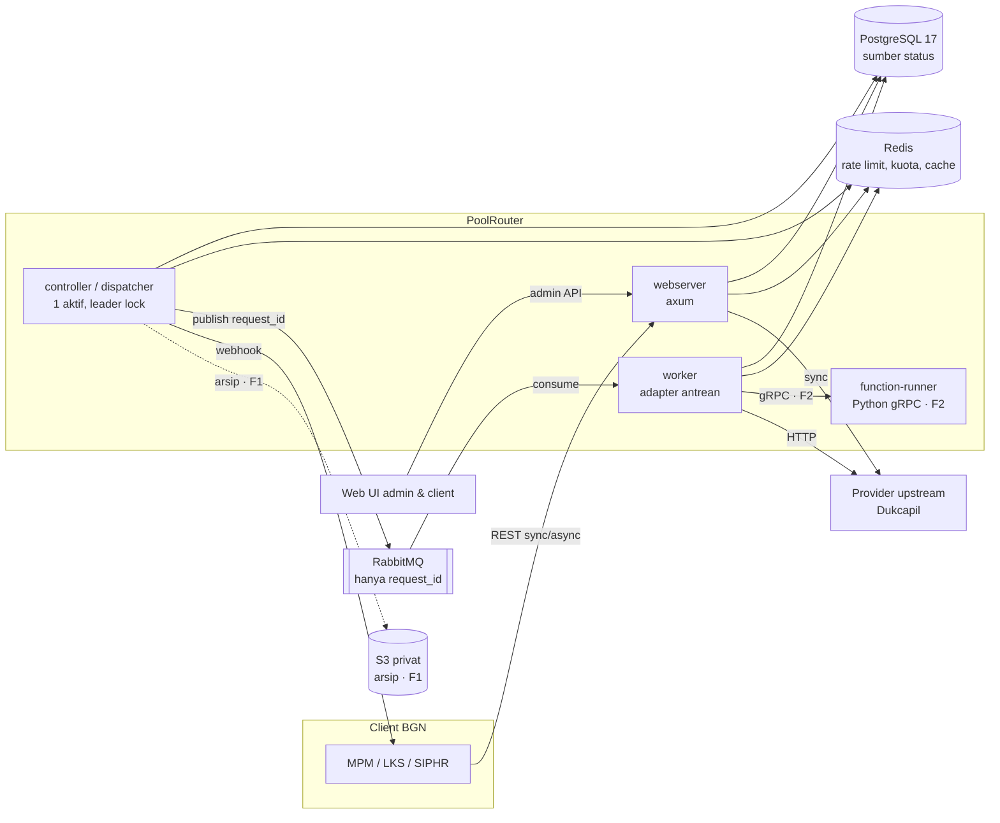
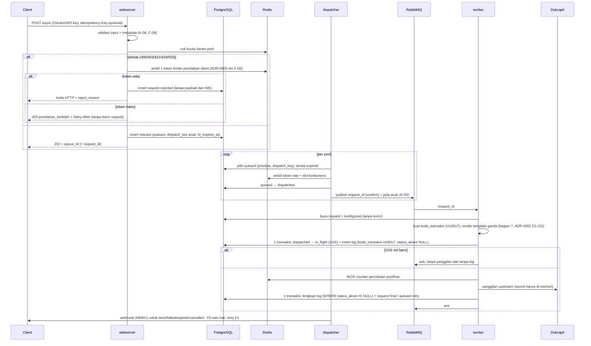

# ADR-0001: Arsitektur PoolRouter F0 — komponen, alur, kuota terdistribusi, dan abstraksi antrean

**Ringkasan:** PoolRouter butuh arsitektur yang mematuhi kuota Dukcapil (K-22), tidak kehilangan request (NFR-03), menjaga NIK dan kredensial tetap aman (NFR-08, K-17), dan tidak terkunci pada apalis-amqp yang baru stabil (risiko 6). ADR ini memutuskan: axum sebagai framework HTTP; PostgreSQL sebagai satu-satunya sumber status request, dengan transisi status kondisional sebagai penengah semua race; RabbitMQ hanya sebagai transport `request_id` di balik port antrean milik PoolRouter (`JobPublisher`/`JobConsumer`), dengan adapter apalis-amqp sebagai implementasi pertama; rate limit dan kuota di Redis yang fail-closed. Spike SHAA-177 menghasilkan **Lulus bersyarat**: adapter `queue-apalis` dipakai untuk F0 dengan consume lewat apalis-amqp dan publish lewat `lapin` langsung, ditambah empat workaround adapter (bagian 6, ADR-0004 §4.3). Reconciler bagian 5 terbukti diperlukan: spike menunjukkan request `in_flight` milik worker yang mati hanya pulih lewat reconciler, dan panggilan upstream ulang setelah crash diterima sebagai percobaan baru yang tercatat. Bagian 1–5 dan 7–10 sudah di-approve Luca (2026-11-03); rev 5 hanya mengisi bagian 6 dan menyelaraskan rujukan repo dan ADR lain. Rev 7 menambah bagian 5a dari riset SHAA-184: kuota efektif dengan margin dan batas harian atomik di titik pemberian token, deteksi failover Redis, retry dengan full jitter dan retry budget, nilai timeout, aturan token, format webhook Standard Webhooks, error RFC 9457, `no-store`, katalog metrik, dan backup PoC; serta threat model F0 (§7.3). Rev 8 menegakkan kuota pada jendela bergulir 24 jam, sehingga kepatuhan tidak bergantung pada jam reset Dukcapil yang belum diketahui. Rev 12 menambah bagian 3a (penonaktifan dan reaktivasi K-20, dari SHAA-217): reaktivasi entitas kecuali kredensial yang dicabut, cakupan pencabutan per kredensial, jendela cache 30 s yang seragam dengan gerbang di compare-and-set `dispatched → in_flight` dan penyapu entitas nonaktif, webhook saat client nonaktif, dan pratinjau jumlah terdampak. Rev 13 menambah §3a.9: penonaktifan tidak membuat percobaan baru, tidak mengembalikan kuota, dan tidak mengubah atau menghapus baris log percobaan sebelumnya. Rev 14 menyelaraskan bagian 3a dengan data contract v0.7.9 (SHAA-218) dan memutuskan EN-04 di §3a.10: request yang belum di-dispatch tidak ditutup saat semua upstream pool rutenya nonaktif. Rev 15 melipat errata E-1…E-3 dan addendum kode HTTP sync `failed` (Keputusan Shu SHAA-200) ke §4.1, §5, dan §5a, sehingga tidak ada lagi errata terpisah. ADR ini menjadi dasar hand-off implementasi F0 (SHAA-175).

- **Pemilik:** Shu
- **Tanggal:** 2026-11-03
- **Status:** **final rev 15**, difinalkan Shu sebagai lead Engineering (rev 15: errata E-1…E-3 dan addendum "Keputusan Shu SHAA-200" dilipat ke teks, tanpa mengubah isinya; rev 14: penyelarasan dengan contract v0.7.9 dan keputusan EN-04 di §3a.10, permintaan Klaus di SHAA-218; rev 13: §3a.9 kuota dan log saat penonaktifan K-20, permintaan Fitcher di SHAA-217; rev 12: bagian 3a penonaktifan dan reaktivasi K-20 dari jawaban Shu di SHAA-217, SHAA-218; selisih contract untuk §3a.4 dimuat contract v0.7.9; rev 11: penyelarasan dengan contract v0.7.7 (rev 11 menulis v0.8.0, yang ditarik; errata E-1) — waktu penentu periode dan ember dari `requested_at`, syarat restore drill B-03/B-04, label metrik yang diizinkan, koreksi rentang `margin_kuota` di §5a.1; rev 10: identitas periode hari kuota diselaraskan dengan contract v0.7.6 KP-06, kunci counter per `periode_mulai`, penegakan pada periode transisi; rev 9: penyelarasan dengan data contract v0.7.5 — kelas retry `provider_sementara`, himpunan `alasan` token, rentang parameter pool, titik injeksi sumber acak; rev 8: jendela kuota bergulir 24 jam, reset hari yang dapat dikonfigurasi per pool, dan perlakuan percobaan gagal, setelah jawaban owner "per hit" dan keputusan margin Fitcher, SHAA-184 2026-11-03; rev 7: bagian 5a dan §7.3 baru dari riset SHAA-184, dengan scope F0 diputuskan Fitcher 2026-11-03; keputusan rev 6 tetap kecuali yang disebut di riwayat). Status rev 6: difinalkan Shu sebagai lead Engineering (arahan owner 2026-11-03, SHAA-180: Luca tidak ikut review project PoolRouter). Rev 6 hanya menambah rujukan ke ADR-0002 rev 5 dan menyelaraskan teks dengan K-30/K-31 (PRD v0.4.6) di atas rev 5 (hasil spike SHAA-177, ADR-0004, monorepo). Isi keputusan rev 5 tidak berubah. Acuan data: contract v0.7.4 final (SHAA-166), yang memuat v0.6.1; ID uji yang dirujuk rev 4–5 tetap. Bagian 1–5 dan 7–10 approve Luca 2026-11-03 (rev 3 + koreksi wajib). Riwayat di akhir dokumen
- **Issue:** SHAA-165 (induk SHAA-162); rev 12, rev 14, dan rev 15: SHAA-218; rev 13: SHAA-217
- **Reviewer:** Luca (rev 1–4, bagian 1–5 dan 7–10). Rev 5–15 difinalkan Shu sebagai lead (arahan owner 2026-11-03, SHAA-180).
- **Rujukan ADR-0009 (KB):** §5a.10 dan §8.3 dilengkapi ADR-0009 `products/poolrouter/adr/0009-definisi-f0-beres-dan-platform-staging.md` di repo `faisalcayunda/ai-agents-knowledge-base`: staging F0 = lane CI `staging-smoke`, `ENV=prod` = lingkungan PoC BGN, produksi = Kubernetes (F1). ADR itu tidak men-supersede ADR ini.
- **Lokasi akhir:** `docs/adr/0001-arsitektur-poolrouter.md` di akar repo `github.com/faisalcayunda/PoolRouter` (folder `docs/adr/` sesuai struktur ADR-0003 §5; rev 5 keliru menulis `backend/docs/adr/`), di commit kerangka repo pertama. Sampai saat itu, lampiran rev 15 di SHAA-218 adalah salinan resmi, dan errata terpisah tidak perlu diterapkan lagi. Rev 15 menggantikan rev 14 (SHAA-218). Rev 14 menggantikan rev 13 (SHAA-217). Rev 13 menggantikan rev 12 (SHAA-218). Rev 12 menggantikan rev 11 (SHAA-189, balasan ke contract v0.8.0 Klaus). Rev 11 menggantikan rev 10 (SHAA-184). Rev 10 menggantikan rev 9 (SHAA-184). Rev 9 menggantikan rev 8 (SHAA-189), rev 7 (SHAA-184), dan rev 6 (SHAA-165). **Lampiran berjudul "ADR-0001 rev 7" yang diunggah di SHAA-189 pukul 11.43 WIB tidak berlaku**: dokumen itu dihasilkan run paralel dari konteks sebelum jawaban owner "per hit", dan isinya bertentangan dengan rev 8 yang sudah diterima Fitcher.

## 1. Konteks

Sumber: PRD v0.4.6 final (SHAA-162), terutama §6, §7a, §9, §10, §12 (K-01…K-37), dan risiko 5, 6, 8, 9, 11. Rev 1–4 disusun dari PRD v0.4.2; K-30…K-37 masuk lewat rev 5–7. Rev 7 juga memakai laporan riset SHAA-184 v1.0.

Batasan yang mengikat (keputusan pemilik produk, tidak dibuka ulang di ADR ini):

| Ref | Batasan | Dampak ke arsitektur |
|---|---|---|
| K-16 | apalis 1.0 + RabbitMQ (`apalis-amqp`, `lapin`) | Broker wajib RabbitMQ; apalis dipakai "untuk saat ini" |
| K-17 | Pesan hanya `request_id` | Semua isi di PostgreSQL; broker tidak pernah melihat NIK |
| K-22 | 1.000.000 request/hari ≈ 41.667/jam ≈ 11,6/s | Throughput kecil; masalahnya kepatuhan, bukan skala |
| K-10 | Porsi sync maksimal per upstream pool (mis. 20%) | Rate limiter harus membagi kapasitas sync/async |
| K-11, K-05 | Prioritas ketat + aging; acak urutan dalam satu tingkat + jeda acak | Urutan diputuskan dispatcher di PostgreSQL, bukan prioritas bawaan RabbitMQ (risiko 5) |
| K-12 | Kuota habis → 429 langsung | Cek kuota di intake, bukan saat dispatch saja |
| K-18, K-19, K-20 | TTL default 24 jam → `expired`; pembatalan oleh client; pembatalan massal saat entitas dinonaktifkan | State machine request dengan transisi kondisional |
| K-25 | Kode transaksi UUIDv7 per percobaan, dibuat di Rust | Baris log percobaan dibuat sebelum panggilan upstream |
| K-09, K-30, K-31 | WASM (Rust) dan function runner gRPC (Python) untuk fungsi middleware. K-23 dicabut K-30 (tanggal YYYY-MM-DD diteruskan apa adanya); seluruh US-10 pindah ke F2 (K-31) | F0 tidak memuat fungsi middleware, antarmuka hook, stub, maupun konfigurasi kosong. `pre_upstream` hanya dicatat sebagai titik ekstensi F2 di antara render template dan panggilan upstream (ADR-0002 D2). Mitigasi perluasan konfigurasi: `config_schema_version` (ADR-0002 rev 5 D3) |
| K-32, K-33 | Rust untuk seluruh backend; stack frontend diputuskan lead Engineering; satu repo `faisalcayunda/PoolRouter` (PRD v0.4.6) | Crate dan toolchain di ADR-0004; Web UI dan struktur monorepo di ADR-0003 |
| K-01…K-04 | Respons Web Service boleh disimpan dan di-cache; full payload boleh; NIK disimpan apa adanya; arsip S3 privat | Kontrol akses log ketat (risiko 2) |
| PRD §10 | Rust; PostgreSQL (Huawei RDS PG17); Redis; Compose dev/PoC, Kubernetes produksi | Stack tetap |

Angka ukuran (perkiraan Shu dari K-22, untuk perencanaan, bukan target):
- Pada kuota penuh: ±11,6 panggilan upstream/s rata-rata. Dengan ±6 tulis PostgreSQL per request (insert request, 3 transisi status, insert dan update log percobaan), sekitar 70 tulis/s. Ini ringan untuk PostgreSQL 17 satu instance.
- Mode full payload dengan perkiraan 3 KB per baris log: ±3 GB/hari, ±90 GB/bulan online. Retensi online (NFR-06) menentukan ukuran disk RDS; angka final mengikuti data contract Klaus (SHAA-166).
- Konkurensi upstream yang dibutuhkan = rate × latensi. Jika latensi Dukcapil 2 s: ±24 panggilan paralel. Latensi Dukcapil belum diketahui dan diukur saat PoC.

## 2. Komponen dan batasnya

| Komponen | Tanggung jawab | Bukan tanggung jawabnya | Skala | Cara verifikasi |
|---|---|---|---|---|
| **webserver** (axum) | API downstream: sync, enqueue async (`queue_id` = `request_id`, bagian 4.1), `Idempotency-Key`, status, pembatalan (K-19); token OAuth2 client credentials dan API key; validasi input per aturan provider (K-06); cek kuota intake → 429 (K-12); limiter penolakan per client (bagian 4.1, ADR-0002 rev 5 D6); jalur sync lengkap (rate limit, render template, panggilan upstream, log), dengan egress ke provider hanya dari webserver dan worker (ADR-0002 D4); admin API untuk Web UI, dengan audit perubahan konfigurasi | Memutuskan urutan antrean; memanggil upstream untuk request async | Stateless, horizontal | Uji integrasi API; uji beban NFR-01/02 |
| **controller / dispatcher** | Memilih request `queued` per upstream pool (prioritas, aging F1, acak K-05); mengambil token rate dan slot konkurensi dari Redis; transisi `queued → dispatched` lalu publish `request_id`; menandai `expired` (K-18); reconciler pesan yang hilang dan penyapu log `tidak_diketahui` (bagian 5); snapshot counter percobaan ke PostgreSQL (bagian 5); pengirim webhook untuk semua status terminal async (bagian 4.1); job purge payload yang menghormati jendela polling P-03 dan pengecualian H-02; job terjadwal (arsip, data balikan, F1). Tidak membaca NIK: anti-pola K-05 memakai `dispatch_key` acak | Memanggil upstream; menyimpan isi request di broker | Satu instance aktif lewat PostgreSQL advisory lock; replika standby mengambil alih | Uji unit algoritma pemilihan (property test); uji failover lock |
| **worker** | Konsumsi `request_id`; transisi kondisional `dispatched → in_flight` bersama insert log percobaan dalam satu transaksi (bagian 4); ack tanpa panggilan jika transisi gagal; resolve secret; render template (ADR-0002 D1–D2; titik ekstensi `pre_upstream` F2 tidak ada di F0, K-31); parser respons `status_skor` (ADR-0002 D3); egress ke provider lewat IP tetap dan trust TLS per provider (ADR-0002 D4–D5); panggilan upstream dengan kode transaksi UUIDv7 per percobaan; tulis log percobaan; status final (mengisi `webhook_status` = `menunggu` atau `tidak_dikirim`, bagian 4.1); ack setelah commit | Retry bawaan framework antrean (retry dikendalikan PoolRouter, bagian 5) | Horizontal; concurrency dan prefetch per pool | Uji kontrak port antrean; uji crash (spike S1–S7) |
| **function-runner** (F2, K-09, K-31; tidak ada di F0) | Menjalankan fungsi Python lewat gRPC (tonic), dengan batas waktu dan memori, tanpa egress kecuali yang diizinkan | Akses ke PostgreSQL atau secret storage | Container terpisah | Uji kontrak gRPC; uji timeout |
| **RabbitMQ** | Transport `request_id` antara dispatcher dan worker; dead-letter untuk pesan gagal permanen | Sumber status; prioritas; penyimpanan isi request | Dev: 1 node. Produksi: 3 node, quorum queue | Spike S2, S11 |
| **PostgreSQL** | Konfigurasi (provider, pool, client, endpoint, secret terenkripsi), state request, `transaction_log`, counter percobaan harian, `audit_akses`, audit konfigurasi; role database per komponen (bagian 7.2) | Rate limit real-time | RDS PG17 HA | Uji migrasi; uji transisi kondisional; uji hak role |
| **Redis** | Token bucket rate limit, counter kuota, semaphore konkurensi, cache respons (K-01, F2), status circuit breaker (F1) | Data yang tidak bisa dibangun ulang dari PostgreSQL | Produksi: HA (mis. Huawei DCS) | Uji fail-closed; uji rebuild counter |

Fungsi middleware (rev 6, K-30 dan K-31): F0 tidak memuat fungsi middleware, trait, antarmuka hook, stub, maupun konfigurasi kosong. `pre_upstream` dicatat sebagai titik ekstensi F2 di antara render template dan panggilan upstream (ADR-0002 D2). Di F2, WASM lewat wasmtime di proses worker dan proxy gRPC ke function-runner dipasang di titik itu, dengan antarmuka yang diputuskan di ADR F2. Penambahan field konfigurasi di F2 ditangani `config_schema_version` (ADR-0002 rev 5 D3, contract v0.7.4 V-05), sehingga dokumen konfigurasi F0 tidak perlu diubah.

Batas antar-komponen berupa kontrak, sesuai `shaal-eng-standards`: OpenAPI untuk API downstream dan admin, skema pesan antrean (`request_id`), proto gRPC function-runner, dan skema PostgreSQL. Binary webserver, controller, dan worker berbagi crate domain (`core`), tetapi tidak saling memanggil kecuali lewat PostgreSQL dan broker.

## 3. State machine request

```mermaid title="Status request"
stateDiagram-v2
  [*] --> rejected: validasi / metadata / kuota / porsi sync / objek nonaktif
  [*] --> queued: async diterima
  [*] --> in_flight: sync diterima
  queued --> dispatched: dispatcher (token rate didapat)
  queued --> expired: TTL habis (K-18), attempt_count = 0
  queued --> cancelled: client (K-19) / entitas nonaktif (K-20), attempt_count = 0
  queued --> failed: menunggu retry (attempt_count > 0) - entitas nonaktif (objek_nonaktif) / TTL habis (retry_habis)
  dispatched --> expired: TTL habis, attempt_count = 0
  dispatched --> cancelled: client / entitas nonaktif (termasuk gerbang dan penyapu §3a.4), attempt_count = 0
  dispatched --> failed: menunggu retry (attempt_count > 0) - entitas nonaktif (objek_nonaktif) / TTL habis (retry_habis)
  dispatched --> in_flight: worker (compare-and-set)
  dispatched --> queued: reconciler (pesan hilang)
  in_flight --> done
  in_flight --> failed: error permanen / batas percobaan atau not_before ≥ TTL (retry_habis) / timeout sync
  in_flight --> failed: reconciler, sync (webserver mati; log tidak_diketahui; timeout_sync)
  in_flight --> queued: error sementara, retry dengan not_before (async saja)
  in_flight --> queued: reconciler, async saja (worker mati; log ditutup tidak_diketahui)
```

Nama status, kode alasan, dan kolom mengikuti data contract SHAA-166 (§3.1–3.2). ADR ini menetapkan transisi, penengah race, dan siapa yang menulis.

Aturan:
- Setiap transisi adalah compare-and-set: `UPDATE … SET status = $baru WHERE request_id = $id AND status = $lama [AND predikat] RETURNING …`, ditulis bersama baris `request_status_history` dalam transaksi yang sama (T-04 contract). Nol baris berarti pihak lain menang, dan pemanggil berhenti tanpa efek samping. Inilah penengah semua race: pembatalan vs dispatch, pesan duplikat, reconciler vs worker lambat.
- **Worker menerima pesan untuk request yang bukan `dispatched`** (sudah `cancelled`, `expired`, `in_flight`, atau terminal): compare-and-set menghasilkan nol baris, worker meng-ack pesan, tidak memanggil provider, dan tidak menulis log (T-01, T-03 contract).
- **`expired` dan `cancelled` hanya untuk request yang belum pernah dipanggil ke provider.** Predikat `attempt_count = 0` wajib ada di transisi keduanya. Ini menjaga definisi contract (DQ-07: request `expired`/`cancelled` tidak punya baris log).
- **Retry kembali ke `queued`** dengan `not_before` (backoff) dan `attempt_count > 0`, bukan tetap `in_flight`. Alasannya di bagian 5. Konsekuensinya: request yang menunggu retry tidak bisa dibatalkan client (409, karena sudah dikirim ke provider) dan tidak menjadi `expired`. Batasnya dua: batas percobaan per pool **dan** `ttl_expires_at`. Batas percobaan saja tidak cukup, karena saat kuota harian habis atau Redis mati (fail-closed) dispatcher berhenti dan request yang menunggu retry tidak pernah dicoba lagi. **Request yang menunggu retry (`queued`/`dispatched`, `attempt_count > 0`) dan melewati `ttl_expires_at` menjadi `failed` dengan `failure_reason = retry_habis`** (keputusan Luca 2026-11-03, tanpa kode alasan baru; aturan normatif: T-02d contract). Transisi ini dijalankan penyapu TTL di controller, yang sama dengan penanda `expired` dan hanya bergantung pada PostgreSQL, bukan Redis atau token, sehingga tetap berjalan saat dispatcher berhenti. Worker yang memutuskan retry (error sementara), atau reconciler untuk worker yang mati (T-06), langsung menulis `failed` (`retry_habis`) bila `not_before` hasil hitungan ≥ `ttl_expires_at`, agar tidak ada putaran dispatch yang pasti gagal (keputusan Luca 2026-11-03; T-02d contract v0.6.1). Karena itu `completed_at` bisa lebih awal dari TTL, sehingga dua jenis `retry_habis` dibedakan hanya lewat `attempt_count` dibanding batas percobaan pool, bukan lewat `completed_at` (§3.2.5 dan DQ-17 contract). Uji wajib: (a) dispatcher berhenti karena kuota habis atau Redis *fail-closed* sampai TTL lewat → U-20a/U-20b contract, dengan angka harapan yang hanya tercatat di contract; (b) worker menghitung `not_before` ≥ `ttl_expires_at` → U-26 contract; (c) penyapu TTL dan worker berebut request `dispatched` dengan `attempt_count > 0` → U-27 contract (penengahnya compare-and-set di atas; bila penyapu menang, worker ack tanpa panggilan, T-03 contract). Angka harapan ketiganya hanya tercatat di contract. Jika entitasnya dinonaktifkan (K-20) saat menunggu retry, request menjadi `failed` dengan `failure_reason = objek_nonaktif`, bukan `cancelled`. Status API untuk `queued`/`dispatched` dengan `attempt_count > 0` adalah `processing`, bukan `queued` (pemetaan normatif di bagian 4.1; keputusan Luca 2026-11-03).
- Pembatalan oleh client (K-19) hanya untuk `queued`/`dispatched` dengan `attempt_count = 0`. Selain itu 409 dengan status saat ini (bagian 4.1).
- Pembatalan massal (K-20) adalah satu transaksi untuk semua request milik entitas itu: `cancelled` (dengan `cancel_reason`, `cancelled_by`) untuk yang `attempt_count = 0`, `failed` (`objek_nonaktif`) untuk yang menunggu retry, baik `queued` maupun `dispatched`. Request `in_flight` dibiarkan selesai. Cakupan per entitas, request yang masuk di jendela cache 30 s sesudah transaksi ini, reaktivasi, webhook, dan pratinjau jumlah terdampak diatur bagian 3a (rev 12).
- `rejected` disimpan sebagai baris `request` terminal **tanpa** `input_payload`, field metadata Rahasia, dan NIK (P-01 contract), sehingga DQ-17 bisa menghitung penolakan per alasan. Request yang gagal autentikasi tidak disimpan.
- Purge payload P-02 (`expired`/`cancelled`) dilakukan di transaksi transisi terminal. Purge P-03 dijalankan job controller dan tidak pernah menyentuh `output_payload` sebelum `completed_at` + TTL downstream pool, apa pun `webhook_status`-nya (S-05 contract), serta melewati rekaman yang ditahan aturan H-01…H-02 untuk data balikan. Predikat kedua syarat itu ditulis di kueri purge, bukan di kode pemanggil, dan diuji dengan U-15 contract.

## 3a. Penonaktifan dan reaktivasi entitas (K-20, rev 12–14)

Bagian ini menuliskan jawaban Shu di SHAA-217 (2026-11-03) untuk tabel fakta K-20 dan copy dialog. Butir 3a.1–3a.10 normatif untuk backend, Admin API, dan Web UI. Butir 3a.4 dimuat data contract v0.7.9 final (Klaus, SHAA-218): T-01, T-01a, T-02e, §3.2.3 C-01/C-02, §3.2.6 EN-01…EN-09, §8.1b, U-49…U-55, dan DQ-36…DQ-38 (rev 14). Bila contract dan ADR ini berbeda, aturan bagian 9 berlaku.

Entitas K-20 ada enam: client, kredensial, downstream endpoint, downstream pool, upstream pool, dan provider. Kolom `request` yang menentukan keterkaitan: `client_id`, `credential_id`, `downstream_endpoint_id`, `downstream_pool_id`, `upstream_pool_id` (diisi saat dispatch), dan `provider_id` (contract §3.1).

### 3a.1 Reaktivasi

- Client, downstream endpoint, downstream pool, upstream pool, dan provider bisa diaktifkan lagi oleh platform admin dari Web UI (Admin API).
- Reaktivasi hanya berlaku untuk request yang masuk sesudahnya, dan tercatat di audit konfigurasi (§2, §7.2): siapa, kapan, entitas, nilai lama → baru.
- Reaktivasi bukan aksi berisiko, jadi tidak memakai dialog K-20.
- Request terminal (`cancelled`, `failed`) tidak pernah hidup lagi (T-05 contract). Client mengirim request baru dan mendapat `queue_id` baru.
- Request di jendela cache (3a.4) yang belum disapu saat entitas diaktifkan lagi diproses normal. Gerbang dan penyapu membaca status entitas **saat itu**, bukan saat penonaktifan.

### 3a.2 Kredensial dicabut bersifat permanen

- Kredensial yang dicabut tidak punya jalur aktif kembali. Penggantinya kredensial baru, dengan batas paling banyak 2 kredensial aktif per client (§5a.5).
- Larangan ini ditegakkan di database untuk **setiap** jalur tulis `pr_admin_api`, bukan hanya di UI. Fungsi database yang dipakai Admin API menolak perubahan dari dicabut ke aktif, dan `pr_admin_api` tidak punya UPDATE langsung atas kolom status kredensial di luar fungsi itu (contract EN-03, rev 14). Admin API menjawab 409.
- Kedaluwarsa kredensial (§5a.5) bukan penonaktifan K-20. Kedaluwarsa hanya menolak autentikasi baru. Request yang sudah diterima tetap diproses dan tidak ditutup gerbang maupun penyapu (contract EN-02, rev 14).
- Alasan: pencabutan biasanya karena kebocoran. Mengaktifkan lagi secret yang bocor membuka risikonya lagi, sementara membuat kredensial baru hanya butuh satu langkah.
- Client tetap bisa dinonaktifkan dan diaktifkan lagi (3a.1). Yang permanen hanya kredensial.

### 3a.3 Cakupan pencabutan kredensial

- Pembatalan K-20 karena kredensial hanya mengenai request dengan `credential_id` itu: `cancelled` dengan `cancel_reason = kredensial_nonaktif` (contract §3.2.3) untuk `attempt_count = 0`, dan `failed`/`objek_nonaktif` untuk yang menunggu retry. Request `in_flight` dibiarkan selesai (§3).
- Request dari kredensial lain milik client yang sama tidak terdampak.
- Polling berlaku per client (§4.1), jadi hasil request kredensial yang dicabut tetap bisa diambil dengan kredensial lain milik client itu.
- Penonaktifan client mengenai semua request client itu dengan `client_nonaktif`.

### 3a.4 Jendela cache ≤ 30 s dan gerbang dispatch

**Batas seragam.** Status aktif kelima jenis entitas yang dibaca webserver (client, kredensial, endpoint, pool, provider) diambil dari cache di proses dengan umur maksimal **30 s**. Rev 11 hanya menyebut client dan kredensial (§5a.5); rev 12 menyeragamkannya. Akibatnya, request baru ditolak paling lambat 30 s setelah penonaktifan, bukan seketika. Copy UI tidak boleh menulis "seketika".

**Masalah.** Transaksi pembatalan massal (§3) hanya mengenai request yang sudah ada saat transaksi itu berjalan. Request async yang diterima webserver di jendela 30 s sesudahnya masuk sebagai `queued` untuk entitas yang sudah nonaktif. Tanpa aturan tambahan, request itu bisa dikirim ke provider.

**Keputusan: dua lapis, keduanya memakai compare-and-set di PostgreSQL.**

1. **Gerbang dispatch (wajib, menjamin tidak ada panggilan).** Compare-and-set `dispatched → in_flight` di worker (T-01 contract) mendapat predikat tambahan: keenam entitas request masih aktif, dibaca dari tabel konfigurasi di PostgreSQL dalam transaksi yang sama, **bukan dari cache**.
   - Bila compare-and-set menghasilkan nol baris, worker membaca ulang status request. Jika status masih `dispatched`, berarti predikat entitas yang gagal. Worker lalu menjalankan transisi K-20 untuk request itu, juga sebagai compare-and-set dari `dispatched`: `cancelled` dengan `cancel_reason` entitas bila `attempt_count = 0` (T-02a), atau `failed`/`objek_nonaktif` bila `attempt_count > 0` (T-02b). Setelah itu ack, tanpa panggilan provider dan tanpa baris log. Aturan lengkapnya ada di contract T-01a (rev 14). Transisi gerbang membawa predikat kebalikan "minimal satu entitas nonaktif"; bila entitas diaktifkan lagi di antara dua langkah, worker ack tanpa panggilan dan reconciler mengembalikan request ke `queued`. Slot konkurensi dilepas saat ack. Purge P-02 untuk `cancelled` berjalan di transaksi yang sama (§7.2).
   - `cancelled_by` = `sistem` (contract §3.1 sudah mengizinkan "id pengguna/sistem"). `request_status_history` menyimpan id entitas yang nonaktif (contract §3.2.3).
   - Bila lebih dari satu entitas nonaktif, gerbang memilih `cancel_reason` dengan urutan tetap: client → kredensial → endpoint → downstream pool → upstream pool → provider. Gerbang tidak tahu urutan eksekusi penonaktifan, jadi aturan "pemicu pertama yang dieksekusi" (contract §3.2.3) diganti urutan tetap untuk jalur ini. Urutannya dari yang paling dekat ke client, agar alasan yang dilihat client paling bisa ditindaklanjuti.
   - Worker sudah membaca konfigurasi request (§4, diagram async), jadi hak baca baru `pr_worker` hanya SELECT kolom `aktif` (atau status kredensial) di keenam tabel itu, per kolom dan tanpa kolom hash kredensial (contract §8.1b). Hak tulis barunya hanya EXECUTE fungsi purge P-02 di jalur gerbang ke `cancelled` (rev 14, §7.2). Biaya: satu predikat `EXISTS` atas tabel konfigurasi kecil di transaksi yang sudah ada, di bawah 1 ms.
2. **Penyapu entitas nonaktif (menjamin status akhir yang benar).** Request di jendela yang belum di-dispatch tidak melewati gerbang. Jika dispatcher berhenti (pool nonaktif, kuota habis, Redis fail-closed), request itu akan berakhir `expired` dengan alasan yang salah. Karena itu, penyapu TTL di controller (§3) menjalankan langkah entitas nonaktif di siklus yang sama, **sebelum** langkah TTL (contract T-02e, rev 14). Request yang entitasnya nonaktif dan TTL-nya sudah lewat ditutup sebagai K-20, bukan `expired`. Request `queued`/`dispatched` yang salah satu entitasnya nonaktif ditransisikan dengan aturan yang sama seperti gerbang (compare-and-set, `cancelled_by = sistem`, urutan alasan yang sama). Penyapu hanya bergantung pada PostgreSQL, sehingga tetap berjalan saat Redis mati.
   - Batas: request di jendela mencapai status terminal paling lambat 30 s + satu siklus penyapu setelah diterima, atau lebih cepat lewat gerbang.
   - Race gerbang vs penyapu vs worker ditengahi compare-and-set yang sama (§3). Yang kalah berhenti tanpa efek samping.

**Request sync di jendela tidak dijamin ditolak.** Jalur sync memeriksa status entitas dari cache yang sama, sehingga request sync yang diterima di jendela 30 s masih bisa dikirim ke provider. Alasan tidak menambah predikat di insert sync: jalur sync harus menjaga overhead p95 ≤ 50 ms (NFR-01); request sync datang satu per satu dari aksi pengguna (K-27), jadi eksposurnya kecil dan terbatas 30 s; dan pemetaan predikat gagal ke kode HTTP (401 untuk client/kredensial, 403/503 untuk yang lain) menambah jalur error kedua. Dinilai ulang di F1 bila PoC menunjukkan kebutuhan.

**Uji wajib (angka harapan hanya di contract v0.7.9: (a)–(b) U-49, (c) U-50, (d) U-51, (e) U-52, (f) U-53; kredensial U-54; hak role U-55):**
- (a) entitas dinonaktifkan, lalu request async diterima di jendela cache dan sudah `dispatched` sebelum penyapu berjalan → gerbang menolak; 0 panggilan provider, 0 baris log, status `cancelled` dengan alasan entitas (untuk tiap jenis entitas);
- (b) sama dengan (a) untuk request menunggu retry → `failed`/`objek_nonaktif`, jumlah baris log tidak bertambah;
- (c) request di jendela yang belum di-dispatch, dispatcher dihentikan → penyapu menutupnya `cancelled` dengan alasan entitas, bukan `expired`;
- (d) dua entitas nonaktif bersamaan → `cancel_reason` mengikuti urutan tetap;
- (e) race gerbang vs penyapu atas request yang sama → tepat satu transisi, satu baris `request_status_history`;
- (f) entitas diaktifkan lagi sebelum penyapu berjalan → request diproses normal.

### 3a.5 Webhook saat client dinonaktifkan

- Penonaktifan client tidak mengubah `client_webhook.aktif`. Webhook terminal (`done`, `failed`, `expired`, `cancelled`) tetap dikirim sesuai urutan kirim contract §3.6, termasuk webhook `cancelled` hasil pembatalan massal dan hasil request `in_flight` yang selesai sesudahnya.
- Polling dan pembatalan oleh client nonaktif tetap 401. Selama client nonaktif, webhook adalah satu-satunya cara client mengetahui status akhir. Bila client diaktifkan lagi sebelum `completed_at` + TTL downstream pool, hasil `done` bisa dipolling lagi (S-05 contract).
- Untuk menghentikan webhook, platform admin menonaktifkan konfigurasi webhook client secara terpisah.

### 3a.6 Body webhook

Body webhook dibangun dengan fungsi pemetaan status API yang sama dengan polling (§4.1), termasuk `cancel_reason` untuk `cancelled` dan `failure_reason` untuk `failed`. Keduanya kode tertutup (contract §3.2.3, §3.2.5), bukan teks bebas. `jenis_objek` hanya ada di body error 403/503 saat submit, tidak di polling maupun webhook. Body tetap tidak disimpan (contract §3.6).

### 3a.7 Pratinjau jumlah terdampak

- Admin API menyediakan pratinjau sebelum konfirmasi dialog K-20 untuk keenam jenis entitas. Isinya dua angka: `akan_cancelled` (request `queued`/`dispatched` dengan `attempt_count = 0`) dan `akan_failed` (menunggu retry, `attempt_count > 0`, akan menjadi `failed`/`objek_nonaktif`), ditambah waktu hitung.
- Pratinjau hanya perkiraan, karena antrean terus bergerak. Angka final adalah jumlah baris yang benar-benar ditransisikan oleh transaksi pembatalan massal. Angka itu dikembalikan di respons aksi dan dicatat di audit konfigurasi dalam dua angka yang sama.
- Request yang kemudian ditutup gerbang atau penyapu (3a.4) tidak masuk angka audit aksi. Request itu tercatat per baris di `request_status_history` dengan `cancelled_by = sistem`.
- Request `in_flight` tidak dihitung karena tidak berubah. Web UI boleh menampilkan jumlahnya sebagai informasi, dengan label terpisah.
- Pratinjau hanya mengembalikan angka, tanpa `request_id`, NIK, atau payload. Path ditetapkan di OpenAPI Admin API (ADR-0003).

### 3a.8 Provider

- Penonaktifan provider mengenai semua request menunggu yang `provider_id`-nya provider itu, di semua upstream pool yang memakai provider itu dan dari downstream pool mana pun, dengan `cancel_reason = provider_nonaktif`.
- Flag `aktif` downstream pool dan upstream pool tidak ikut diubah. Setelah provider diaktifkan lagi, rute langsung pulih tanpa langkah tambahan.
- Request baru sync maupun async: 503 `objek_nonaktif` + `jenis_objek = provider`, tanpa `Retry-After` (§4.1, §5a.7). Async tercatat `rejected`.

### 3a.9 Kuota dan log saat penonaktifan (rev 13)

Penonaktifan tidak pernah membuat percobaan baru dan tidak pernah mengubah percobaan yang sudah terjadi. Kuota dan log hanya bergerak karena percobaan (§5, butir 1c; K-25), jadi:

| Kelompok saat penonaktifan | Status akhir | Percobaan baru | Kuota upstream (`attempts`, `upstream_attempt_daily`) | Baris `transaction_log` |
|---|---|---|---|---|
| `queued`/`dispatched`, `attempt_count = 0` | `cancelled` + `cancel_reason` entitas | 0 | Tidak terpakai | Tidak ada (DQ-07 contract) |
| `queued`/`dispatched`, menunggu retry (`attempt_count > 0`) | `failed`/`objek_nonaktif` | 0 | Percobaan sebelumnya tetap terhitung; tidak dikembalikan dan tidak bertambah | Baris percobaan sebelumnya tetap ada, tidak diubah dan tidak dihapus; tidak ada baris baru |
| `in_flight` | Percobaan berjalan selesai normal (`done`/`failed`). Bila hasilnya error sementara, request kembali ke `queued` (§3) lalu ditutup penyapu atau gerbang (3a.4) menjadi `failed`/`objek_nonaktif` selama entitas masih nonaktif | 0 setelah percobaan yang sedang berjalan | Percobaan berjalan terhitung seperti biasa | Baris percobaan berjalan dilengkapi seperti biasa; tidak ada baris baru |

- Alasan tidak ada pengembalian kuota: Dukcapil menghitung per hit, termasuk panggilan gagal (§5a.1, jawaban owner SHAA-184). Mengurangi counter akan memutus invarian counter = jumlah baris log (DQ-05).
- Retry budget (§5a.3) tidak terpakai oleh request yang ditutup `failed`/`objek_nonaktif`, karena tidak ada percobaan ulang.
- Baris log tetap tunduk pada retensi biasa (contract §8.4). Status request tidak memengaruhi retensi log.
- Berlaku juga untuk penutupan oleh gerbang dan penyapu (3a.4): 0 percobaan, 0 baris log baru, kuota tidak berubah.

### 3a.10 Semua upstream pool rute nonaktif, request belum di-dispatch (EN-04, rev 14)

**Konteks.** `request.upstream_pool_id` baru terisi saat dispatch (contract EN-04). Request `queued` dengan `attempt_count = 0` belum punya upstream pool, jadi penonaktifan upstream pool tidak menutupnya lewat pembatalan massal, gerbang, maupun penyapu. Bila **semua** upstream pool yang melayani downstream pool-nya nonaktif, request itu tidak bisa di-dispatch.

**Keputusan: opsi (a).** Request itu tetap `queued` (status API `queued`, masih bisa dibatalkan client). Request diproses normal bila salah satu upstream pool rute itu diaktifkan lagi, atau upstream pool aktif ditambahkan, sebelum `ttl_expires_at`. Bila tidak, request berakhir `expired` lewat langkah TTL (K-18). Dengan ini contract §9 butir 14 dan §11 butir 36i diputuskan (a), dan angka U-50e tetap.

**Opsi yang ditolak: (b)**, yaitu penyapu menutup request itu sebagai `cancelled`/`pool_nonaktif` dengan `objek_pemicu_id` = downstream pool. Alasannya:
1. **Alasannya tidak benar.** Tidak ada entitas request yang nonaktif, karena downstream pool masih aktif. `pool_nonaktif` dengan pemicu downstream pool menunjuk entitas yang tidak dinonaktifkan siapa pun, dan DQ-36 tidak menemukan interval nonaktifnya di audit konfigurasi (EN-07).
2. **Pembatalan tidak bisa dibalik, penonaktifan upstream pool bisa.** `cancelled` terminal (T-05), sedangkan upstream pool bisa diaktifkan lagi (3a.1). Urutan admin yang wajar saat mengganti upstream pool (nonaktifkan A, lalu aktifkan B) akan membatalkan seluruh antrean downstream pool dalam satu siklus penyapu.
3. **Angka dialog menjadi salah.** Pembatalan itu terjadi lewat penyapu, di luar pratinjau dan angka audit aksi (3a.7, EN-08). Admin melihat 0 terdampak, lalu antrean hilang.
4. **Konsisten dengan 3a.8.** Flag dan dampak pool tidak diturunkan dari entitas lain, dan rute pulih tanpa langkah tambahan.

**Biaya yang diterima.** Request yang sudah diterima bisa menunggu sampai TTL downstream pool (default 24 jam), lalu `expired`. Request baru di rute itu ditolak 503 `objek_nonaktif` + `jenis_objek` (§4.1) paling lambat 30 s setelah penonaktifan (3a.4), jadi antrean tidak bertambah.

**Kontrol.**
- Untuk menghentikan request yang menunggu, platform admin menonaktifkan **downstream pool**. Itu aksi K-20 biasa: `cancelled`/`pool_nonaktif`, dengan pratinjau dan angka audit.
- Dialog nonaktifkan upstream pool di Web UI menampilkan peringatan bila pool itu upstream pool aktif terakhir untuk minimal satu downstream pool. Isinya: request yang belum dikirim tidak dibatalkan, dan tetap menunggu sampai ada upstream pool aktif atau TTL lewat; untuk membatalkannya, nonaktifkan downstream pool. Kondisi "aktif terakhir" dihitung dari konfigurasi. Pratinjau dua angka (3a.7, EN-08) tidak berubah.
- Dinilai ulang di F1 bila PoC menunjukkan request yang berakhir `expired` karena kondisi ini.

## 4. Alur sync dan async

Alur sync: webserver menjalankan validasi, cek kuota, token rate dari bucket sync (bagian 5), render template (ADR-0002 D2; titik `pre_upstream` F2 tidak ada di F0), insert log percobaan, panggilan upstream, update log, lalu respons, semuanya dalam satu request HTTP. Sync tidak lewat broker agar overhead p95 ≤ 50 ms (NFR-01) tercapai. Jika token sync tidak tersedia dalam batas tunggu singkat (konfigurasi, mis. 200 ms), respons 429 dengan `Retry-After`. Anti-pola K-05 tidak diterapkan ke sync karena request sync datang satu per satu dari aksi pengguna (K-27, PRD v0.4.2).

Anti-pola NIK (K-05): setiap request async diberi `dispatch_key` acak (CSPRNG) saat intake, dan dispatcher memilih dengan urutan `(prioritas efektif, dispatch_key)`. Hasilnya, urutan acak di seluruh tingkat prioritas, bukan hanya di dalam satu batch, sehingga daftar NIK berurutan dari MPM tidak dikirim berurutan. Jeda acak kecil antar-publish dapat dikonfigurasi per pool. Jeda itu ditarik di dalam slot token (0 sampai 1/rate pool), bukan ditambahkan di atas jadwal token, sehingga throughput tetap sama dengan rate K-22 (sisa risiko 9 PRD). Admin API menolak nilai di luar batas itu. Pengacakan ini bisa membuat satu request menunggu lama; batasnya TTL (K-18) dan aging (K-11, F1), dan intake 429 mencegah antrean melebihi kuota harian.

Log percobaan (R-01 contract) di-commit **sebelum** panggilan upstream dengan `status_akses = NULL`, dalam transaksi yang sama dengan compare-and-set `dispatched → in_flight` dan kenaikan `request.attempt_count` (sync: bersama insert request `in_flight`), sehingga DQ-06 contract (`attempt_count` = jumlah baris log) benar secara konstruksi. Tidak ada panggilan tanpa baris log yang sudah ter-commit. Jika worker mati di tengah panggilan, baris itu tetap ada dan penyapu di controller mengisi `tidak_diketahui` setelah timeout provider + 60 detik (R-02), lewat `WHERE status_akses IS NULL`. Update hasil oleh worker memakai predikat yang sama, sehingga respons yang terlambat tidak menimpa `tidak_diketahui`. Setelah `status_akses` terisi, baris tidak berubah lagi kecuali `archived_at` (R-03). Dengan begitu C-01/M-03 (100% panggilan tercatat) tetap terpenuhi walaupun proses crash.

### 4.1 Keputusan kontrak API downstream

Butir ini mengikat OpenAPI F0. Label status untuk pengguna tetap mengikuti BRD (SHAA-164).

**Pengenal.** `queue_id` yang dikembalikan mode async = `request_id` (UUIDv7, dibuat di Rust saat intake). Satu pengenal untuk client, polling, pembatalan, webhook, dan log. Tidak ada id kedua yang perlu dipetakan.

**`Idempotency-Key` (async, F0).**
- Header opsional, maksimal 128 karakter ASCII, tanpa data pribadi (disarankan UUID). Disimpan di `request.idempotency_key`; unik per (`client_id`, `idempotency_key`) selama baris `request` masih online. Batas ini lebih panjang dari TTL, sehingga syarat contract "unik selama TTL" terpenuhi tanpa logika jendela waktu.
- Bersama kunci disimpan sidik `idempotency_fingerprint` = HMAC-SHA256 atas kanonik (`downstream_endpoint_id`, input, metadata), dengan kunci `${POOLROUTER_IDEMPOTENCY_HMAC_KEY}` dari secret manager. Hash tanpa kunci tidak dipakai karena NIK 16 digit berstruktur mudah ditebak ulang. Sidik bertahan setelah payload di-purge.
- Kunci dan sidik sama → 200 dengan `request_id` dan status yang sudah ada. Tidak ada request baru dan tidak ada cek kuota ulang. Kunci sama dengan sidik berbeda → 422 `idempotency_key_konflik`. Dua request bersamaan dengan kunci sama ditengahi unique constraint; yang kalah membaca ulang dan menjawab 200.
- Request `rejected` tidak memegang kunci (`idempotency_key` disimpan NULL), sehingga client boleh mengulang dengan kunci yang sama setelah 429.
- Mode sync F0 tidak mendukung header ini dan menjawab 400 bila dikirim, agar client tidak mengira dirinya terlindungi. Dukungan sync dinilai ulang di F1 bersama cache (K-01).

**Status API polling (US-17, normatif).** API hanya mengeluarkan enam nilai. Pemetaan ditentukan oleh status internal **dan** `attempt_count`, karena status API `queued` berarti "belum pernah dikirim ke provider dan masih bisa dibatalkan" (S-01 contract).

| Status internal | `attempt_count` | Status API | Pembatalan client | Hasil dikembalikan |
|---|---|---|---|---|
| `queued`, `dispatched` | 0 | `queued` | Boleh | Tidak |
| `queued`, `dispatched` (menunggu retry) | > 0 | `processing` | Ditolak 409 | Tidak |
| `in_flight` | ≥ 1 | `processing` | Ditolak 409 | Tidak |
| `done` | ≥ 1 | `done` | Ditolak 409 | Ya, minimal selama `completed_at` + TTL (S-05) |
| `failed` | ≥ 0 | `failed` + `failure_reason` | Ditolak 409 | Tidak |
| `expired` | 0 | `expired` | Ditolak 409 | Tidak |
| `cancelled` | 0 | `cancelled` + `cancel_reason` | Ditolak 409 | Tidak |
| `rejected` | 0 | Tidak pernah dipolling; tidak punya `queue_id` (S-02) | — | — |

Pemetaan ini satu fungsi murni di crate `core` yang dipakai endpoint polling dan webhook, dengan uji tabel untuk setiap baris di atas. Status API tidak pernah mundur: urutannya `queued` → `processing` → status terminal.

**Webhook (US-17, BRD v0.5).** Dikirim tepat satu kali di F0 untuk setiap request async yang mencapai `done`, `failed`, `expired`, atau `cancelled`, bila client punya webhook URL. Pengirimnya satu, yaitu job webhook di controller, untuk semua status terminal. Status `expired` dan `cancelled` tidak pernah melewati worker, jadi pengirim tunggal lebih sederhana daripada dua jalur. Polanya outbox: transisi terminal mengisi `webhook_status` di transaksi yang sama, yaitu `menunggu` bila client punya webhook URL dan `tidak_dikirim` bila tidak (contract v0.4.0 final, §3.1). Job mengklaim baris dengan compare-and-set `webhook_attempt_count` 0 → 1 (`WHERE webhook_status = 'menunggu' AND webhook_attempt_count = 0`), mengirim satu kali dengan timeout, lalu menulis `webhook_log` dan `webhook_status` terminal (`terkirim`/`gagal`) dalam satu transaksi. Body webhook tidak disimpan (contract §3.6). Klaim compare-and-set mencegah dua pengiriman. Jika controller mati di antara kirim dan commit, baris `menunggu` dengan `webhook_attempt_count = 1` yang lewat ambang (mis. 5 menit) ditutup `gagal` tanpa kirim ulang, karena F0 tidak me-retry; client tetap bisa polling (S-05). Kolom yang dipakai sudah ada di contract, jadi tidak ada nilai status baru. Retry webhook F1 menambah baris `webhook_log` tanpa mengubah pola ini. Body webhook memakai fungsi pemetaan yang sama dengan polling, termasuk `cancel_reason`/`failure_reason` (§3a.6); penonaktifan client tidak menghentikan webhook (§3a.5).

**Kode HTTP.**

| Kondisi | HTTP | Kode di body |
|---|---|---|
| Validasi input atau metadata gagal; field input di luar kontrak input endpoint (ADR-0002 D6) | 422; 400 untuk body yang bukan JSON valid atau memuat kunci ganda (baris `rejected`/`validasi_gagal`, contract v0.7.4 §3.2.2) | `validasi_gagal`, `metadata_tidak_valid` |
| Token limiter penolakan client habis (ADR-0002 rev 5 D6, contract v0.7.4 §3.2.2a) | 429 + `Retry-After` | `penolakan_berlebih`; bukan `reject_reason`, tanpa baris `request` |
| Kuota habis / porsi sync habis | 429 + `Retry-After` | `kuota_habis`, `porsi_sync_habis` |
| Downstream endpoint nonaktif | 403 | `objek_nonaktif` + `jenis_objek = endpoint` |
| Downstream pool, upstream pool, atau provider nonaktif | 503, tanpa `Retry-After` | `objek_nonaktif` + `jenis_objek` |
| Client atau kredensial nonaktif / auth gagal | 401 | Tidak disimpan di `request` (contract §3.2.2) |
| Pembatalan request `in_flight`, menunggu retry, atau terminal | 409 + status saat ini | `tidak_bisa_dibatalkan` |
| Polling atau pembatalan `request_id` milik client lain atau tidak ada | 404 | Tidak membedakan keduanya agar keberadaan request tidak bocor |
| Redis tidak tersedia (fail-closed) | 503 + `Retry-After` | `layanan_tidak_tersedia`; tidak disimpan sebagai `rejected` karena bukan keputusan atas request |
| Sync `failed`/`provider_error_permanen` | 502, tanpa `Retry-After` | `provider_error_permanen`, dengan `request_id` |
| Sync `failed`/`retry_habis` (kelas sementara dengan batas efektif 1: `koneksi`, `rate_limit_provider`, `provider_sementara`) | 502, tanpa `Retry-After` | `retry_habis`, dengan `request_id` |
| Sync `failed`/`timeout_sync` (`timeout`, atau ditutup reconciler `tidak_diketahui`) | 504, tanpa `Retry-After` | `timeout_sync`, dengan `request_id` |
| Async `failed` | Tanpa error HTTP: polling 200 dengan status `failed` dan `failure_reason`; webhook satu kali | — |

**Request sync `failed` (rev 15, melipat addendum "Keputusan Shu SHAA-200" tanpa mengubah isi).** Empat baris terakhir tabel di atas berlaku sejak keputusan di SHAA-200. Dasar `retry_habis` untuk sync adalah contract v0.7.8 varian SHAA-200 (§3.2.5 "Async, sync", R-08, DQ-07, DQ-17). Butir itu belum terbawa ke v0.7.9, jadi ADR ini yang berlaku sampai contract memuatnya (aturan bagian 9).
- Pembeda tindakan client ada di `kode`, bukan di kode HTTP. `retry_habis` dan `timeout_sync` berarti boleh kirim ulang nanti. `provider_error_permanen` berarti jangan kirim ulang tanpa perubahan input atau konfigurasi. 503 tidak dipakai, karena sudah berarti PoolRouter sendiri tidak tersedia, dan 429 berarti batas client.
- Sync tidak punya `Idempotency-Key` (400 bila dikirim). Jadi kirim ulang adalah request baru dan memakai kuota baru. Dokumen integrasi client menulis "jangan retry otomatis pada 502/504".
- Client sync yang memutus koneksi sebelum jawaban tidak membatalkan panggilan upstream. Request berakhir sesuai hasil satu percobaan itu, dengan pemetaan R-08 yang sama, dan respons tidak terkirim. Tidak ada `failure_reason` baru.

**Limiter penolakan per client (rev 6, rujukan).** Setiap penolakan submit setelah autentikasi mengambil 1 token dari bucket penolakan client, termasuk penolakan tanpa baris (header `Idempotency-Key` pada sync → 400, sidik berbeda → 422). Selama token ada, respons dan baris `rejected` seperti biasa. Bila token habis, respons 429 `penolakan_berlebih` tanpa baris `request`. Request yang diterima tidak memakai bucket ini. Mekanisme, angka, dan metrik: ADR-0002 rev 5 D6 dan contract v0.7.4 §3.2.2a (L-01…L-08); uji: contract v0.7.4 U-45.

Alasan pemisahan 403/503 pada `objek_nonaktif`: endpoint dinonaktifkan adalah keputusan kebijakan terhadap client, sehingga client tidak boleh mengulang. Pool atau provider dinonaktifkan biasanya pemeliharaan atau insiden di sisi PoolRouter, sehingga 503 memberi sinyal yang benar ke client.

## 5. Rate limit, kuota terdistribusi, dan ketahanan antrean

**Rate limit dan kuota (Redis, skrip Lua atomik):**
- Token bucket GCRA per upstream pool untuk setiap jendela yang dikonfigurasi (TPS/TPM/TPH). Semua jendela dicek dalam satu skrip sehingga atomik di semua instance webserver dan dispatcher.
- Porsi sync (K-10): sync memakai bucket global ditambah bucket sendiri sebesar `share × rate`. Dispatcher berhenti mengambil token saat isi bucket global di bawah cadangan sync (`share × burst`). Akibatnya async tidak bisa menghabiskan kapasitas sync, dan jika sync sepi, cadangannya tetap terisi lalu terpakai async pada siklus berikutnya. Algoritma diuji dengan property test terhadap rate K-22.
- Kuota harian: counter `attempts:{pool}:{periode_mulai}` (satu counter, sama dengan §5a.1 dan contract KP-06; rev 11–14 keliru menulis `quota:{pool}:…`, errata E-2), dengan batas hari mengikuti konfigurasi reset per upstream pool (rev 8: jam dan zona, default 00.00 Asia/Jakarta, §5a.1). Penegakan kuota memakai jendela bergulir 24 jam (rev 8, §5a.1); counter kalender dipakai untuk pelaporan dan DQ-05. Intake menolak jika `terpakai + antre ≥ kuota_efektif` (K-12). **Rev 7:** kuota efektif, margin, dan cek batas harian di skrip pemberian token dispatch/sync ada di §5a.1.
- Semaphore konkurensi per pool (sorted set dengan kedaluwarsa) membatasi panggilan paralel dari sync dan worker bersama.
- **Limiter penolakan per client (rev 6, rujukan ADR-0002 rev 5 D6).** Bucket GCRA per `client_id` dengan kunci terpisah dari bucket upstream pool di atas, lewat skrip Lua atomik, dan hanya diperiksa di jalur penolakan. Satu client yang rusak tidak memakan kapasitas client lain maupun kapasitas pool. Redis tidak tersedia → 503 *fail-closed*. Angka dan aturan: contract v0.7.4 §3.2.2a L-03…L-08.
- **Fail-closed:** jika Redis tidak tersedia, sync menjawab 503 dan dispatcher berhenti. Tidak ada panggilan upstream tanpa token, karena melampaui kuota Dukcapil (M-02) lebih mahal daripada jeda layanan. Saat Redis pulih, termasuk restart dan promosi replika yang dideteksi lewat penanda `pr:siap` (rev 7, §5a.2), counter hari berjalan dibangun ulang sebagai nilai terbesar dari snapshot PostgreSQL terakhir dan `COUNT` baris `transaction_log` hari itu (selalu memilih angka yang lebih konservatif untuk M-02).
- **Counter percobaan upstream dipersistenkan (DQ-05 contract).** Counter `attempts:{pool}:{periode_mulai}` di Redis di-INCR oleh worker atau webserver (sync) setelah baris log ter-commit dan sebelum panggilan. Counter ini juga menjadi angka "terpakai" untuk cek kuota intake. Controller menyalinnya ke tabel PostgreSQL `upstream_attempt_daily` (`upstream_pool_id`, `periode_mulai`, `periode_selesai`, `periode_transisi`, `tanggal` sebagai label, `jumlah`, `snapshot_at`; unik per pool + `periode_mulai`, rev 10 §5a.1 butir 1d) setiap 1 menit dan sekali final setelah periode ditutup + 5 menit, dengan upsert idempoten. DQ-05 membandingkan nilai final itu dengan jumlah baris log. Karena counter dan log ditulis lewat jalur berbeda (Redis vs PostgreSQL), rekonsiliasinya bermakna dan bukan tautologi. Satu-satunya celah yang diketahui: proses mati tepat di antara commit log dan INCR. Akibatnya log lebih banyak 1 dari counter dan baris itu berakhir `tidak_diketahui` tanpa `responded_at`, sehingga selisih DQ-05 bisa ditelusuri ke baris tertentu. Celah ini dipilih karena arah sebaliknya (INCR dulu) menghitung pesan duplikat yang tidak pernah dipanggil.
- Retry upstream dikendalikan PoolRouter: error sementara mengembalikan request ke `queued` dengan `not_before` (backoff eksponensial dengan full jitter dan retry budget per pool, §5a.3; batas percobaan per pool, default 3, dan batas waktu `ttl_expires_at`; bagian 3). Setiap percobaan memakai token dan kuota serta mendapat kode transaksi baru (K-25). Retry bawaan apalis dimatikan (spike S5). **Alasan retry lewat `queued`, bukan tetap `in_flight` seperti contract v0.1.0–v0.3.0 §3.2 (diterima Luca 2026-11-03):** (a) token rate, porsi sync, dan pengacakan K-05 tetap diputuskan di satu tempat, yaitu dispatcher; (b) worker tidak tidur sambil memegang slot konkurensi dan pesan yang belum di-ack; (c) `in_flight` tetap berarti "panggilan sedang berjalan", sehingga deteksi worker mati di reconciler cukup dengan ambang waktu sederhana. Biayanya adalah predikat `attempt_count = 0` di transisi `expired`/`cancelled` (bagian 3) dan satu kode `failure_reason` baru.

**Ketahanan antrean (NFR-03):** tidak ada request hilang karena PostgreSQL adalah sumber status, dan broker hanya lapisan kedua.
1. Lapisan 1, broker: queue durable (quorum di produksi), pesan persistent, publisher confirm, ack manual setelah commit PostgreSQL, dead-letter exchange untuk pesan gagal permanen.
2. Lapisan 2, reconciler di controller: request `dispatched` lebih lama dari ambang (mis. 2 menit) dikembalikan ke `queued` lewat transisi kondisional, lalu di-publish ulang. Request `in_flight` lebih lama dari timeout upstream + 60 detik dianggap pemrosesnya mati. Tindakannya bergantung pada `mode`:
   - **Async (worker mati):** dalam satu transaksi, baris log yang masih `status_akses IS NULL` ditutup `tidak_diketahui`, lalu request kembali `queued` (dengan `not_before`) atau `failed` (`retry_habis`) bila batas percobaan habis atau `not_before` ≥ `ttl_expires_at` (T-02d, T-06 contract).
   - **Sync (webserver mati):** dalam satu transaksi, baris log ditutup `tidak_diketahui` dan request langsung `failed` dengan `failure_reason = timeout_sync` (kode yang sudah ada). Request sync **tidak pernah** masuk `queued`: pemanggilnya sudah tidak menunggu, jadi requeue hanya akan menjadi panggilan async yatim yang memakan kuota dan tidak pernah dipolling (keputusan Luca 2026-11-03). Compare-and-set reconciler memakai predikat `mode = 'async'` untuk transisi ke `queued`, sehingga larangan ini ditegakkan di kueri, bukan di kode pemanggil. Kasus reconciler tetap bisa dibedakan dari timeout biasa lewat `status_akses = tidak_diketahui` (timeout biasa: `gagal_jaringan`); pilihan `timeout_sync` disetujui Luca 2026-11-03.
   - **Pemenang race (T-06 contract, normatif).** Reconciler memakai predikat `status = 'in_flight' AND attempt_count = $dibaca`; webserver/worker memakai `status = 'in_flight'` untuk status hasil dan `WHERE status_akses IS NULL` untuk log. Jika reconciler menang, hasil yang terlambat tidak ditulis: log tetap `tidak_diketahui`, `output_payload` tetap NULL, dan respons HTTP sync mengikuti status di PostgreSQL (gagal), bukan hasil provider. Jika webserver/worker menang, reconciler mendapat nol baris dan tidak berbuat apa-apa.
   - Uji wajib: webserver mati di tengah panggilan sync → U-21 contract; race dua arah reconciler vs webserver → U-22a/U-22b contract (minimal 100 kali, urutan acak). Angka harapan hanya tercatat di contract.
3. Duplikat aman karena transisi `dispatched → in_flight` memakai compare-and-set, dan pesan untuk request yang bukan `dispatched` di-ack tanpa panggilan (spike S4).
4. Urutan commit dispatcher: commit `dispatched` dulu, lalu publish. Jika publish gagal setelah commit, reconciler yang memulihkan. Tidak perlu tabel outbox terpisah karena status request sendiri berfungsi sebagai outbox.

Konsekuensinya, bug atau kehilangan pesan di apalis-amqp hanya menurunkan latensi (reconciler memulihkan dalam menit), bukan kehilangan data. Ini yang membuat risiko 6 bisa diterima.

## 5a. Parameter ketahanan dan kontrak client (rev 7, SHAA-184)

Sumber: laporan riset SHAA-184 v1.2 final (Apple), verifikasi teknis Shu, dan keputusan scope F0 Fitcher (SHAA-184, 2026-11-03). Bagian ini mengikat implementasi SHAA-175 (lingkup SHAA-189). Acuan data sejak rev 9: **contract v0.7.5 final** (SHAA-184, Klaus): §3.3a KP-01…KP-05, R-08/R-09 (`provider_sementara`), §7.2 MT-01…MT-05, §8.2 E-01…E-06, DQ-34, DQ-35, U-47, U-48.

**Butir yang mengubah kontrak client dan wajib masuk paket hand-off SHAA-175 serta dokumen integrasi MPM/LKS/SIPHR:** R-09 format webhook (§5a.6), R-10 format error dan `Retry-After` (§5a.7), R-16 `no-store` (§5a.8), R-05 umur token dan kedaluwarsa kredensial (§5a.5), serta R-18 ekspor auditor (ADR-0003 rev 4 §3.6d, kontrak admin API). Semua angka adalah **default yang dapat dikonfigurasi**, kecuali bila disebut tetap. Nilai di luar rentang ditolak admin API (422), dan setiap perubahan ditulis ke audit konfigurasi.

### 5a.1 Kuota efektif dan batas harian atomik (R-01)

**Masalah yang ditutup.** Rev 6 mengecek kuota harian di intake (`terpakai + antre ≥ kuota`). Dispatcher memang berhenti saat kuota habis, tetapi INCR `attempts:{pool}:{periode_mulai}` di worker dan sync tidak bersyarat, dan request yang di-retry masuk lagi ke `antre`. Akibatnya kelebihan maksimal sama dengan jumlah percobaan yang sudah memegang token tetapi belum di-INCR. Pada ukuran K-22 jumlahnya puluhan, tetapi M-02 menuntut 0.

**Cara hitung Dukcapil (jawaban owner 2026-11-03, SHAA-184): per hit**, termasuk retry dan panggilan gagal. Ini sama dengan counter `attempts`, yang di-INCR untuk setiap percobaan sebelum panggilan. Yang tetap tidak diketahui adalah jam dan zona reset hari Dukcapil. Pertanyaan ke Dukcapil tidak dikirim (arahan owner lewat Luca), jadi desain harus aman untuk jam reset mana pun.

**Masalah tambahan (rev 8).** Kalau reset Dukcapil tidak jatuh pada batas hari PoolRouter, satu "hari Dukcapil" memuat ujung hari kemarin dan awal hari ini menurut PoolRouter. Dengan penegakan per hari kalender, kedua potongan itu masing-masing boleh mencapai kuota, sehingga satu hari Dukcapil bisa menerima hampir 2× kuota bila trafik menumpuk di sekitar batas hari. Margin persentase tidak menutup ini.

| Opsi | Kelebihan | Kekurangan | Risiko M-02 |
|---|---|---|---|
| A. Hari kalender (rev 7), reset dapat dikonfigurasi | Paling sederhana; kuota "segar" tiap reset | Aman hanya bila jam reset benar | Tinggi selama jam reset tidak diketahui |
| B. Plafon per jam = `kuota_efektif / 24` (jendela TPH GCRA yang sudah ada) | Tanpa kode baru; setiap 24 jam ≤ kuota | Kapasitas jam sepi hangus. Bila permintaan menumpuk di 8 jam kerja, kapasitas efektif tinggal ±1/3 kuota | Rendah |
| **C. Jendela bergulir 24 jam** | Setiap rentang 24 jam ≤ kuota, apa pun jam reset Dukcapil; burst tetap boleh | Setelah burst besar, kapasitas pulih bertahap 24 jam kemudian, bukan saat tengah malam; skrip Lua sedikit lebih panjang | Rendah |

**Keputusan: C**, dengan A tersedia sebagai mode konfigurasi bila jam reset kelak dipastikan. B ditolak karena memotong kapasitas sampai dua pertiga pada pola trafik jam kerja.

**Keputusan:**
1. **Kuota efektif.** `kuota_efektif = floor(kuota_harian × (1 − margin_kuota))`. `margin_kuota` disimpan per upstream pool, dengan default **0,01** (10.000/hari pada K-22) dan rentang **0,001**–0,20 (batas bawah rev 9, §5a.3; teks "0–0,20" di rev 9–10 butir ini adalah sisa yang terlewat, dikoreksi rev 11). Margin dipertahankan 1% setelah jawaban "per hit" (keputusan Fitcher, SHAA-184). Semua cek kuota di bawah memakai `kuota_efektif`, bukan `kuota_harian`.
1a. **Jendela kuota (rev 8).** Konfigurasi per upstream pool `jendela_kuota`: `bergulir_24j` (**default**) atau `kalender`. Pada `bergulir_24j`, `terpakai` = jumlah percobaan dalam ember 10 menit (hash Redis per pool, 145 ember) yang mencakup 24 jam terakhir **ditambah** ember berjalan. Cakupan ini sedikit lebih dari 24 jam, jadi hitungannya selalu berlebih, tidak pernah kurang, dan kapasitas jenuh maksimal ±99,3% dari `kuota_efektif` per 24 jam. Pada `kalender`, `terpakai` = `attempts:{pool}:{periode_mulai}` seperti rev 7. Mode `kalender` hanya boleh dipilih bila jam reset Dukcapil sudah dipastikan; perubahan mode tercatat di audit konfigurasi.
1b. **Reset hari kalender (rev 8; periode rev 10).** Konfigurasi per upstream pool `reset_kuota_jam` dan `reset_kuota_zona` (nama IANA), default **00:00 Asia/Jakarta** (contract v0.7.6 KP-01). Nilai ini menentukan **periode hari kuota** untuk counter `attempts`, `upstream_attempt_daily` (DQ-05), quota tracker (US-12), dan penegakan pada mode `kalender`. Mengubahnya cukup lewat konfigurasi, tanpa kode.
1d. **Identitas periode (rev 10, contract v0.7.6 KP-06).**
   - Periode dihitung oleh **satu fungsi murni di crate `core`** dari riwayat konfigurasi reset per pool. Fungsi ini dipakai webserver, worker, controller (snapshot, rebuild), dan pelaporan, sehingga semua komponen memakai batas yang sama.
   - **Perubahan `reset_kuota_*` tidak berlaku seketika.** Admin API menyimpan nilai baru dengan `berlaku_mulai` = `periode_selesai` periode berjalan. Periode berjalan selesai menurut nilai lama. Sesudahnya ada satu **periode transisi** (> 0 dan ≤ 24 jam) sampai jam reset baru, lalu periode 24 jam seperti biasa (KP-06).
   - **Kunci periode adalah `periode_mulai` (UTC), bukan `tanggal`.** Counter Redis memakai `attempts:{pool}:{periode_mulai}`, dan `upstream_attempt_daily` unik per (`upstream_pool_id`, `periode_mulai`). `tanggal` (tanggal lokal awal periode) hanya label tampilan. Alasannya, `tanggal` **bisa sama** untuk dua periode berurutan. Contoh: reset diubah dari 00:00 ke 17:00 pada tanggal 3. Periode transisi berjalan 4 Nov 00:00–17:00 dan periode berikutnya 4 Nov 17:00–5 Nov 17:00, sehingga keduanya bertanggal 4. Jadi `tanggal` tidak bisa menjadi kunci.
   - **Penegakan pada periode transisi.** Pada mode `kalender`, selama periode transisi penegakan memakai jendela bergulir 24 jam (butir 1a). Periode transisi pendek berada di dalam hari Dukcapil yang sama dengan ekor periode sebelumnya, sehingga kuota penuh untuk periode transisi bisa melampaui kuota hari Dukcapil. Mode `bergulir_24j` tidak terpengaruh oleh transisi.
   - **Waktu penentu periode dan ember (rev 11, contract v0.7.7 KP-06; rev 11 menulis v0.8.0 K-01, yang ditarik dan isinya dipindah ke v0.7.7).** Periode (`periode_mulai`) dan indeks ember 10 menit untuk satu percobaan dihitung **sekali**, dari nilai `requested_at` baris log percobaan itu, oleh fungsi periode di `core`. Nilai `requested_at` dibuat di Rust, bukan lewat default `now()` database. Nilai yang sama ditulis ke baris log dan dikirim sebagai argumen ke skrip Lua yang melakukan INCR `attempts:{pool}:{periode_mulai}` dan ember jendela. Skrip Lua tidak membaca jam (`TIME`) untuk menentukan kunci. Alasannya: jika INCR memakai jam saat INCR dijalankan, percobaan dengan `requested_at` 23:59:59,9 yang di-INCR pada 00:00:00,1 masuk ke periode berbeda dengan baris lognya, dan DQ-05 menjadi salah positif di sekitar jam reset. Rebuild (§5a.2) dan DQ-34 (d) memakai `requested_at` yang sama, jadi ketiganya selalu sepakat.
1c. **Percobaan yang gagal ikut dihitung, tanpa opsi mematikan di F0 (rev 8).** Setiap percobaan, termasuk yang gagal di tahap TLS atau koneksi, menambah `attempts` dan ember jendela. Alasannya: (1) owner menjawab "per hit"; (2) mengecualikan kegagalan berarti mengurangi counter setelah klasifikasi, sehingga counter tidak lagi sama dengan jumlah baris log, dan DQ-05 kehilangan invarian itu; (3) kegagalan `tls` tidak di-retry, dan retry `koneksi` dibatasi retry budget (§5a.3). Biaya yang diterima: saat Dukcapil mati total, percobaan pertama yang gagal tetap memakai kuota PoolRouter. Ini menurunkan kapasitas hari itu, tetapi tidak melanggar kuota Dukcapil. Penanganannya di F1 bersama circuit breaker (R-26): pemutus menghentikan pengiriman saat gangguan, dan opsi pengecualian percobaan yang terbukti tidak pernah mengirim byte request dinilai di sana.
2. **Intake** menolak 429 `kuota_habis` bila `terpakai + antre ≥ kuota_efektif` (K-12; `terpakai` menurut butir 1a).
3. **Dispatch dan sync.** Skrip Lua yang mengambil token rate dan slot konkurensi juga memeriksa `terpakai + slot_aktif ≥ kuota_efektif` (`terpakai` menurut butir 1a), dalam satu eksekusi atomik. Jika syarat itu terpenuhi, token tidak diberikan: dispatcher berhenti mengambil untuk pool itu, dan sync menjawab 429 `kuota_habis`. `slot_aktif` adalah jumlah anggota semaphore pool yang belum kedaluwarsa.
4. **Mengapa batas ini benar.** Setiap percobaan memegang slot sejak token diberikan sampai hasilnya ditulis (atau ditutup reconciler). Karena itu, `terpakai + slot_aktif` adalah batas atas jumlah percobaan yang akan terjadi dalam jendela. Slot yang sudah di-INCR tetapi belum dilepas terhitung dua kali. Hitungan ganda ini konservatif dan diterima.
5. **Pelepasan slot.** Slot dilepas setelah log percobaan dilengkapi (worker/sync) atau ditutup reconciler. TTL slot = timeout total upstream + 60 detik, sama dengan ambang reconciler, sehingga slot yang kedaluwarsa selalu berada di wilayah reconciler.
6. **Sisa celah yang diketahui.** Proses yang macet melewati TTL slot tetapi kemudian tetap memanggil upstream bisa menambah 1 percobaan per kejadian. Kejadian ini dihitung `poolrouter_slot_kedaluwarsa_total` dan ditutup oleh margin.
7. **Jaminan.** Selama state Redis utuh (atau sudah dibangun ulang menurut §5a.2), percobaan dalam **setiap rentang 24 jam** ≤ `kuota_efektif` + jumlah slot kedaluwarsa, sehingga hari Dukcapil dengan jam reset apa pun juga terpenuhi (mode `bergulir_24j`). M-02 = 0 selama margin lebih besar dari jumlah slot kedaluwarsa ditambah selisih cara hitung Dukcapil.
8. **Rekonsiliasi (OQ-12).** DQ-05 tetap berlaku. Begitu Dukcapil menyediakan laporan pemakaian, angka final `upstream_attempt_daily` dibandingkan dengan laporan itu per hari. Selisih positif di sisi Dukcapil menjadi pemicu kenaikan margin.

**Uji wajib (rev 10):** uji tabel fungsi periode, meliputi perubahan reset maju (00:00→17:00), mundur (17:00→00:00), dan perubahan zona, dengan hasil periode bersambung, tanpa tumpang tindih, dan `periode_mulai` unik. Uji batas (rev 11): percobaan dengan `requested_at` 1 ms sebelum batas periode dan INCR yang dijalankan sesudah batas masuk ke periode dan ember yang sama dengan baris lognya, dan DQ-05 bernilai selisih 0. Ditambah uji jam dimajukan pada mode `kalender` yang melewati periode transisi: 0 rentang 24 jam di atas `kuota_efektif`. **Uji lain:** property test pada skrip Lua dengan N pemanggil acak dan kuota kecil (jumlah token yang diberikan ≤ `kuota_efektif` − `terpakai` awal); uji pergantian hari dengan stub yang menghitung sendiri pada **beberapa jam reset** (00.00, 06.00, dan 17.00 WIB) dan trafik yang menumpuk di sekitar batas, dengan hasil 0 hari-stub di atas `kuota_efektif` pada mode `bergulir_24j` (rencana uji Quality, laporan SHAA-184 §7 butir 1); uji jam dimajukan: ember lama keluar jendela tepat setelah 24 jam; uji retry dekat batas (request yang di-retry tidak menembus `kuota_efektif`).

### 5a.2 Failover dan restart Redis (R-02)

**Masalah.** Replikasi Redis asinkron. Saat replika dipromosikan, increment terakhir yang sudah di-ack bisa hilang (dokumentasi Redis, *Redis replication*). Rev 6 hanya membangun ulang counter "saat Redis pulih", sehingga promosi replika tidak terdeteksi.

**Keputusan: penanda kesiapan per instance Redis.**
1. Setiap proses membaca `run_id` (`INFO server`) setiap kali (re)connect ke Redis, lalu mengirimnya sebagai argumen ke setiap skrip Lua. `run_id` berubah saat Redis restart maupun saat replika dipromosikan.
2. Setiap skrip memeriksa `GET pr:siap == run_id`. Jika tidak sama atau kunci tidak ada, skrip menjawab `belum_siap` dan pemanggil memperlakukannya sebagai Redis tidak tersedia: sync dan intake 503 `layanan_tidak_tersedia`, dispatcher berhenti (*fail-closed*).
3. Controller aktif (leader) yang melihat `pr:siap` tidak sama dengan `run_id` menjalankan rebuild, lalu menulis `SET pr:siap <run_id>` sebagai langkah terakhir:
   - `attempts:{pool}:{periode_mulai}` = nilai terbesar dari snapshot `upstream_attempt_daily` dan `COUNT` baris `transaction_log` hari itu (aturan rev 6);
   - counter `antre` per pool dihitung dari PostgreSQL (`queued` + `dispatched`);
   - (rev 8) ember jendela bergulir per pool diisi dari `COUNT` baris `transaction_log` per ember 10 menit selama 24 jam 10 menit terakhir;
   - (rev 10) batas periode berjalan dihitung ulang dengan fungsi periode `core` (butir 1d); `COUNT` log memakai `periode_mulai ≤ requested_at < periode_selesai`, sama dengan DQ-05;
   - semaphore per pool diisi dari request `dispatched` dan `in_flight`, masing-masing dengan TTL slot penuh (konservatif);
   - bucket GCRA upstream pool dan limiter penolakan client dimulai **kosong** (tanpa burst), sehingga pemulihan tidak menghasilkan lonjakan ke Dukcapil.
4. Restart Redis dan kehilangan Redis total memakai jalur yang sama. Istilah "saat Redis pulih" di §5 dibaca sebagai jalur ini.
5. **Asumsi:** Redis terkelola di lingkungan BGN (mis. Huawei DCS) mengizinkan `INFO server` **[asumsi]**. Platform & SRE memverifikasinya sebelum PoC. Jika tidak diizinkan, ADR ini dibuka kembali sebelum PoC. Tidak ada fallback diam-diam.

**Uji wajib:** chaos promosi replika saat beban sync dan async berjalan, dengan hasil 0 percobaan di atas `kuota_efektif`; restart Redis dengan AOF, dengan hasil rebuild selesai sebelum token pertama diberikan; uji skrip dengan `run_id` salah, dengan hasil `belum_siap`.

### 5a.3 Kebijakan retry dan retry budget (R-03)

- **Parameter per upstream pool dan rentangnya (rev 9, mengikuti contract v0.7.5 §3.3a KP-01, dengan satu koreksi):** `margin_kuota` 0,010 (rentang **0,001**–0,200; batas bawah 0 dari rev 7 dicabut, karena margin 0 menghapus penyangga slot kedaluwarsa yang menjadi dasar jaminan §5a.1 butir 7); `batas_percobaan` 3 (1–5); `retry_backoff_base_detik` 5 (1–300); `retry_backoff_cap_detik` 300 (base–3.600); `retry_rasio` 0,100 (0–0,500); `retry_min_per_jam` 20 (0–10.000); `jendela_kuota` `bergulir_24j` (`bergulir_24j` | `kalender`); `reset_kuota` 00.00 Asia/Jakarta (jam 00.00–23.59, zona IANA). Hanya platform admin yang boleh mengubah, dengan alasan wajib di audit konfigurasi (KP-02).
- **Backoff:** full jitter. `not_before = now + acak(0, min(cap, base × 2^(n−1)))`, dengan `n` = `attempt_count` setelah percobaan gagal. Default base **5 s** dan cap **300 s**, per pool. Batas percobaan default tetap 3 (§5). Angka acak memakai `aws-lc-rs` (ADR-0004 §4.4), tanpa crate baru. **Titik injeksi (rev 9, contract KP-05):** sumber acak backoff diakses lewat satu trait di crate `core` (mis. `SumberAcakBackoff`). Produksi memakai implementasi `aws-lc-rs`; uji kontrak memakai stub yang selalu mengembalikan batas atas. Rumus backoff dan pembandingan dengan `ttl_expires_at` memakai kode yang sama di kedua lingkungan.
- **Kelas yang di-retry dan tidak** (`error_class`, contract §3.3):

| `error_class` | Retry | Alasan |
|---|---|---|
| `timeout`, `koneksi` | Ya | Gangguan sementara |
| `rate_limit_provider` | Ya, dengan backoff yang sama | Provider meminta pelan; backoff + budget mencegah badai |
| `respons_tidak_valid`, `tls` | Tidak (contract R-08, tetap) | Respons yang sama akan gagal lagi |
| `provider_sementara` (rev 9, contract v0.7.5 §11 butir 32c) | Ya, dengan backoff dan retry budget yang sama | Kode provider yang **dipetakan eksplisit** di skema respons provider sebagai gangguan sementara (mis. HTTP 503). Tidak masuk M-02, karena bukan penolakan kuota atau rate. Tanpa kelas ini, error sementara yang dikenal hanya bisa jatuh ke `lainnya` (tidak di-retry) atau `rate_limit_provider` (M-02 palsu) |
| `auth_ditolak`, `kuota_provider_habis` | Tidak | Mengulang hanya membakar kuota; butuh tindakan operator |
| `lainnya` | **Tidak** (default baru) | Kode tak dikenal tidak boleh diasumsikan sementara. Request `failed`/`provider_error_permanen` lewat pemetaan skema respons (contract §3.2.5 butir a) |

- **Retry budget per pool.** Dalam jendela bergulir 1 jam (60 bucket per menit di Redis, diperiksa di skrip dispatch yang sama dengan §5a.1), percobaan ulang (`attempt_count ≥ 1`) hanya diberi token bila `retry_jendela < max(retry_min, rasio_retry × percobaan_jendela)`. Default `rasio_retry` **0,10** dan `retry_min` **20/jam**. Bila budget habis, dispatcher melewati request yang menunggu retry. Request baru tetap berjalan, dan request yang dilewati tetap `queued` sampai budget tersedia atau TTL lewat, lalu `failed`/`retry_habis` (b) tanpa kode baru. Kejadiannya dihitung `poolrouter_retry_budget_habis_total`.
- **Dampak:** saat Dukcapil gangguan total, retry menambah pemakaian kuota paling banyak ±10% per jam, bukan 3× lipat.

### 5a.4 Timeout di semua lapisan (R-04)

| Lapisan | Default | Catatan |
|---|---|---|
| Upstream Dukcapil: connect / total | 5 s / 20 s | Sampai T-4 terukur di PoC; lalu ditetapkan dari p99 terukur. Ambang reconciler dan TTL slot = total + 60 s |
| Server HTTP: baca header / request | 10 s / 30 s | Sync: total upstream + 5 s. Batas ukuran body tetap di `tower-http` `limit` |
| Tunggu token sync | 200 ms | Rev 6, tetap |
| PostgreSQL `statement_timeout` | 5 s untuk `pr_api`, `pr_worker`, `pr_controller`, `pr_webhook`; 30 s untuk `pr_admin_api` | Diset per role (`ALTER ROLE … SET`), bukan per koneksi, agar tidak bisa terlewat |
| PostgreSQL `lock_timeout` / `idle_in_transaction_session_timeout` | 2 s / 30 s | Semua role aplikasi |
| Perintah Redis | 250 ms | Timeout = Redis tidak tersedia (*fail-closed*). Bila INCR `attempts` timeout setelah log ter-commit, panggilan upstream **tidak** dilakukan; baris log ditutup reconciler `tidak_diketahui` dan tetap terhitung (konservatif) |
| Publish RabbitMQ (confirm) | 5 s | Gagal = reconciler memulihkan (§5 butir 4) |
| Kirim webhook: connect / total | 5 s / 10 s | Ambang penutupan `menunggu` macet (§4.1) tetap 5 menit |

### 5a.5 Token client dan kredensial (R-05)

- **JWT client credentials.** Default EdDSA (Ed25519), ES256 diizinkan. Header `kid` wajib. Kunci dicari dari `kid`, dan algoritma diambil dari kunci itu, bukan dari header; header `alg` yang berbeda → 401. `kid` tak dikenal → 401.
- **Klaim:** `iss` = `${POOLROUTER_TOKEN_ISSUER}`, `aud` = `poolrouter-downstream-api`, `sub` = `client_id`, `exp`, `iat`, `nbf`, `jti`. Semua wajib dan diperiksa, dengan leeway **60 s**. `jti` hanya untuk korelasi log; tidak ada denylist di F0.
- **Umur token 15 menit, tanpa refresh token** (RFC 6749 §4.4.3). Ini menutup OQ-07. Endpoint token mengembalikan `expires_in`.
- **Pencabutan.** Status client dan kredensial dicek di setiap request dari cache di proses dengan umur maksimal 30 s. Penonaktifan (K-20) berlaku paling lambat 30 s, tanpa menunggu token kedaluwarsa. Rev 12: batas 30 s yang sama berlaku untuk endpoint, pool, dan provider, request async di jendela itu ditahan gerbang dispatch dan penyapu (§3a.4), dan kredensial yang dicabut tidak bisa diaktifkan lagi (§3a.2).
- **Rotasi signing key.** Paling banyak dua kunci verifikasi aktif. Kunci baru dipasang untuk verifikasi lebih dulu, baru dipakai menandatangani. Kunci lama dihapus setelah ≥ 15 menit + leeway. Prosedur terjadwal ada di F1 (R-21); mekanisme `kid` wajib di F0.
- **Throttle endpoint token, bukan lockout.** Lockout per `client_id` memberi penyerang cara mematikan client sah. Keputusannya: GCRA per `client_id` 60 permintaan/menit (burst 10) dan per IP sumber 120 permintaan/menit. Bila habis → 429 + `Retry-After`. Setiap kegagalan autentikasi dicatat di access log (tanpa secret) dan `poolrouter_token_gagal_total{alasan}`. **Himpunan tertutup `alasan` (rev 9, contract MT-03):** `kredensial_tidak_dikenal`, `secret_salah`, `kredensial_nonaktif`, `kredensial_kedaluwarsa`, `grant_tidak_didukung`, `permintaan_tidak_valid`, `dibatasi` (throttle 429), `token_tidak_valid` (tanda tangan, `kid`, `alg`, `iss`, `aud`, atau `nbf` gagal), `token_kedaluwarsa`, `api_key_tidak_valid`. Pesan pustaka JWT dan isi klaim tidak pernah menjadi nilai label, dan label `client_id` tidak dipakai untuk metrik ini (MT-02). Nilai baru hanya lewat revisi ADR ini.
- **API key dan client secret.** Keduanya dibangkitkan server (256 bit, ADR-0003 §3.6a) dan wajib punya `kedaluwarsa_at`, dengan default dan maksimum **365 hari**. Paling banyak 2 kredensial aktif per client, untuk tumpang tindih rotasi. Gauge `poolrouter_kredensial_sisa_hari{client_id}` menjadi dasar alert 30 hari sebelum kedaluwarsa. Penyimpanan tidak berubah (§7: argon2id untuk client secret, SHA-256 untuk API key).

### 5a.6 Format tanda tangan webhook (R-09)

Mengikuti spesifikasi Standard Webhooks, sehingga client bisa memakai pustaka verifikasi yang sudah ada:
- `webhook-id: <request_id>`. Satu event terminal per request; id tetap sama saat retry F1, sehingga client bisa dedupe.
- `webhook-timestamp: <detik Unix>`.
- `webhook-signature: v1,<base64(HMAC-SHA256(kunci, "{webhook-id}.{webhook-timestamp}.{body}"))>`.
- `poolrouter-secret-versi: <secret_versi>` (contract §3.7). Header ini informatif dan tidak ikut ditandatangani.
- **Format secret:** `whsec_` + base64 standar dari 32 byte acak. Kunci HMAC = byte hasil decode (ADR-0003 rev 4 §3.6a).
- **Panduan client** (di OpenAPI dan dokumen integrasi): bandingkan tanda tangan dengan perbandingan waktu-konstan, tolak selisih timestamp > 5 menit, dan dedupe per `webhook-id`.

### 5a.7 Format error dan `Retry-After` (R-10)

- Semua respons 4xx/5xx API downstream dan admin API memakai **RFC 9457** `application/problem+json`: `type`, `title`, `status`, `kode` (kode yang sudah ada di §4.1), dan opsional `detail`. Untuk 422, ada `errors` berisi nama field tanpa nilai. `reject_reason`/`failure_reason` disertakan bila relevan.
- `type` = `https://github.com/faisalcayunda/PoolRouter/blob/main/docs/masalah.md#<kode>`. Nilai ini pengenal stabil yang tidak bergantung lingkungan; isinya didokumentasikan di repo. Client boleh mencocokkan `kode`, karena `type` dan `kode` berpasangan 1:1.
- `detail` tidak pernah memuat nilai input, NIK, atau secret. Body `penolakan_berlebih` hanya memuat `type`, `title`, `status`, dan `kode` (contract L-05).
- **`Retry-After` (detik bulat, dibulatkan ke atas, minimal 1):**

| Kode | Nilai |
|---|---|
| `kuota_habis` | Mode `bergulir_24j`: detik sampai ember tertua yang berisi keluar dari jendela (kapasitas pertama pulih). Mode `kalender`: detik sampai `reset_kuota` berikutnya |
| `porsi_sync_habis`, 429 tunggu token sync | Waktu sampai token GCRA berikutnya |
| `penolakan_berlebih` | Waktu sampai token limiter penolakan berikutnya (contract L-05) |
| `layanan_tidak_tersedia` (Redis, `belum_siap`) | 5 |
| 429 endpoint token | Waktu sampai token throttle berikutnya |
| `objek_nonaktif` 503 | Tanpa `Retry-After` (rev 6, tetap) |
| Sync `failed` 502/504 (`provider_error_permanen`, `retry_habis`, `timeout_sync`) | Tanpa `Retry-After` (rev 15, Keputusan Shu SHAA-200, §4.1) |

### 5a.8 Respons tidak di-cache (R-16)

Semua respons API downstream dan admin API membawa `Cache-Control: no-store`, dipasang satu kali lewat layer `tower-http` di akar router. Ini lebih sederhana dan lebih aman daripada memilih endpoint satu per satu, dan biayanya nol karena tidak ada respons API yang layak di-cache browser atau proxy. Aset statis Web UI di nginx boleh di-cache (nama berkas ber-hash), kecuali `index.html` (`no-cache`), ADR-0003 §3.9.

### 5a.9 Katalog metrik inti dan probe (R-13)

Label yang diizinkan: `upstream_pool_id`, `client_id`, `downstream_endpoint_id`, `route` (template path, bukan path hasil render), `method`, `http_status` atau kelasnya, `status_akses`, `error_class`, `kode`, `komponen`, `hasil`, serta (rev 11, contract v0.7.7 MT-01) `status`, `jenis`, `alasan`, dan `aksi`. Keempat label terakhir hanya boleh bernilai dari himpunan tertutup di tabel di bawah: `status` = status request internal (`queued`/`dispatched`/`in_flight`), `jenis` = jenis pemulihan reconciler, `alasan` = himpunan MT-03 (§5a.5, rev 9), `aksi` = nilai aksi `audit_akses` di contract. Nilai di luar himpunan dipetakan ke `lainnya`, bukan diteruskan. Label yang **dilarang**: NIK, `request_id`, `kode_transaksi`, IP, dan nilai field (ADR-0004 §4.5, contract L-06). Metrik limiter penolakan di contract L-06 tetap berlaku apa adanya.

| Metrik | Jenis | Label | Untuk |
|---|---|---|---|
| `poolrouter_http_request_duration_seconds` | histogram | `route`, `method`, `http_status`, `client_id` (API downstream saja) | Latensi p95 per endpoint, NFR-01 |
| `poolrouter_upstream_attempts_total` | counter | `upstream_pool_id`, `status_akses`, `error_class` | M-02, M-03; memisahkan error Dukcapil dari error PoolRouter |
| `poolrouter_upstream_duration_seconds` | histogram | `upstream_pool_id` | T-4, dasar timeout |
| `poolrouter_kuota_terpakai`, `poolrouter_kuota_efektif` | gauge | `upstream_pool_id` | Quota tracker (US-12), alert mendekati batas |
| `poolrouter_antrean_kedalaman` | gauge | `upstream_pool_id`, `status` (`queued`/`dispatched`/`in_flight`) | Backlog |
| `poolrouter_antrean_umur_tertua_seconds` | gauge | `upstream_pool_id` | Request menunggu terlalu lama, TTL K-18 |
| `poolrouter_retry_budget_habis_total` | counter | `upstream_pool_id` | §5a.3 |
| `poolrouter_slot_kedaluwarsa_total` | counter | `upstream_pool_id` | §5a.1 butir 6 |
| `poolrouter_redis_failclosed_total`, `poolrouter_redis_rebuild_total` | counter | `komponen` | §5, §5a.2 |
| `poolrouter_reconciler_pulih_total` | counter | `jenis` (`dispatched`, `in_flight_async`, `in_flight_sync`) | NFR-03 |
| `poolrouter_webhook_total` | counter | `hasil` | US-17 |
| `poolrouter_dlq_pesan` | gauge | — | DLQ (prosedur di F1, R-29) |
| `poolrouter_token_gagal_total` | counter | `alasan` | §5a.5 |
| `poolrouter_audit_akses_total` | counter | `aksi`, `hasil` | Basis alert anomali F1 (R-30) |

**Probe** di port admin yang sama dengan `/metrics`:
- `/healthz` (liveness) hanya memeriksa proses hidup, tanpa dependensi, agar gangguan PostgreSQL atau Redis tidak memicu restart berantai.
- `/readyz` (readiness) memeriksa PostgreSQL dan Redis (`pr:siap` cocok). Worker dan controller juga memeriksa koneksi broker (W3, ADR-0004 §4.3), dan controller melaporkan status leader-nya sebagai info, bukan sebagai syarat siap.

Dashboard tetap F1 (US-11). Ambang alert ditetapkan Platform & SRE.

### 5a.10 Backup dan pemulihan lingkungan PoC (R-08)

- Opsi "tanpa backup" **ditolak**, karena log C-01 adalah bukti kepatuhan. Keputusan scope Fitcher, SHAA-184.
- **Hanya PostgreSQL yang di-backup.** Redis dan RabbitMQ dibangun ulang dari PostgreSQL menurut desain (§2, §5, §5a.2). Secret infrastruktur ada di secret manager, bukan di backup aplikasi.
- **Default:** backup terkelola RDS dengan PITR, retensi 7 hari, terenkripsi (KMS lingkungan BGN, T-5), dan RTO ≤ 4 jam. RPO ≤ 5 menit **[asumsi]** sampai kemampuan PITR Huawei RDS dikonfirmasi Platform & SRE.
- **Satu restore drill sebelum NIK asli dipakai** (gerbang PoC, bukan gerbang hand-off). Restore dilakukan ke lingkungan terpisah, lalu DQ-05 dan DQ-06 dijalankan pada data hasil restore. Drill dinyatakan lulus hanya bila dua syarat contract v0.7.7 §8.4 juga terbukti (rev 11): **B-03**, purge dan retensi dijalankan ulang pada data hasil restore sebelum akses dibuka, dan hasilnya 0 baris yang melewati retensi; **B-04**, baris yang hilang karena RPO dicatat sebagai insiden M-03, dan counter kuota tidak diturunkan (rebuild tetap `max(snapshot, COUNT log)`, §5a.2). Hasilnya dilaporkan di issue gerbang PoC.
- Retensi backup tidak boleh melebihi retensi data online (contract v0.7.7 §8.4). Ini keputusan desain, bukan kutipan pasal (errata E-3).
- Eksekusinya oleh Platform & SRE bersama BGN. Agent Shaal tidak punya akses ke lingkungan BGN (contract §8.1).
- Backup dan DR produksi (PITR berkala, uji restore terjadwal) ada di F1 (R-22).

## 6. Abstraksi antrean dan hasil spike

**Pola:** port dan adapter. Crate `queue` mendefinisikan:
- `JobPublisher::publish(queue, request_id)`, yang selesai setelah publisher confirm.
- `JobConsumer::run(queue, handler)`: ack jika `Ok`, nack ke DLX jika error permanen, requeue jika proses mati sebelum ack.
- Suite uji kontrak yang dijalankan untuk setiap adapter.

Crate `queue-apalis` adalah adapter pertama. Tipe apalis dan lapin tidak keluar dari crate adapter. Dispatcher dan worker hanya bergantung pada trait. Adapter cadangan yang disiapkan di desain (belum dibangun): `queue-lapin` (RabbitMQ langsung tanpa apalis). Pesan tetap hanya `request_id`, sedangkan header AMQP hanya membawa trace id dan message id.

**Spike:** SHAA-177 (Flik), timebox 2 hari kerja, kriteria lulus/gagal S1–S11 (durabilitas worker dan broker, ack manual, idempoten, kendali retry, konkurensi, graceful shutdown, throughput ≥ 60 job/s, kompatibilitas axum/tokio/sqlx, kesehatan dependensi, isi pesan).

**Hasil spike: Lulus bersyarat** (SHAA-177, Flik, 2026-11-03; laporan `report.md` dan arsip kode `spike-shaa-177.tar.gz` di SHAA-177; review desain Shu 2026-11-03). Semua butir S1–S11 terpenuhi, tetapi S1 dan S2 hanya dengan workaround. Tidak ada butir yang gagal tanpa workaround, jadi aturan "Gagal" (penggantian apalis, K-16) tidak terpicu.

| # | Hasil | Angka utama |
|---|---|---|
| S1 | Lulus dengan reconciler | 10.000 job, `kill -9` worker 3 kali: 0 hilang. 60 request `in_flight` dari worker yang mati baru final setelah pemulihan lease; 60 panggilan upstream ulang (satu per job yang sedang berjalan saat crash) |
| S2 | Lulus dengan W1 | Restart broker dengan 5.000 pesan antre: classic dan quorum 0 hilang dengan publish `lapin` (confirm, persistent). Publish native apalis-amqp: 20 dari 20 hilang |
| S3 | Lulus | Gagal sebelum commit → dikirim ulang (20/20); ack setelah handler return |
| S4 | Lulus | 2.000 publish duplikat: 0 panggilan upstream ganda (compare-and-set PostgreSQL) |
| S5 | Lulus | Retry bawaan apalis tidak aktif tanpa layer `.retry()`; error permanen → DLQ 10/10 |
| S6 | Lulus | In-flight tidak pernah melebihi `min(prefetch, concurrency)` |
| S7 | Lulus | SIGTERM saat 10 job berjalan: 0 hilang, 0 panggilan ganda |
| S8 | Lulus | 10 menit, 60.010 job per skenario, 0 error: 100,0 job/s (latensi 0 ms, p95 publish→mulai 18,6 ms) dan 99,7 job/s (latensi 2 s). Mesin 2 CPU / 2 GiB, jadi batas bawah |
| S9 | Lulus | axum + tokio 1.54.1 + sqlx 0.8.6: satu tokio, satu hyper |
| S10 | Lulus, catatan | `cargo audit` 0 advisory (351 dependensi). `apalis-amqp` kecil dan satu pemelihara; API stabil sejak 2026-10-12. `amq-protocol` BSD-2-Clause, sudah diizinkan ADR-0004 §3 |
| S11 | Lulus | Body hanya `request_id`; header hanya `x-trace-id`, properti `message_id` |

**Keputusan antrean F0:** adapter `queue-apalis` = consume lewat apalis 1.0 + `apalis-amqp` `=1.0.0`, publish dan deklarasi topologi lewat `lapin` langsung. Daftar crate, pin versi, dan cara verifikasi ada di ADR-0004 §4.3 dan §8. Port `JobPublisher`/`JobConsumer` di atas tidak berubah. Workaround wajib di adapter:
- **W1:** `JobPublisher` memakai `lapin` dengan publisher confirm, `delivery_mode = 2`, dan `mandatory = true`. Hanya `Ack` tanpa pesan kembali yang sukses. Ini memenuhi lapisan 1 bagian 5 (publisher confirm, pesan persistent), yang tidak dipenuhi publish native apalis-amqp 1.0.0.
- **W2:** `Sink::poll_ready` dipanggil sekali sebelum worker consume-only berjalan (mencegah panic `poll_next`).
- **W3:** loop reconnect dengan backoff di luar `Worker::run`, karena worker apalis-amqp berhenti saat koneksi broker putus.
- **W4:** `requeue = true` untuk error sementara; DLX/DLQ dideklarasikan adapter dengan argumen queue yang sama.

**Temuan desain (W5) dan keputusannya.**
- **Pesan yang dikirim ulang untuk request `in_flight` milik worker yang mati** tetap mengikuti bagian 3 dan 5: compare-and-set `dispatched → in_flight` menghasilkan nol baris, worker meng-ack tanpa panggilan, dan reconciler controller memulihkan request setelah timeout provider + 60 detik (log ditutup `tidak_diketahui`, request kembali `queued` atau `failed`/`retry_habis`). Usulan spike agar worker sendiri mengambil alih `in_flight` yang melewati lease **tidak dipakai**. Alasannya: (a) itu membuat jalur pemulihan kedua di luar reconciler, sehingga aturan pemenang race T-06 contract (predikat `attempt_count = $dibaca`, `WHERE status_akses IS NULL`) harus ditegakkan di dua tempat; (b) pengambilalihan di worker melewati dispatcher, jadi token rate, porsi sync, dan pengacakan K-05 tidak lagi diputuskan di satu tempat (alasan (a) bagian 5); (c) pemulihan yang lebih cepat beberapa menit tidak berarti untuk TTL K-18. Biayanya: latensi pemulihan per crash ≈ timeout provider + 60 detik + interval reconciler.
- **Panggilan upstream ulang setelah worker crash diterima.** Spike S1 menunjukkan setiap job yang sedang berjalan saat worker mati dipanggil ulang (60 dari 60). Ini sifat at-least-once yang tidak bisa dihilangkan broker atau apalis, karena tidak diketahui apakah panggilan pertama sampai ke provider. Desain bagian 4 dan 5 sudah menandai kasus ini: baris log percobaan pertama ditutup `status_akses = tidak_diketahui`, percobaan ulang mendapat baris log dan kode transaksi baru (K-25), memakai token dan kuota, dan dibatasi batas percobaan per pool dan TTL. Penanda "hasil tidak pasti" yang baru di PostgreSQL **tidak dibuat**, karena `tidak_diketahui` sudah menjadi penanda itu dan bisa ditelusuri per baris (C-01, DQ-05 contract). Dampaknya ke Dukcapil: satu panggilan tambahan per job yang sedang berjalan pada worker yang crash, maksimal sebesar konkurensi worker itu, dengan kode transaksi berbeda. Asumsi yang dipakai: API Kesesuaian adalah pencocokan data yang tidak mengubah data di sisi Dukcapil, sehingga panggilan ulang berbiaya kuota, bukan berisiko salah data. Jika Juknis atau Dukcapil menyatakan sebaliknya, bagian ini dibuka ulang.
- **Retry upstream tidak lewat nack-requeue.** Spike S3 menunjukkan nack-requeue mengirim ulang seketika tanpa backoff. Ini menegaskan bagian 5: error sementara di-ack setelah request kembali `queued` dengan `not_before`. `HandlerError::Transient` (requeue broker) hanya dipakai untuk kegagalan sebelum commit PostgreSQL, misalnya koneksi database putus.

**Batas pembuktian spike** (tidak memblok F0, masuk rencana uji Quality dan PR implementasi):
- Kegagalan broker hanya diuji lewat restart graceful. Crash keras broker (`kill -9`) dan partisi jaringan pada cluster quorum 3 node belum diuji.
- Angka S8 dari mesin 2 CPU / 2 GiB; uji beban NFR-01/02 di lingkungan PoC tetap wajib.
- Spike memakai Rust 1.90 dan sqlx 0.8.6. Kompatibilitas di toolchain ADR-0004 (1.99, sqlx 0.9) diverifikasi ulang di PR pertama (ADR-0004 §8).
- `poll_close` apalis-amqp 1.0.0 belum menutup channel; graceful shutdown S7 bergantung pada koneksi yang ditutup saat proses keluar. Uji SIGTERM wajib masuk suite kontrak.

**Temuan upstream:** enam cacat `apalis-amqp` 1.0.0 di laporan spike (W1–W4, `max_retries` tidak dibaca, `quorum(false)` tidak menghapus argumen) belum dilaporkan ke `apalis-dev/apalis-amqp`. Keputusan: **tidak dilaporkan di F0.** Issue publik akan terbit atas identitas GitHub owner (satu-satunya akun yang dipakai repo PoolRouter), jadi publikasinya butuh persetujuan owner, dan teksnya harus bebas nama klien, sistem, dan endpoint (`references/klien-pemerintah.md`). Penundaan tidak memblok F0, karena semua cacat sudah ditambal di adapter dan versinya di-pin. Dibuka ulang saat pemicu ADR-0004 §4.3 (b) terjadi, atau saat Shaal punya akun GitHub sendiri untuk kontribusi open source.

Aturan keputusan (dipakai di rev 5):
- Lulus atau lulus bersyarat → adapter apalis-amqp untuk F0, workaround dicatat di sini. **Ini yang berlaku.**
- Gagal → adapter `queue-lapin` di balik port yang sama (RabbitMQ tetap). Karena ini mengganti apalis dari K-16, keputusannya milik owner. Arsitektur di bagian 2–5 tidak berubah. Pemicu peninjauan ulang setelah F0 tercatat di ADR-0004 §4.3.

## 7. Keamanan secret dan data (NFR-08)

- **Secret provider** (mis. USER_ID, PASSWORD, IP_USER Dukcapil, K-07/K-08): disimpan di PostgreSQL dengan envelope encryption AES-256-GCM. Data key per secret dienkripsi oleh KEK dari KMS (produksi: KMS cloud, mis. Huawei KMS, pertanyaan terbuka T-5; dev: KEK dari environment variable `${POOLROUTER_KEK}` lewat Podman secret). API admin bersifat write-only: nilai secret tidak pernah dikembalikan, dan UI hanya menampilkan versi tersamar.
- Secret provider didekripsi hanya di memori worker/webserver saat render template, lalu di-zeroize. Secret webhook didekripsi hanya di memori job webhook controller saat menandatangani body (lihat butir Webhook).
- **Redaksi secret sebelum tulis log (R-04 contract), secara konstruksi.** Renderer template menghasilkan dua keluaran dari satu kali render: body kabel (nilai secret asli, hanya di memori) dan body log (setiap `{{secret.X}}` tetap sebagai penanda `"{{secret.X}}"`). Body log tidak dibuat dengan mencari-dan-mengganti nilai secret di body kabel, karena cara itu gagal jika nilai secret ditransformasi fungsi middleware. Header auth upstream tidak pernah disimpan. Untuk `response_payload`, nilai secret milik provider itu yang masih di memori dicari di body respons dan diganti penanda sebelum ditulis, untuk menangani provider yang menggemakan kredensial. Uji wajib (blocking): fixture secret sintetis menghasilkan 0 kecocokan di `transaction_log`, arsip, log aplikasi, dan trace.
- **Level `log_mode` (contract §3.3).** Ditetapkan per provider; downstream endpoint hanya boleh lebih ketat (`full_payload` → `metadata_only`). Admin API menolak (422) konfigurasi endpoint yang melonggarkan. Nilai efektif dihitung saat render dan ditulis per baris log, sehingga perubahan konfigurasi hanya berlaku untuk percobaan berikutnya.
- **Pemetaan `error_class` di skema respons provider (contract §7.1, M-02).** Konfigurasi skema respons provider memetakan kode HTTP dan kode body provider ke `status_akses` dan `error_class`, termasuk pemisahan `kuota_provider_habis` dan `rate_limit_provider`. Pemetaan ini konfigurasi, bukan kode. Kode Dukcapil yang sebenarnya diisi saat PoC; sampai saat itu kode tak dikenal dipetakan ke `lainnya` dan dihitung di dashboard.
- **Validator template (R-06 contract).** Saat konfigurasi provider disimpan, admin API memvalidasi template: rujukan yang diizinkan hanya `{{input.*}}`, `{{secret.*}}`, serta dua namespace tertutup dari ADR-0002: `{{system.kode_transaksi}}` (D2) dan `{{endpoint.*}}` yang diisi `parameter_literal` endpoint tanpa render ulang (D3). Rujukan `{{metadata.*}}` atau variabel tak dikenal ditolak dengan 422, sehingga metadata endpoint tidak pernah terkirim ke provider. F0 tidak punya keluaran fungsi middleware (K-31).
- **Konfigurasi provider lain (rev 6, rujukan ADR-0002).** Parser respons `status_skor` dan daftar parameter output adalah konfigurasi provider (D3). Trust TLS per provider `tls_trust` (`system`, `ca_kustom`, `pin_spki`), tanpa mode yang mematikan verifikasi (D5). Dokumen konfigurasi provider dan endpoint membawa `config_schema_version` (F0 = 1), yang ditolak 422 bila tidak ada, tidak didukung, atau memuat field di luar skemanya (ADR-0002 rev 5 D3, contract v0.7.4 V-05).
- **Kredensial client:** client secret di-hash dengan argon2id. API key hanya disimpan sebagai hash SHA-256 dengan prefix identifikasi, karena entropinya tinggi. Token OAuth2 client credentials berupa JWT bertanda tangan, TTL 15 menit tanpa refresh token, signing key dari secret manager. Aturan validasi klaim, `kid`, throttle endpoint token, dan masa berlaku kredensial: §5a.5 (rev 7).
- **Webhook (keputusan Luca 2026-11-03, SHAA-165):** ditandatangani HMAC-SHA256 dengan timestamp, format header Standard Webhooks (§5a.6, rev 7). URL webhook dibatasi allowlist domain yang disetujui admin untuk mencegah SSRF.
  - **Penyimpanan terpisah.** Konfigurasi webhook client (URL, status aktif, versi secret, ciphertext secret HMAC, data key terbungkus, nonce `secret_nonce`, dan pengenal KEK `kek_id`) disimpan di tabel sendiri, `client_webhook` (contract §3.7, W-01…W-07), terpisah dari tabel secret provider. Enkripsinya sama: envelope encryption AES-256-GCM, data key per secret dibungkus KEK, dengan nonce dan pengenal KEK sebagai kolom terpisah (turunan c, final). Admin API menulisnya write-only seperti secret provider. Grant diberikan per tabel dan per kolom (contract §8.1a): `pr_webhook` hanya SELECT kolom W-02 `client_webhook`, dan tidak punya grant apa pun atas tabel secret provider. `pr_api`, `pr_worker`, dan `pr_controller` hanya diberi SELECT kolom `client_id` dan `aktif` `client_webhook`, untuk mengisi `webhook_status = menunggu`/`tidak_dikirim` di transaksi transisi terminal; SELECT kolom lain oleh ketiganya (`webhook_url`, `secret_versi`, `kek_id`, dan kolom secret) ditolak (keputusan Luca 2026-11-03, turunan b contract; §8.1a, diuji U-23). Pemisahan ini struktural di skema dan grant, bukan larangan di kode.
  - **Dekripsi di controller.** Job webhook membuka data key lewat KEK di proses controller saat menandatangani body, lalu men-zeroize plaintext. Plaintext secret tidak pernah ditulis ke log aplikasi, trace, `webhook_log`, atau pesan error. Tipe secret di kode tidak mengimplementasikan `Debug`/`Display` yang menampilkan nilai. Kegagalan dekripsi dicatat `hasil = gagal_internal`, `error_class = dekripsi_gagal`, tanpa koneksi keluar; `webhook_log.secret_versi` hanya menyimpan nomor versi (contract §3.6, W-04; diuji U-24).
  - **Allowlist diperiksa ulang saat kirim.** Sebelum membuka koneksi, job mencocokkan host URL dengan allowlist yang berlaku saat itu, bukan hasil validasi ketika URL disimpan. Jika host tidak lagi diizinkan, tidak ada koneksi keluar; `webhook_status` menjadi `gagal` dan `webhook_log` mencatat `hasil = ditolak_allowlist`, `error_class = domain_tidak_diizinkan`, tanpa nilai status baru (contract §3.6, W-05; diuji U-25). **W-06:** HTTP client webhook tidak mengikuti redirect, karena redirect ke host lain akan melewati pemeriksaan ini. Respons 3xx dicatat `hasil = gagal_http`, `http_status` = kode 3xx, `error_class = redirect_ditolak`, dan `webhook_status = gagal`, tanpa nilai status baru (keputusan Luca 2026-11-03, SHAA-165; diuji U-28).
  - **W-07: penolakan DNS rebinding (keputusan Luca 2026-11-03, SHAA-165).** Setelah host lolos allowlist, job me-resolve host saat kirim dan menolak pengiriman bila **ada satu saja** alamat hasil resolve yang berada di rentang berikut: loopback (`127.0.0.0/8`), privat RFC 1918 (`10.0.0.0/8`, `172.16.0.0/12`, `192.168.0.0/16`), link-local (`169.254.0.0/16`, termasuk `169.254.169.254`), CGNAT (`100.64.0.0/10`), unspecified (`0.0.0.0/8`), multicast (`224.0.0.0/4`), serta padanannya di IPv6: `::1`, `::`, `fc00::/7`, `fe80::/10`, `ff00::/8`, dan alamat IPv4-mapped (`::ffff:0:0/96`) yang dinilai menurut alamat IPv4-nya. Pemeriksaan memakai seluruh hasil resolve, bukan hanya alamat pertama.
    - Koneksi dibuat ke IP yang sudah diperiksa (di-pin). HTTP client tidak me-resolve ulang host; resolver yang dipakai client mengembalikan hanya IP yang lolos pemeriksaan. SNI dan header `Host` tetap memakai hostname asli, dan verifikasi sertifikat TLS terhadap hostname itu tidak dilonggarkan.
    - Bila ditolak: tidak ada koneksi keluar; `webhook_log` mencatat `hasil = ditolak_allowlist`, `error_class = ip_terlarang`; `webhook_status = gagal`; tanpa nilai `hasil` atau status baru (contract W-07; diuji U-29).
- **Secret infrastruktur** (password PostgreSQL, Redis, RabbitMQ, KEK, signing key): hanya environment variable, Kubernetes Secret, atau secret manager. Tidak pernah di repo, issue, atau `custom_env`.
- **Transport dan at-rest:** TLS di ingress; TLS ke PostgreSQL, Redis, dan RabbitMQ di PoC dan produksi (dev lokal boleh plain); enkripsi disk at rest; bucket arsip privat (K-04).
- **Audit konfigurasi:** setiap perubahan provider, pool, client, secret, dan endpoint ditulis ke tabel audit append-only (siapa, kapan, apa; nilai secret tidak dicatat).

### 7.1 Lokasi NIK (K-03, risiko 2)

| Tempat | NIK | Aturan |
|---|---|---|
| `request.input_payload` | Utuh, sampai di-purge (P-01…P-03 contract) | `rejected` tidak pernah menyimpan |
| `transaction_log.nik`, `request_payload`, `response_payload` | Utuh (K-03) | Kelas Rahasia; akses lewat bagian 7.2 |
| `data_balikan_item` (F1) | Utuh | Kelas dan akses sama dengan log; retensi contract §8.4 |
| Arsip S3 (K-04, F1) | Utuh | Bucket privat; tulis hanya job arsip, baca hanya role restore |
| `audit_akses` | Hanya HMAC + 4 digit terakhir | Kunci `${POOLROUTER_NIK_HMAC_KEY}` |
| `request.idempotency_fingerprint` | Turunan HMAC, bukan NIK | Kunci `${POOLROUTER_IDEMPOTENCY_HMAC_KEY}` |
| Cache respons Redis (K-01, F2) | Key: HMAC input ternormalisasi; value mengikuti kelas `transaction_log` | Batasan desain F2 |
| RabbitMQ (K-17), log aplikasi, trace, metrik, `request_status_history` | **Tidak pernah** | Log aplikasi memakai `request_id` dan `kode_transaksi`. Span dan log HTTP client hanya mencatat `endpoint_id` dan template URL, bukan URL hasil render, karena provider GET bisa membawa NIK di path/query. Body request/respons tidak pernah menjadi atribut span |
| Log server PostgreSQL | **Tidak pernah** | Kontrol Platform & SRE: `log_parameter_max_length = 0`, `log_parameter_max_length_on_error = 0`, tanpa `auto_explain` yang mencatat parameter |

Uji wajib: NIK sintetis berprefiks `00` (contract §6.1) dicari di log aplikasi, trace, dan pesan broker setelah skenario uji; hasilnya harus 0.

### 7.2 Role database dan role Web UI (A-01 contract)

Setiap komponen memakai role PostgreSQL sendiri dengan hak minimum. Tidak ada komponen aplikasi yang memakai role pemilik skema. Hak kolom dipakai untuk memisahkan NIK dan payload dari kolom operasional.

| Role database | Dipakai oleh | Hak utama | Tidak boleh |
|---|---|---|---|
| `poolrouter_owner` | Job migrasi di pipeline deploy saja | Pemilik skema, DDL | Dipakai aplikasi; kredensial tidak ada di container aplikasi |
| `pr_api` | webserver, jalur API downstream dan sync | INSERT `request`; compare-and-set status; INSERT/UPDATE `transaction_log` (jalur sync); INSERT `request_status_history`; SELECT konfigurasi dan ciphertext secret; SELECT `client_webhook` hanya kolom `client_id`, `aktif` (§8.1a contract) | DELETE apa pun; SELECT `audit_akses`; SELECT kolom lain `client_webhook` (`webhook_url`, `secret_versi`, `kek_id`, kolom secret) |
| `pr_admin_api` | webserver, admin API untuk Web UI (pool koneksi terpisah) | CRUD konfigurasi; INSERT/UPDATE secret tanpa SELECT ciphertext; SELECT view tersamar `request`/`transaction_log`; EXECUTE fungsi akses auditor; INSERT/SELECT `audit_akses` dan audit konfigurasi | SELECT langsung kolom `nik` dan payload; UPDATE/DELETE tabel audit |
| `pr_controller` | controller | SELECT/UPDATE kolom status dan dispatch `request`; UPDATE `transaction_log.status_akses` (hanya `WHERE status_akses IS NULL`, lewat fungsi) dan `archived_at`; UPDATE kolom payload ke NULL (purge) tanpa SELECT-nya; upsert `upstream_attempt_daily`; SELECT `client_webhook` hanya kolom `client_id`, `aktif` (§8.1a contract); SELECT kolom status aktif client, kredensial, endpoint, pool, dan provider untuk penyapu entitas nonaktif (rev 12, §3a.4) | SELECT kolom `nik` dan payload; SELECT kolom lain `client_webhook` (`webhook_url`, `secret_versi`, `kek_id`, kolom secret); SELECT ciphertext secret provider (§8.1a contract) |
| `pr_webhook` | job webhook di controller (pool koneksi terpisah dari `pr_controller`) | SELECT `output_payload` serta kolom status dan `webhook_*` milik request terminal; INSERT `webhook_log`; UPDATE kolom `webhook_*` di `request` (keputusan Luca 2026-11-03, SHAA-166). SELECT konfigurasi webhook client saja, yaitu 8 kolom W-02 `client_webhook`: `client_id`, `webhook_url`, `aktif`, `secret_versi`, `secret_ciphertext`, `secret_dek_terbungkus`, `secret_nonce`, `kek_id`; SELECT allowlist domain webhook (`webhook_domain_allowlist`) untuk pemeriksaan saat kirim (keputusan Luca 2026-11-03, SHAA-165). Tanpa INSERT/UPDATE/DELETE atas keduanya (W-02 dan §8.1a contract v0.6.1). Pembacaan `output_payload` adalah akses layanan dan tidak dicatat di `audit_akses`, sama seperti worker | SELECT `input_payload`, `metadata`, kolom `nik`, dan `transaction_log`; akses apa pun ke tabel secret provider dan ke tabel atau kolom client lain di luar konfigurasi webhook; DELETE apa pun |
| `pr_worker` | worker | SELECT `request` termasuk `input_payload`; compare-and-set status; INSERT/UPDATE `transaction_log`; INSERT `request_status_history`; SELECT ciphertext secret; SELECT `client_webhook` hanya kolom `client_id`, `aktif` (§8.1a contract); SELECT kolom status aktif client, kredensial, endpoint, pool, dan provider untuk gerbang dispatch, per kolom dan tanpa kolom hash kredensial (rev 12, §3a.4; contract §8.1b); EXECUTE fungsi purge P-02 yang sama dengan `pr_controller`, hanya di jalur gerbang ke `cancelled`, tanpa hak SELECT baru (rev 14; contract §8.1b, §11 butir 36g) | DELETE apa pun; akses tabel audit; SELECT kolom lain `client_webhook` (`webhook_url`, `secret_versi`, `kek_id`, kolom secret) |
| `pr_job_balikan`, `pr_job_arsip`, `pr_restore`, `pr_analytics` | Job F1 di controller dan ekstraktor analitik | Sesuai matriks contract §8.1. Hanya `pr_job_arsip` yang boleh DELETE baris online, setelah DQ-15 lulus | — |

Penegakan peran Web UI (contract §8.1):
- Admin API menegakkan RBAC per peran (auditor, operator, platform admin, client owner) di middleware tower, dan role database di atas menjadi lapis kedua.
- **Masking di server (K-29, A-06/A-07 contract).** Operator membaca lewat view tersamar (NIK hanya `************1234`, tanpa payload). Client owner hanya membaca view `request` tersamar milik `client_id`-nya, tanpa `transaction_log` (contract v0.3.0). Masking dilakukan di view database dan serializer respons admin API, sehingga respons UI, API, dan ekspor untuk kedua peran itu tidak memuat NIK lengkap di field mana pun. Uji wajib: snapshot respons setiap endpoint admin untuk peran operator tidak cocok dengan regex `[0-9]{16}`.
- **Tanpa pencarian NIK untuk operator dan client owner.** Filter berbasis NIK, lengkap maupun sebagian (termasuk 4 digit akhir), tidak ada di API mereka. Permintaan seperti itu dijawab 403 dan dicatat `audit_akses.aksi = akses_ditolak`. Kunci penelusuran operator: `kode_transaksi`, `queue_id`, client, dan rentang waktu.
- **Audit tampilan tersamar.** Setiap tampilan, pencarian, dan ekspor log oleh peran mana pun ditulis ke `audit_akses` (`lihat_log`, dengan `filter_kueri` dan `jumlah_record`) oleh middleware admin API dalam transaksi yang sama dengan kuerinya. Middleware yang sama menulis access log aplikasi (tanpa NIK) per request admin, yang dicocokkan DQ-21 dengan `audit_akses`.
- **NIK utuh dan payload hanya lewat fungsi database `SECURITY DEFINER`** yang menerima `pengguna_id`, peran, dan alasan wajib, menulis baris `audit_akses`, lalu mengembalikan data dalam transaksi yang sama. Dengan begitu tidak ada jalur baca NIK utuh tanpa jejak audit, walaupun ada bug di aplikasi. Pencarian per NIK (US-14, hanya auditor) memakai fungsi yang sama dan mencatat `nik_hmac`. Akses auditor atas permintaan operator mengisi `atas_permintaan_pengguna_id`.
- Pemisahan tugas (A-02): pemberian peran auditor atau operator diajukan platform admin dan disetujui pengguna lain berstatus penanggung jawab. Admin API menolak jika penyetuju sama dengan pengaju atau dengan penerima peran. Semua perubahan peran dicatat (`audit_akses.aksi = ubah_peran`). Login admin F0 sudah diputuskan di ADR-0003 §3.6 (sesi opaque PoolRouter); yang masih T-2 hanya integrasi IdP/OIDC BGN.
- Uji wajib: `pr_admin_api`, `pr_controller`, dan `pr_webhook` yang menjalankan `SELECT nik FROM transaction_log` harus gagal dengan permission denied; `pr_controller` yang membaca `output_payload` dan `pr_webhook` yang membaca `input_payload` juga harus gagal; `pr_webhook` yang membaca ciphertext atau data key terbungkus secret provider harus gagal dengan permission denied; setiap pemanggilan fungsi auditor menambah tepat satu baris `audit_akses`.
- Uji wajib webhook (blocking), dengan angka harapan yang hanya tercatat di contract v0.6.1: U-23 (hak role: permission denied `pr_webhook` atas secret provider dan tabel client, penolakan SELECT `webhook_url` dan kolom secret `client_webhook` oleh `pr_api`, `pr_worker`, `pr_controller`, penolakan SELECT kolom secret oleh `pr_admin_api` (write-only), dan kontrol positif 8 kolom W-02), U-24 (redaksi secret webhook, termasuk kegagalan dekripsi), U-25 (host dicabut dari allowlist setelah URL disimpan), U-28 (redirect tidak diikuti, W-06), dan U-29 (DNS rebinding ke `127.0.0.1` dan `169.254.169.254`, W-07).

### 7.3 Threat model F0 (rev 7, R-15)

Threat model F0 ditulis terpisah: **TM-0001 Threat model PoolRouter F0** (lampiran yang sama dengan rev 7, lokasi akhir `docs/threat-model/tm-0001-f0.md`). Isinya: STRIDE per alur (intake API downstream, dispatch dan panggilan Dukcapil, webhook, admin API dan Web UI, operasi dan supply chain), LINDDUN untuk NIK, kontrol yang sudah diputuskan beserta rujukannya, uji yang membuktikannya, dan risiko sisa. Dokumen ini menjadi bahan rencana uji Quality (SHAA-175, K2). Threat model ditinjau ulang setiap kali ADR menambah alur atau batas kepercayaan baru.

## 8. Opsi dan keputusan

### 8.1 Framework HTTP

| Opsi | Kelebihan | Kekurangan | Biaya atau risiko |
|---|---|---|---|
| **A. axum** | Dibangun di atas tokio, hyper, dan tower. Middleware tower dipakai bersama apalis (juga berbasis tower) dan tonic (gRPC function-runner). Ekosistem terbesar di Rust saat ini; dipelihara tim tokio | Sedikit lebih verbose untuk extractor kustom | Rendah |
| B. actix-web | Throughput mentah sedikit lebih tinggi di benchmark | Model middleware sendiri, tidak berbagi tower dengan apalis/tonic; dua gaya middleware dalam satu codebase | Sedang: biaya pemeliharaan |
| C. poem / salvo | OpenAPI bawaan | Komunitas lebih kecil; risiko bus factor | Sedang |

**Keputusan: A (axum).** Satu stack tower untuk HTTP, antrean, dan gRPC berarti middleware (tracing, timeout, auth) ditulis sekali. Selisih performa B tidak relevan karena beban hanya ±12 request/s dan target overhead 50 ms. OpenAPI dibangkitkan dari kode (`utoipa`, code-first), diputuskan di ADR-0004 §4.1, dengan spesifikasi di-commit di `backend/openapi/` (ADR-0003 §4.2).

Crate pendukung ditetapkan mengikat di ADR-0004 (stack crate Rust, SHAA-165), yang menggantikan paragraf crate "usulan" rev 4.

### 8.2 Abstraksi antrean

| Opsi | Kelebihan | Kekurangan | Biaya atau risiko |
|---|---|---|---|
| A. Pakai apalis langsung di kode domain | Paling cepat ditulis | Tipe apalis menyebar; mengganti framework = menulis ulang dispatcher dan worker; melanggar mitigasi risiko 6 | Tinggi bila apalis bermasalah |
| **B. Port milik PoolRouter + adapter apalis-amqp + PostgreSQL sebagai sumber status + reconciler** | Ganti adapter tanpa menyentuh domain; kehilangan pesan pulih otomatis; uji kontrak bisa dipakai ulang | Satu lapisan abstraksi dan reconciler perlu ditulis dan diuji | Rendah; biaya tambahan perkiraan 1–2 hari kerja |
| C. Antrean di PostgreSQL saja (`SELECT … FOR UPDATE SKIP LOCKED`), tanpa RabbitMQ | Satu komponen lebih sedikit; cukup untuk ±12/s | Bertentangan dengan K-16 | Butuh keputusan owner; dicatat sebagai cadangan terakhir, tidak dipilih |

**Keputusan: B.** Ini menjalankan K-16 dan K-17 apa adanya, sekaligus memenuhi mitigasi risiko 6 ("antrean di balik antarmuka sendiri"). Opsi C secara teknis lebih sederhana untuk beban ini, tetapi K-16 adalah keputusan owner. Saya mencatatnya agar trade-off-nya terlihat, bukan untuk membuka ulang keputusan itu.

### 8.3 Repositori dan lingkungan

**Diputuskan owner 2026-11-03 (SHAA-178):** satu monorepo `github.com/faisalcayunda/PoolRouter` dengan `backend/` dan `frontend/`, struktur di ADR-0003 (stack Web UI) §5. Ini menggantikan opsi R1 dan rekomendasi di bawah; tabel opsi dipertahankan sebagai catatan trade-off. Tabel lingkungan tetap berlaku.

| Opsi | Kelebihan | Kekurangan |
|---|---|---|
| **R1. Dua repo di org GitHub `ideas-data-ecosystem`: `poolrouter-backend` (Rust workspace, OpenAPI, Compose, `docs/`) dan `poolrouter-frontend`** | Konsisten dengan pola repo yang sudah ada (`portal-adpem-backend`/`-frontend`); CI dan reviewer terpisah per stack | Kontrak OpenAPI harus disinkronkan lintas repo |
| R2. Satu monorepo `poolrouter` | Perubahan API dan UI dalam satu PR | Berbeda dari pola yang ada; CI lebih kompleks |
| R3. GitLab internal BGN (seperti trino-cms) | Dekat dengan lingkungan PoC/produksi; data dan kode di bawah kendali BGN | Akses agent Shaal dan CI perlu disiapkan; belum ada di workspace |

Rekomendasi Shu: R1, atau R3 dengan struktur yang sama jika owner mewajibkan GitLab BGN. Sumber kebenaran kontrak API adalah OpenAPI di repo backend; frontend membangkitkan client dari situ.

Lingkungan (usulan):

| Lingkungan | Isi | Data | Pemilik setup |
|---|---|---|---|
| dev lokal | Podman Compose: webserver, controller, worker, PostgreSQL 17, Redis, RabbitMQ, mock Dukcapil | Sintetis saja | Platform & SRE (K2) |
| CI | Build, uji unit, uji integrasi dengan container yang sama, uji kontrak antrean | Sintetis saja | Platform & SRE (K2) |
| PoC (Juknis III) | Di jaringan BGN. Egress dari IP tetap yang didaftarkan ke Dukcapil (parameter IP_USER), TLS penuh | NIK asli hanya dengan persetujuan tertulis pemilik produk | Platform & SRE bersama BGN |
| Produksi | Kubernetes (mis. Huawei CCE), RDS PG17 HA, Redis HA, RabbitMQ 3 node quorum, bucket OBS/S3 privat | Asli | Platform & SRE bersama BGN |

Biaya infrastruktur belum dihitung karena hosting belum terverifikasi (risiko 11). Komponen berbayar minimal produksi: cluster Kubernetes, RDS PG17 HA, Redis HA, RabbitMQ (managed atau 3 pod), dan object storage. Estimasi angka dikerjakan Platform & SRE setelah Q-05 dan lokasi hosting dijawab. Infrastruktur produksi akan diputuskan di ADR terpisah.

## 9. Konsekuensi

- **Lebih mudah:** mengganti adapter antrean; membuktikan kepatuhan C-01 (log percobaan dibuat sebelum panggilan); menskalakan webserver dan worker horizontal; menambah fungsi middleware di F2 tanpa mengubah dokumen konfigurasi F0 (K-31, `config_schema_version`).
- **Lebih sulit atau perlu dikerjakan:** reconciler dan transisi kondisional wajib diuji dengan uji race (bukan hanya happy path); skrip Lua rate limit wajib punya property test; satu controller aktif adalah titik tunggal (dimitigasi dengan standby lewat advisory lock; dispatch berhenti sebentar saat failover, sync tidak terdampak); fail-closed Redis membuat Redis bagian dari ketersediaan sync.
- **Ketergantungan ke dokumen lain:** nama status, kode alasan, field `transaction_log`, matriks akses, aturan kualitas DQ-01…DQ-23, dan retensi mengikuti data contract Klaus (SHAA-166). Rev 3 menjawab butir §11 1–15 contract v0.3.0. Retry lewat `queued` sudah diputuskan Luca (2026-11-03). Perubahan yang menyusul di contract v0.4.0 (Klaus) adalah state machine retry, pemetaan `processing` untuk `attempt_count > 0`, `failure_reason = objek_nonaktif`, `idempotency_fingerprint`, controller tanpa hak baca NIK, fungsi `SECURITY DEFINER`, dan R-04 sisi respons. Jika v0.4.0 berbeda dari ADR ini, yang menang adalah keputusan Luca di SHAA-166 dan ADR ikut direvisi. Semantik 429, TTL, dan pembatalan dari sisi pengguna mengikuti BRD (SHAA-164).
- **Pekerjaan lanjutan:** SHAA-177 (spike) selesai; workaround W1–W4 dan suite kontrak antrean masuk lingkup backend SHAA-175, batas pembuktian spike (crash keras broker, partisi quorum, uji beban PoC) masuk rencana uji Quality. Setelah ADR final: hand-off implementasi F0 (stage 4 SHAA-162) dipecah per komponen untuk Flik (backend) dan Viktor (Web UI), dengan sub-issue K2 ke Platform & SRE (Compose, CI, lingkungan) dan Quality (rencana uji, data uji sintetis).

- **Rev 7 (SHAA-184):**
  - *Lebih mudah:* M-02 = 0 punya argumen konstruksi (§5a.1), bukan hanya fail-closed; kontrak client (error, webhook, cache) final sebelum MPM/LKS/SIPHR integrasi; metrik PoC terdefinisi.
  - *Biaya:* satu skrip Lua lebih panjang (kuota efektif, slot, retry budget, `pr:siap`); rebuild Redis mencakup semaphore dan bucket; layer `no-store` dan problem+json; endpoint token dengan throttle; kedaluwarsa kredensial. Semua masuk lingkup backend SHAA-175 (Flik). R-14 (SBOM, scan image, secret scanning, SAST) masuk paket hand-off untuk Platform & SRE.
  - *Ke data contract (Klaus):* `margin_kuota` dan parameter retry per upstream pool sebagai konfigurasi; `auth_ditolak`, `kuota_provider_habis`, dan `lainnya` menjadi kelas tanpa retry (`provider_error_permanen` butir a; DQ-31); header `poolrouter-secret-versi` sebagai wujud "versi dikirim di header" (§3.7); katalog metrik §5a.9 di samping L-06; checksum ekspor dihitung di fungsi database (ADR-0003 rev 4 §3.6d).
  - *Ke BRD/PRD (Fitcher):* OQ-07 ditutup (token 15 menit tanpa refresh); NFR-09 password minimal 15 (ADR-0003 rev 4).

- **Rev 12 (SHAA-218, dari SHAA-217):**
  - *Lebih mudah:* copy dialog K-20 punya dasar fakta di satu dokumen; jaminan "tidak ada panggilan provider setelah penonaktifan" untuk async punya argumen konstruksi (predikat di compare-and-set), bukan bergantung pada umur cache.
  - *Biaya:* satu predikat `EXISTS` di compare-and-set worker; satu langkah tambahan di siklus penyapu TTL; endpoint pratinjau di Admin API; fungsi database yang menolak reaktivasi kredensial; hak SELECT kolom status entitas untuk `pr_worker` dan `pr_controller`. Semua masuk lingkup backend SHAA-175 (Flik) dan Web UI (Viktor, dialog K-20 dan pratinjau).
  - *Risiko yang diterima:* request sync di jendela 30 s masih bisa dikirim ke provider (§3a.4).
  - *Ke data contract (Klaus), dimuat v0.7.9 (SHAA-218):* T-01 dengan predikat entitas dan transisi gerbang; langkah penyapu entitas nonaktif; urutan tetap `cancel_reason` untuk gerbang dan penyapu (pengecualian aturan "pemicu pertama" §3.2.3); `cancelled_by = sistem`; status kredensial dicabut yang terminal; hak `pr_worker`/`pr_controller`; uji §3a.4 (a)–(f).
  - *Ke BRD (Fitcher/Richmond, SHAA-217):* US-20 AC1 dipisah menjadi client → `client_nonaktif` dan kredensial → `kredensial_nonaktif`; copy pool yang sudah ada (`risk.pool.body1/body2`, SHAA-216) perlu direvisi karena request menunggu retry menjadi `failed`.

- **Rev 14 (SHAA-218):**
  - *Lebih mudah:* ADR dan contract v0.7.9 merujuk aturan yang sama (T-01a, T-02e, EN-01…EN-09, §8.1b); EN-04 tidak lagi terbuka.
  - *Biaya:* peringatan "upstream pool aktif terakhir" di dialog K-20 upstream pool (Web UI dan copy UX); EXECUTE purge P-02 untuk `pr_worker`.
  - *Risiko yang diterima:* request yang belum di-dispatch bisa menunggu sampai TTL lalu `expired` bila semua upstream pool rutenya nonaktif (§3a.10).

- **Rev 15 (SHAA-218):** satu teks tanpa errata terpisah, untuk commit ke `docs/adr/` (SHAA-191). Kode HTTP sync `failed` (§4.1) bergantung pada `retry_habis` sync yang belum terbawa ke contract v0.7.9; ADR ini berlaku sampai contract memuatnya.

## 10. Pertanyaan terbuka

| ID | Pertanyaan | Untuk | Dampak bila belum dijawab |
|---|---|---|---|
| T-1 | ~~Lokasi repo dan aturan deploy (Q-05)~~ | Owner | **Ditutup 2026-11-03:** monorepo `faisalcayunda/PoolRouter` (K-33), deploy sementara lokal lewat Podman (ADR-0003). Aturan deploy produksi tetap ADR infrastruktur terpisah |
| T-2 | SSO/IdP BGN untuk login admin Web UI (OIDC) dan apakah client memakai IdP BGN atau token dari PoolRouter | Owner/BGN, lewat Fitcher | F0 memakai token PoolRouter sendiri; login admin belum diputuskan |
| T-3 | ~~Batas hari kuota Dukcapil dan apakah percobaan ulang dihitung~~ | — | **Ditutup 2026-11-03 (rev 8):** cara hitung "per hit" dijawab owner; pertanyaan jam reset tidak dikirim (arahan owner lewat Luca). Ditangani desain: jendela bergulir 24 jam, `reset_kuota` dapat dikonfigurasi, margin 1% (§5a.1) |
| T-4 | Latensi, timeout, dan rate per detik Dukcapil | PoC | Default §5a.4 (connect 5 s, total 20 s); ditetapkan ulang dari p99 terukur |
| T-5 | KMS yang tersedia di lingkungan BGN | Platform & SRE / BGN | KEK dari secret manager Kubernetes sebagai sementara |
| T-6 | IP egress tetap untuk PoC (IP_USER) | BGN | PoC tidak bisa memanggil Dukcapil |

## Rujukan

- PRD PoolRouter v0.4.2 final (lampiran SHAA-166), §6, §7a, §9, §10, §12, §13. Data contract SHAA-166 v0.6.1 final (T-02d, T-03, T-06, §3.2.5, §3.6, §3.7 W-01…W-07, §8.1, §8.1a, U-20…U-29, DQ-17, DQ-24, §11 butir 16–23). v0.5.0 dan v0.5.1 ditarik dan bukan acuan; v0.6.0 digantikan v0.6.1.
- SHAA-177: spike apalis-amqp, `report.md` dan `spike-shaa-177.tar.gz` (Flik, 2026-11-03).
- ADR-0003 stack Web UI dan struktur monorepo (SHAA-178, rev 2 di SHAA-183). ADR-0004 stack crate Rust (SHAA-165; bernama ADR-0003 di rev 1).
- SHAA-166: data contract log transaksi (Klaus). SHAA-164: BRD dan user story F0.
- (rev 6) ADR-0002 rev 5 final (adapter provider Dukcapil, limiter penolakan, `config_schema_version`); ADR-0003 rev 3 final (Web UI dan monorepo, SHAA-178/183/167); ADR-0004 rev 3 final (crate dan toolchain Rust). Data contract v0.7.4 final (SHAA-166): §3.2.2, §3.2.2a L-01…L-08, V-05, U-45, U-46, DQ-32, DQ-33. PRD v0.4.6 final: K-30…K-35.
- (rev 7) Laporan riset SHAA-184 v1.0 (Apple) dan verifikasi teknis Shu; keputusan scope F0 Fitcher, SHAA-184, 2026-11-03. Redis, *Redis replication* (replikasi asinkron): https://redis.io/docs/latest/operate/oss_and_stack/management/replication/. NIST SP 800-228 REC-API-15-2, REC-API-16-1/16-7. Amazon Builders' Library, *Timeouts, retries, and backoff with jitter*. RFC 9457 (Problem Details), RFC 9110 §10.2.3 (`Retry-After`), RFC 9111 §5.2.2.5 (`no-store`), RFC 6749 §4.4.3, RFC 9700. Standard Webhooks specification (github.com/standard-webhooks/standard-webhooks). TM-0001 (lampiran rev 7). ADR-0003 rev 4 (§3.6d ekspor auditor, §3.6e audit akses) dan ADR-0004 rev 4, terlampir bersama rev 7 di SHAA-184.
- (rev 12) SHAA-217: pertanyaan Richmond untuk tabel fakta K-20 dan jawaban Shu (2026-11-03). Data contract v0.7.9 final (Klaus, SHAA-218): §3.1 `credential_id`/`cancelled_by`, §3.2.3 C-01/C-02, §3.2.5, §3.2.6 EN-01…EN-09, §3.6 urutan kirim, T-01, T-01a, T-02e, T-03…T-05, §8.1b, U-19, U-49…U-55, DQ-36…DQ-38. Koreksi rev 14: rev 12 menulis "v0.8.0 final (SHAA-189)", padahal v0.8.0 sudah ditarik di SHAA-189; garis versi yang berlaku v0.7.6 → v0.7.7 → v0.7.8 → v0.7.9. BRD/US F0 US-20, OQ-23. Addendum UX bahasa v0.1 §9.K (SHAA-216).
- `shaal-eng-standards`: batas antar-komponen berupa kontrak, folder `docs/adr/`.
- Commit: belum ada (repo belum dibuat).

## Riwayat revisi

| Rev | Tanggal | Perubahan |
|---|---|---|
| 1 | 2026-11-03 | Draft pertama |
| 2 | 2026-11-03 | Penyelarasan 9 butir §11 data contract v0.1.0 (SHAA-166): `queue_id` = `request_id`; compare-and-set + ack tanpa panggilan; log di-commit sebelum panggilan dengan `status_akses` NULL dan penyapu `tidak_diketahui`; counter percobaan harian di PostgreSQL; level `log_mode`; redaksi secret secara konstruksi dan validator template; `Idempotency-Key`; role database dan Web UI (bagian 7.2); kode HTTP `objek_nonaktif` dan 409. Tambahan: lokasi NIK (bagian 7.1); retry lewat `queued` dengan predikat `attempt_count = 0` |
| 3 | 2026-11-03 | Atas keputusan Luca di SHAA-166 (retry lewat `queued` diterima): tabel status API polling normatif di bagian 4.1, dengan `queued`/`dispatched` + `attempt_count > 0` → `processing`. Selaras contract v0.3.0: status internal `done` (bukan `succeeded`), ID cek DQ-xx, webhook satu pengirim (outbox di controller) untuk `done`/`failed`/`expired`/`cancelled`, purge yang menghormati S-05 dan H-02, masking di server dan larangan cari NIK untuk operator dan client owner (K-29), audit `lihat_log` dan access log untuk DQ-21, pemetaan `error_class` di skema respons provider. Sumber PRD v0.4.2 final (K-26…K-29); jeda acak K-05 ditarik di dalam slot token (risiko 9). Status menjadi review |
| 4 | 2026-11-03 | Draf. Koreksi wajib review Luca atas rev 3: (1) request menunggu retry yang melewati `ttl_expires_at` menjadi `failed`/`retry_habis` lewat penyapu TTL yang tidak bergantung Redis; klaim "hitungan menit" dihapus; (2) reconciler tidak me-requeue request sync: `in_flight` sync yang lewat ambang langsung `failed`/`timeout_sync`, log `tidak_diketahui`, ditambah uji race; (3) diagram bagian 3 memuat `dispatched → failed` dan transisi TTL retry, kalimat bagian 6 diperbarui. Penyelarasan ke keputusan Luca di SHAA-166 (aturan bagian 9): `webhook_status = tidak_dikirim` untuk client tanpa webhook URL; role `pr_webhook` untuk job webhook. Keputusan Luca atas usulan hak `pr_webhook` (SHAA-165): SELECT hanya konfigurasi webhook client; secret webhook di tabel terpisah dari secret provider dengan envelope encryption yang sama dan grant per tabel; dekripsi di controller tanpa plaintext di log, `webhook_log`, atau error; allowlist diperiksa ulang saat kirim; uji permission denied atas secret provider dan uji redaksi `webhook_log` (bagian 7, 7.2). Atas review Luca terhadap contract v0.5.0 (SHAA-165): bagian 3 dan 5 merujuk T-02d dan T-06 contract (`timeout_sync` disetujui, aturan pemenang race dengan predikat dua sisi); aturan worker `not_before` ≥ `ttl_expires_at` → `failed`/`retry_habis` dipertahankan dan menjadi acuan contract v0.5.1; dua jenis `retry_habis` dibedakan lewat `attempt_count`, bukan `completed_at`; angka uji TTL-retry dan reconciler sync diganti rujukan ke U-20, U-21, U-22 contract agar angka hanya ada di satu tempat. Keputusan Luca atas turunan webhook (SHAA-165), final: SELECT allowlist domain untuk `pr_webhook` (read-only); HTTP client tidak mengikuti redirect dan 3xx dicatat `gagal`; penolakan DNS rebinding saat kirim (rentang loopback, privat, link-local, CGNAT, unspecified, multicast, dan padanan IPv6; koneksi di-pin ke IP yang diperiksa dengan SNI/`Host` hostname asli dan TLS tidak dilonggarkan); uji host dihapus dari allowlist, redirect, serta resolve ke `127.0.0.1` dan `169.254.169.254` → 0 koneksi keluar (bagian 7, 7.2). Penyelarasan ke contract v0.6.0 (SHAA-165): rujukan versi contract, nama `client_webhook`, `webhook_domain_allowlist`, `ditolak_allowlist`/`domain_tidak_diizinkan`, rujukan W-01…W-05, §8.1a, U-23…U-25; v0.5.0 tidak dipakai sebagai acuan. Keputusan Luca atas v0.6.0 (SHAA-165): turunan (b) disetujui, `pr_api`, `pr_worker`, `pr_controller` hanya SELECT `client_id` dan `aktif` `client_webhook`; nama W-06 (`gagal_http`/`redirect_ditolak`), W-07 (`ditolak_allowlist`/`ip_terlarang`), dan `gagal_internal`/`dekripsi_gagal` dipakai di bagian 7 dan 7.2. Penyelarasan ke contract v0.6.1 final (SHAA-165, approve Luca 02:05): rujukan versi; §3 merujuk T-02d (worker atau reconciler) dan U-26, U-27 untuk uji `not_before` ≥ TTL dan race penyapu vs worker; §7 dan §7.2 memakai 8 kolom W-02 termasuk `secret_nonce` dan `kek_id` (turunan c tetap), larangan SELECT kolom lain `client_webhook` untuk `pr_api`, `pr_worker`, `pr_controller` sesuai §8.1a; angka uji redirect, DNS rebinding, dan race dihapus dari ADR dan diganti rujukan U-23…U-25, U-28, U-29. Bagian 6 (hasil spike) menyusul |
| 5 | 2026-11-03 | Final oleh Shu sebagai lead (SHAA-180). Bagian 6 diisi hasil spike SHAA-177: Lulus bersyarat, tabel S1–S11, keputusan adapter (consume apalis-amqp `=1.0.0`, publish `lapin`), workaround W1–W4, keputusan W5 (pemulihan tetap lewat reconciler bagian 5; usulan pengambilalihan lease di worker ditolak), panggilan upstream ulang setelah crash diterima dengan penanda `tidak_diketahui` yang sudah ada, batas pembuktian spike, laporan upstream tidak dikirim di F0. §8.1 merujuk ADR-0004 untuk crate. §8.3 mencatat keputusan monorepo owner (ADR-0003 §5). Lokasi akhir mengikuti monorepo. Bagian 1–5 dan 7–10 tidak berubah |
| 6 | 2026-11-03 | Final rev 6 (Shu sebagai lead). Hanya rujukan dan penyelarasan teks, tanpa mengubah keputusan rev 5: ADR-0002 di §2 (egress D4, render dan parser D1–D3), §4 (diagram, alur sync), §4.1 (D6: field di luar kontrak → 422, JSON tidak valid/kunci ganda → 400 `validasi_gagal`, limiter penolakan → 429 `penolakan_berlebih`; contract v0.7.4 §3.2.2, §3.2.2a, U-45), §5 (limiter penolakan per client terpisah dari bucket pool; L-03…L-08), dan §7 (namespace `{{system.kode_transaksi}}` D2 dan `{{endpoint.*}}` + `parameter_literal` D3, `status_skor` dan parameter output D3, `tls_trust` D5, `config_schema_version` V-05). K-30/K-31: fungsi middleware, trait, dan diagram `date-ymd-to-dmy` dihapus dari F0; `pre_upstream` hanya titik ekstensi F2; function-runner ditandai F2. §8.1 OpenAPI code-first merujuk ADR-0004 §4.1 dan `backend/openapi/` (ADR-0003 §4.2); T-1 ditutup (monorepo K-33). Lokasi akhir dikoreksi ke `docs/adr/` di akar repo (ADR-0003 §5) |
| 7 | 2026-11-03 | Final rev 7 (Shu sebagai lead), dari riset SHAA-184 dan keputusan scope F0 Fitcher. Bagian 5a baru: kuota efektif `kuota × (1 − margin)`, margin default 1%, dan cek `attempts + slot_aktif ≥ kuota_efektif` di skrip pemberian token dispatch/sync (R-01; mengoreksi celah rev 6 bahwa INCR percobaan tidak bersyarat); penanda `pr:siap` berbasis `run_id` untuk restart dan promosi replika Redis, rebuild semaphore dan bucket kosong (R-02); full jitter base 5 s cap 300 s, `lainnya`/`auth_ditolak`/`kuota_provider_habis` tidak di-retry, retry budget 10%/jam (R-03); tabel timeout (R-04); aturan JWT, throttle endpoint token pengganti lockout, kedaluwarsa kredensial 365 hari (R-05); header Standard Webhooks (R-09); RFC 9457 dan aturan `Retry-After` (R-10); `no-store` untuk semua respons API (R-16); katalog metrik dan probe (R-13); backup PoC (R-08). §7.3 threat model TM-0001 (R-15). Penyelarasan Lampiran A SHAA-184: §1 merujuk PRD v0.4.6 K-01…K-37; §7.2 login admin F0 sudah diputuskan ADR-0003. Keputusan lain rev 6 tidak berubah |
| 8 | 2026-11-03 | Final rev 8 (Shu sebagai lead, SHAA-189). R-01 setelah jawaban owner "per hit" dan keputusan Fitcher (margin tetap 1%): penegakan kuota pada **jendela bergulir 24 jam** (ember 10 menit) sebagai default, sehingga aman untuk jam reset Dukcapil mana pun; mode `kalender` tetap tersedia; `reset_kuota` per upstream pool (default 00.00 Asia/Jakarta) untuk pelaporan, DQ-05, dan mode `kalender`; percobaan gagal (TLS/koneksi) selalu dihitung di F0, opsi pengecualian dinilai bersama circuit breaker F1 (R-26). Plafon per jam ditolak (memotong kapasitas). Rebuild §5a.2 mencakup ember jendela; `Retry-After` `kuota_habis` menurut mode. T-3 ditutup. Daftar butir kontrak client untuk paket hand-off di awal §5a. Keputusan lain rev 7 tidak berubah |
| 9 | 2026-11-03 | Final rev 9 (Shu sebagai lead), penyelarasan dengan data contract v0.7.5 (Klaus, SHAA-184): §5a.3 menambah `provider_sementara` → di-retry (contract §11 butir 32c), sehingga HTTP 503 yang dipetakan eksplisit di-retry tanpa masuk M-02, sedangkan kode tak dikenal tetap `lainnya` tanpa retry; rentang parameter pool mengikuti KP-01, dengan batas bawah `margin_kuota` dinaikkan ke 0,001 (koreksi atas KP-01 dan rev 7); `jendela_kuota` dan `reset_kuota` dicantumkan di daftar parameter; titik injeksi sumber acak backoff (KP-05); himpunan tertutup `alasan` untuk `poolrouter_token_gagal_total` (MT-03). Lampiran "ADR-0001 rev 7" di SHAA-189 pukul 11.43 WIB dinyatakan tidak berlaku. Keputusan lain rev 8 tidak berubah |
| 10 | 2026-11-03 | Final rev 10 (Shu sebagai lead), penyelarasan dengan contract v0.7.6 KP-06 (Klaus): `reset_kuota` dipecah menjadi `reset_kuota_jam` + `reset_kuota_zona`; §5a.1 butir 1d baru: satu fungsi periode di `core`, perubahan reset berlaku pada akhir periode berjalan lalu periode transisi, kunci counter dan `upstream_attempt_daily` = `periode_mulai`, bukan `tanggal` (koreksi atas klaim KP-06 bahwa `tanggal` tidak pernah sama untuk dua periode), mode `kalender` memakai jendela bergulir selama periode transisi. Rebuild §5a.2 dan uji wajib §5a.1 memakai periode. Keputusan lain rev 9 tidak berubah |
| 11 | 2026-11-03 | Final rev 11 (Shu sebagai lead, SHAA-189), penyelarasan dengan data contract v0.8.0 (Klaus): §5a.1 butir 1d menetapkan `requested_at` baris log sebagai satu-satunya waktu penentu periode dan ember, dihitung sekali di `core` dan dikirim ke skrip Lua (K-01, mencegah DQ-05 salah positif di jam reset), ditambah uji batas; §5a.10 restore drill wajib membuktikan B-03 dan B-04; §5a.9 label `status`, `jenis`, `alasan`, dan `aksi` (yang terakhir terlewat di rev 7–10 walau dipakai `poolrouter_audit_akses_total`) masuk daftar yang diizinkan dengan himpunan tertutup; koreksi rentang `margin_kuota` di §5a.1 butir 1 menjadi 0,001–0,20 sesuai rev 9. Tanpa perubahan scope, status, `failure_reason`, atau kolom. (Errata E-1, dilipat di rev 14–15: "contract v0.8.0" dibaca contract v0.7.7.) |
| 12 | 2026-11-03 | Final rev 12 (Shu sebagai lead, SHAA-218), dari jawaban Shu atas pertanyaan Richmond di SHAA-217 untuk tabel fakta K-20. Bagian 3a baru: reaktivasi client, endpoint, pool, dan provider oleh platform admin, hanya untuk request baru dan tercatat di audit konfigurasi (3a.1); kredensial dicabut permanen, ditegakkan di fungsi database (3a.2); pencabutan kredensial hanya mengenai request dengan `credential_id` itu (3a.3); cache status ≤ 30 s seragam untuk kelima jenis entitas, gerbang predikat entitas di compare-and-set `dispatched → in_flight` dan penyapu entitas nonaktif di siklus penyapu TTL, `cancelled_by = sistem`, urutan tetap `cancel_reason`, request sync di jendela tidak dijamin ditolak (3a.4); webhook tetap dikirim saat client nonaktif (3a.5); body webhook memakai pemetaan polling termasuk alasan (3a.6); pratinjau dua angka di Admin API (3a.7); cakupan penonaktifan provider tanpa mengubah flag pool (3a.8). §3, §4.1, §5a.5, §9 merujuk bagian 3a. Selisih contract (T-01, penyapu, uji) diajukan ke Klaus. Tanpa perubahan kode HTTP, nilai status, `cancel_reason`, atau `failure_reason`. |
| 13 | 2026-11-03 | Final rev 13 (Shu sebagai lead, SHAA-217). §3a.9 baru: penonaktifan K-20 tidak membuat percobaan baru dan tidak mengubah percobaan sebelumnya. `cancelled` tanpa kuota dan log; `failed`/`objek_nonaktif` (menunggu retry) mempertahankan kuota dan baris log percobaan sebelumnya, tanpa pengembalian dan tanpa baris baru; `in_flight` menyelesaikan percobaan berjalan; error sementara sesudahnya ditutup `failed`/`objek_nonaktif` tanpa percobaan baru. Dasar: §5 butir 1c, §5a.1 (per hit), K-25, DQ-05, DQ-07. Menggantikan interpretasi [I] di BRD v0.18 US-20. Tidak mengubah kode HTTP, status, maupun kode alasan |
| 14 | 2026-11-03 | Final rev 14 (Shu sebagai lead, SHAA-218), atas contract v0.7.9 final dan tiga permintaan Klaus. (1) §3a.10 baru: EN-04 diputuskan opsi (a). Request `queued` yang belum di-dispatch tidak ditutup saat semua upstream pool rutenya nonaktif, dan berakhir `expired` bila sampai TTL tidak ada upstream pool aktif. Opsi (b) ditolak karena alasannya tidak benar, pembatalannya tidak bisa dibalik, dan terjadi di luar angka pratinjau. Ditambah peringatan "upstream pool aktif terakhir" di dialog K-20. (2) Koreksi rujukan (permintaan errata E-4 Klaus, dimuat sebagai revisi karena butir 1 dan 3 menambah keputusan): sumber rev 12 menjadi contract v0.7.9, bukan v0.8.0 yang sudah ditarik; §3a.4 merujuk T-01a dan T-02e, peta uji U-49…U-55, dan langkah entitas sebelum langkah TTL. §3a.2 memuat penegakan EN-03 di setiap jalur tulis dan kedaluwarsa kredensial yang bukan K-20 (EN-02). (3) §7.2 `pr_worker`: EXECUTE purge P-02 di jalur gerbang, dan SELECT status entitas per kolom tanpa hash kredensial (§8.1b). Baris status, issue, reviewer, dan lokasi akhir yang belum diperbarui di rev 13 ikut dikoreksi. Tiga rujukan rev 11 ke contract v0.8.0 di badan dokumen (§5a.1 butir 1d, §5a.9, §5a.10) diarahkan ke v0.7.7 (KP-06, MT-01, §8.4); baris riwayat rev 11 dibiarkan sebagai catatan sejarah. Tanpa perubahan kode HTTP, status, `cancel_reason`, atau `failure_reason` |
| 15 | 2026-11-03 | Final rev 15 (Shu sebagai lead, SHAA-218). Hanya melipat keputusan yang sudah mengikat, tanpa mengubah isinya. Errata E-1 (rujukan contract v0.8.0 → v0.7.7, termasuk header Status dan riwayat rev 11; badan dokumen sudah di rev 14), E-2 (§5 counter `attempts:{pool}:{periode_mulai}`, bukan `quota:…`), dan E-3 (§5a.10 retensi backup merujuk contract v0.7.7 §8.4 sebagai keputusan desain, bukan UU PDP Pasal 44). Addendum "Keputusan Shu SHAA-200" masuk §4.1 dan §5a.7: sync `failed` → 502 (`provider_error_permanen`, `retry_habis`) atau 504 (`timeout_sync`), tanpa `Retry-After`; async `failed` tanpa error HTTP; client sync yang memutus koneksi tidak membatalkan panggilan upstream. Mulai rev 15 tidak ada errata terpisah yang perlu diterapkan |
