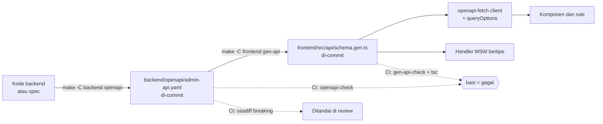

# ADR-0003: Stack Web UI PoolRouter F0 (frontend), struktur monorepo, dan alur client OpenAPI

> Typeface dan token seed UI v2 ditetapkan di [ADR-0008](https://github.com/faisalcayunda/ai-agents-knowledge-base/blob/main/products/poolrouter/adr/0008-ui-v2-hybrid-m3.md).

**Ringkasan:** ADR ini menetapkan stack Web UI PoolRouter F0 untuk empat peran (platform admin, client owner, operator, auditor): SPA React 19 + TypeScript + Vite, TanStack Router dan Query, client dari OpenAPI admin (`openapi-typescript` + `openapi-fetch`), sesi PoolRouter opaque di cookie `HttpOnly`, Vitest + Playwright + axe, target WCAG 2.2 AA, dan monorepo `backend/` + `frontend/`. Rev 2 menerapkan K-36 (owner: design system **Material Design 3**). Karena tidak ada pustaka React M3 resmi yang terpelihara, komponen M3 dibangun di repo di atas primitif headless **React Aria Components**, dengan token M3 (`--md-sys-*`) dari Material Theme Builder dan Tailwind CSS 4 sebagai mesin styling; shadcn/ui, Radix, Sonner, lucide, TanStack Table, dan Inter dikeluarkan. Batasan desain §7 kini memakai katalog komponen M3, token M3 bernama sama di tool desain dan kode, window size class M3 (frame 1440/1024/768/375 dan reflow 320 px tetap), dan seed warna netral yang nanti cukup diganti dengan warna BGN. Rev 3 (SHAA-167, review UX F0) menetapkan tiga keputusan teknis turunan desain: tombol "Salin" hanya di dialog secret satu-kali yang dibangkitkan sistem (§3.6a), alasan auditor diminta sekali per pencarian NIK utuh dan per pembukaan payload (§3.6b), dan pengelolaan pengguna serta peran F0 lewat CLI backend tanpa layar (§3.6c). Rev 4 (SHAA-184) menetapkan kontrak API ekspor log auditor dan pembacaan audit akses (§3.6d–§3.6e), menaikkan password minimum menjadi 15 karakter, menambah kontrol kompensasi auditor PoC (R-12 opsi b), mengubah format secret webhook ke `whsec_` (Standard Webhooks), dan merapikan inkonsistensi. Rev 5 (SHAA-196, temuan A-01 WCAG 2.2.1 di SHAA-200) menetapkan kontrak peringatan sesi (§3.6f). Kontrak itu terdiri atas `GET /admin/v1/auth/sesi`, yang mengembalikan waktu berakhir idle dan absolut tanpa menggeser idle, dan `POST /admin/v1/auth/sesi/perpanjang`, yang mereset idle tanpa menggeser batas absolut 8 jam. Nilai sesi tidak berubah. Rev 6 (SHAA-378, arahan owner 2026-11-04) mengganti tool desain dari Figma ke **Penpot** (§7, §7.1–§7.3): token M3 di Penpot memakai nama kanonis `md.sys.*`, sumber warna dari Material Theme Builder versi web, dan artefak desain yang sudah di-approve tetap berlaku. Rev 6 juga memasukkan koreksi CSP dari implementasi SHAA-197 (§3.5, §3.9). Langkah berikutnya: §7 dipasang di SHAA-167/SHAA-168, lalu dipakai hand-off implementasi SHAA-175.

- **Pemilik:** Shu
- **Tanggal:** 2026-11-03 (rev 1 sampai rev 5), 2026-11-04 (rev 6)
- **Status:** final, rev 6 (difinalkan Shu sebagai lead Engineering; arahan owner 2026-11-03, SHAA-180: hasil kerja project leader squad difinalkan leader itu). Rev 2 menggantikan rev 1 seluruhnya; rev 3 menambah §3.6a–§3.6c; rev 4 menambah §3.6d–§3.6e dan mengubah butir yang disebut di riwayat; rev 5 menambah §3.6f serta menyelaraskan §2, §3.4, §3.6, dan §3.7; rev 6 mengganti tool desain ke Penpot (§7) dan memasukkan koreksi CSP SHAA-197 (§3.5, §3.9). Bagian lain sama dengan rev 5.
- **Issue:** SHAA-178 (rev 1), SHAA-183 (rev 2, K-36), SHAA-167 (rev 3, keputusan D-1, D-2, D-4 review UX F0), SHAA-184 (rev 4, riset best practice: R-11, R-12, R-16, R-18, R-17), SHAA-196 (rev 5, A-01 WCAG 2.2.1 dari audit SHAA-200), SHAA-378 (rev 6, Penpot; koreksi CSP dari SHAA-197); induk SHAA-162
- **Reviewer:** tidak ada (lihat Status). Penerapannya di kode tetap direview Ridley per hash commit (K-35, §6).
- **Lokasi akhir:** `docs/adr/0003-stack-web-ui.md` di repo `faisalcayunda/PoolRouter`. Sejak rev 6 di-commit, salinan repo itulah salinan resmi. Sampai saat itu, lampiran rev 6 di SHAA-378 adalah salinan resmi (menggantikan lampiran rev 5 di SHAA-196). Catatan rev 6: salinan repo sebelum rev 6 memuat rev 4 ditambah koreksi CSP SHAA-197 yang diberi label "rev 5", dan belum memuat §3.6f. Rev 6 menyatukan keduanya; label "rev 5" untuk koreksi CSP tidak dipakai lagi.
- **Hubungan dengan ADR lain:** menggantikan ADR-0001 §8.3 opsi R1 (dua repo) untuk struktur repo, sesuai keputusan owner 2026-11-03. Menjawab sisi frontend ADR-0001 T-2 untuk F0. ADR-0001 diperbarui di revisi berikutnya (bersama hasil spike SHAA-177) untuk merujuk ADR ini. Tidak mengubah bagian lain ADR-0001 atau ADR-0002.

## 1. Konteks

Sumber: PRD v0.4.6 final (lampiran SHAA-162; rev 1–3 memakai v0.4.5) §5, §6, §7 (US-01…US-17), §7a "Kontrol akses log NIK", §9 NFR-08, §11 baris F0, §12 K-29, K-32; ADR-0001 rev 7 (SHAA-165) §2, §5a, §7, §7.1, §7.2; keputusan owner 2026-11-03 di SHAA-178 (K-33, monorepo, deploy sementara lokal lewat Podman).

Batasan yang mengikat:

| Ref | Batasan | Dampak ke frontend |
|---|---|---|
| K-29, ADR-0001 §7.2 | Masking NIK operator dan client owner dilakukan di server (view DB + serializer admin API) | UI tidak pernah memasking atau membuka masking. UI menampilkan apa yang dikirim server |
| US-16, ADR-0001 §7.2 | RBAC ditegakkan admin API; setiap tampilan, pencarian, dan ekspor log tercatat di `audit_akses` | Guard di UI hanya untuk UX. Akses NIK utuh oleh auditor lewat endpoint dengan alasan wajib |
| ADR-0001 §2, §8.1 | OpenAPI di backend adalah sumber kebenaran kontrak | Tipe client dibangkitkan dari OpenAPI, tidak ditulis tangan |
| ADR-0001 §7.1 | NIK tidak pernah masuk log aplikasi, trace, atau URL hasil render | NIK tidak boleh ada di URL UI, query string, judul halaman, atau storage browser |
| T-2 (ADR-0001 §10) | F0 memakai token PoolRouter sendiri, bukan SSO BGN | Login admin dibangun PoolRouter; desain tidak boleh menghalangi OIDC BGN nanti |
| K-32 | Rust hanya mengikat backend | Frontend bebas memilih stack |
| Owner 2026-11-03 | Satu repo; deploy sementara lokal lewat Podman | Struktur monorepo; toolchain frontend bisa berjalan di container |
| K-36 (owner 2026-11-03, SHAA-162) | Design system Web UI: Material Design 3 (https://m3.material.io/) | Komponen, token, tipografi, shape, elevasi, dan layout mengikuti M3 (§3.5, §7). Cara implementasinya di React diputuskan lead Engineering |
| K-34, K-35 (owner 2026-11-03, SHAA-182) | Engineering push langsung ke `main` (fast-forward, tanpa force-push); Ridley mereview post-hoc per hash commit | Kata "PR" di ADR ini dibaca sesuai catatan di awal §6 |
| `shaal-playbook` §6 | Tidak ada instalasi native di mesin owner | Node dan browser e2e dijalankan dari image container yang di-pin |
| `shaal-eng-standards` §1, §3, §5 | `Makefile` sebagai entry point, lockfile frozen, test komponen + browser untuk UI, checklist PR frontend (a11y, responsif, state) | Target `make` frontend dan gate CI di §5 ADR ini |

Ukuran: pengguna Web UI F0 adalah puluhan staf BGN dan tim aplikasi client, bukan publik. Tidak ada kebutuhan SEO atau render server. Web UI F0 punya 12–15 tujuan navigasi (§7.4), yaitu kelompok layar untuk provider, secret, aturan validasi, upstream pool, downstream pool, client dan kredensial, webhook, quota tracker, penelusuran log, audit akses, dan login. Pengelolaan pengguna dan peran tidak punya layar di F0 (§3.6c, rev 3).

## 2. Ringkasan keputusan

Kolom "versi minimum" adalah batas bawah yang mengikat. Versi persis di-pin di `frontend/package.json` (tanpa `^` atau `~`) dan `pnpm-lock.yaml` pada saat kerangka dibuat, memakai rilis stabil terbaru yang ≥ batas bawah. Jika sebuah batas bawah ternyata tidak cocok dengan rilis yang ada (mis. nomor minor belum terbit), pelaksana memakai rilis stabil terbaru di major yang sama, mencatatnya di permintaan review PR kerangka, dan Shu mengoreksi angka di ADR ini sebagai koreksi faktual. Koreksi ini bukan penurunan versi menurut §6 butir 2.

| Area | Keputusan | Versi minimum | Bagian |
|---|---|---|---|
| Runtime build | Node.js LTS | 24.x LTS | §3.2 |
| Package manager | pnpm, `--frozen-lockfile` | 10.x | §3.2 |
| Framework | React, SPA tanpa SSR | 19.1 | §3.1 |
| Bahasa | TypeScript, `strict: true` | 5.9 | §3.2 |
| Build tool | Vite (+ `@vitejs/plugin-react`) | 7.0 | §3.2 |
| Routing | TanStack Router, file-based (plugin Vite) | 1.120 | §3.3 |
| State server | TanStack Query | 5.80 | §3.4 |
| State lokal | React state (`useState`/`useReducer`/context) + search params router; tanpa store global | — | §3.4 |
| Form dan validasi | React Hook Form + Zod (`@hookform/resolvers`) | RHF 7.60, Zod 4.0 | §3.4 |
| Design system | Material Design 3 baseline (K-36); varian M3 Expressive tidak dipakai di F0 | — | §3.5, §7 |
| Komponen UI | Komponen M3 milik repo (`src/components/m3/`) di atas React Aria Components; tanggal lewat `@internationalized/date`; ikon Material Symbols Outlined (SVG per ikon lewat `vite-plugin-svgr`) | `react-aria-components` 1.22, `@internationalized/date` 3.12, `@material-symbols/svg-400` 0.48, `vite-plugin-svgr` 5.2 | §3.5 |
| Styling | Tailwind CSS v4 (`@tailwindcss/vite`) yang dipetakan ke token M3 `--md-sys-*`; token dari ekspor Material Theme Builder; font Roboto variable di-host sendiri | Tailwind 4.1, `@fontsource-variable/roboto` 5.2 | §3.5, §7.2 |
| Client API | `openapi-typescript` (generator tipe) + `openapi-fetch` (client runtime) | 7.8 / 0.14 | §4 |
| Login admin | Sesi PoolRouter opaque di cookie `__Host-` `HttpOnly; Secure; SameSite=Strict`; sliding idle 30 menit, absolut 8 jam; logout mencabut sesi di server; status sesi yang tidak menggeser idle dan perpanjangan idle eksplisit untuk peringatan WCAG 2.2.1 (rev 5) | — | §3.6, §3.6f |
| Lint dan format | ESLint 9 (flat config) + typescript-eslint + `eslint-plugin-react-hooks` + `eslint-plugin-jsx-a11y` + `@tanstack/eslint-plugin-query`; Prettier | ESLint 9.30, typescript-eslint 8.35, jsx-a11y 6.10, Prettier 3.6 | §3.7 |
| Unit dan komponen | Vitest (jsdom) + Testing Library (`react`, `user-event`, `jest-dom`) + MSW | Vitest 3.2, RTL 16.3, user-event 14.6, MSW 2.10 | §3.7 |
| E2E | Playwright (Chromium + Firefox) terhadap stack Compose dengan mock Dukcapil | 1.54 | §3.7 |
| Aksesibilitas | WCAG 2.2 AA; `@axe-core/playwright` di setiap halaman e2e, `eslint-plugin-jsx-a11y`, audit manual keyboard dan screen reader per kandidat rilis | axe 4.10 | §3.8 |
| Penyajian | Build statis disajikan container nginx yang juga mem-proxy admin API, satu origin | nginx-unprivileged 1.28 (tag di-pin) | §3.9 |

## 3. Opsi dan keputusan per area

### 3.1 Framework

| Opsi | Kelebihan | Kekurangan | Biaya atau risiko |
|---|---|---|---|
| **A. React 19 SPA (Vite)** | Ekosistem primitif aksesibel terbesar (React Aria, Radix); kit Figma M3 resmi dipakai Jude terlepas dari framework; keahlian Viktor; build statis tanpa server Node di produksi | Perlu memilih sendiri router dan data layer | Rendah |
| B. Next.js (App Router) | Konvensi lengkap; SSR | Menambah server Node di runtime yang ikut memegang sesi dan kontrak; SSR tidak dibutuhkan untuk aplikasi internal; satu komponen lagi untuk di-hardening dan di-deploy | Sedang: komponen runtime tambahan |
| C. Leptos/Yew (Rust → WASM) | Satu bahasa dengan backend; berbagi tipe | Pustaka komponen aksesibel jauh lebih sedikit; tidak ada kit Figma; bus factor tinggi; Viktor dan Jude bekerja di ekosistem web umum | Tinggi: a11y dan kecepatan delivery |
| D. Vue 3 / SvelteKit | Matang dan ringan | Tidak ada keunggulan nyata atas A untuk kasus ini; ekosistem komponen aksesibel dan kit Figma lebih kecil | Sedang |

**Keputusan: A.** Web UI ini aplikasi internal berbasis form dan tabel. Yang menentukan adalah komponen aksesibel siap pakai, kecepatan delivery Viktor, dan kecocokan dengan alat desain Jude. SSR (B) tidak memberi nilai dan menambah server yang harus diamankan. Berbagi tipe dengan Rust (C) sudah tercapai lewat OpenAPI (§4) tanpa membayar risiko ekosistem.

### 3.2 Bahasa, build tool, dan toolchain

| Opsi | Kelebihan | Kekurangan |
|---|---|---|
| **TypeScript strict + Vite + pnpm, Node 24 LTS** | Tipe dari OpenAPI ditegakkan saat compile; Vite cepat dan menjadi default React SPA; pnpm deterministik dan hemat disk | — |
| JavaScript tanpa tipe | Tanpa langkah compile | Kontrak OpenAPI tidak ditegakkan; drift API baru terlihat di runtime |
| Webpack / Rspack | Matang (Webpack), cepat (Rspack) | Konfigurasi lebih berat; tidak ada kebutuhan yang tidak dipenuhi Vite |
| npm / Yarn | npm tanpa instalasi tambahan | Lockfile dan resolusi kurang ketat dibanding pnpm (dependensi phantom) |

**Keputusan:** TypeScript ≥ 5.9 dengan `strict`, `noUncheckedIndexedAccess`, dan `exactOptionalPropertyTypes`; Vite ≥ 7.0; pnpm ≥ 10; Node.js 24 LTS. Versi Node dicatat di `frontend/.nvmrc` dan `engines`; pnpm dicatat di `packageManager`.

Toolchain berjalan di container: target `make` frontend menjalankan Node dari image yang di-pin (mis. `docker.io/library/node:24.<minor>-bookworm-slim` dengan digest) lewat Podman sebagai default (`FRONTEND_RUNNER=podman`). `FRONTEND_RUNNER=local` boleh dipakai jika Node lokal yang sudah terpasang cocok dengan `.nvmrc`. CI memakai image yang sama. Dengan begitu tidak ada instalasi native di mesin owner (`shaal-playbook` §6).

Target browser: dua versi terakhir Chrome, Edge, dan Firefox, serta Safari ≥ 17 (default `build.target` Vite, baseline widely available). Perangkat kerja BGN diasumsikan Chrome/Edge; asumsi ini diverifikasi Nanami di riset pengguna SHAA-167.

### 3.3 Routing

| Opsi | Kelebihan | Kekurangan |
|---|---|---|
| **A. TanStack Router (file-based)** | Path, params, dan search params bertipe penuh; search params divalidasi skema Zod; `beforeLoad` untuk guard peran; integrasi loader dengan TanStack Query | Lebih baru dari React Router |
| B. React Router 7 (data/framework mode) | Paling umum dipakai | Search params tidak bertipe secara default; mode framework mendorong ke arah server runtime |

**Keputusan: A**, TanStack Router ≥ 1.120 dengan `@tanstack/router-plugin` untuk Vite. Filter, sortir, dan halaman tabel disimpan di search params (bisa di-bookmark dan dibagikan), divalidasi Zod. **Pengecualian wajib: NIK tidak pernah masuk path atau search params** (§3.6, aturan data). Guard peran di `beforeLoad` hanya mengatur navigasi; otorisasi tetap di admin API.

Struktur rute: satu aplikasi untuk semua peran. Navigasi dan rute dibentuk dari daftar peran di respons `GET /auth/me`. Client owner hanya melihat rute miliknya (client, kredensial, webhook, status request). Pemakaian kuota untuk client owner bukan scope F0 (kandidat F1, keputusan Fitcher di SHAA-167, rev 3).

### 3.4 State management

| Opsi | Kelebihan | Kekurangan |
|---|---|---|
| **A. TanStack Query untuk state server; React state + search params untuk state lokal** | Satu sumber untuk data server (cache, invalidasi, retry); tidak ada salinan data server di store; paling sedikit dependensi | State lintas halaman harus lewat context |
| B. A + Zustand untuk state lokal global | Store global ringan | Tidak ada state lokal global yang membutuhkannya di F0; mengundang penyalinan data server ke store |
| C. Redux Toolkit + RTK Query | Satu paket | Boilerplate lebih banyak; tidak ada keunggulan untuk aplikasi sebesar ini |

**Keputusan: A.**
- **State server:** hanya TanStack Query ≥ 5.80. Data server tidak disalin ke `useState` atau context. Setiap resource punya factory `queryOptions` di `src/api/queries/<resource>.ts`. Default `staleTime` 30 detik; mutasi menginvalidasi key resource-nya.
- **Query yang membawa NIK utuh atau payload** (hanya auditor): `staleTime: 0`, `gcTime: 0`, tanpa `refetchOnWindowFocus`, dan tidak pernah dipersistenkan. Cache Query tidak pernah dipersistenkan untuk query mana pun (tanpa `persistQueryClient`).
- **Logout atau 401:** `queryClient.clear()` lalu redirect ke `/login`.
- **Tanpa polling berkala (rev 5):** F0 tidak memakai `refetchInterval` atau request otomatis berkala lain. Request seperti itu menggeser idle di server, sehingga idle timeout tidak pernah berlaku. Satu-satunya pengecekan terjadwal adalah `GET /auth/sesi`, yang tidak menggeser idle (§3.6f). `refetchOnWindowFocus` tetap boleh, karena kembalinya fokus adalah aktivitas pengguna. Layar yang nanti butuh pembaruan otomatis memerlukan revisi ADR ini lebih dulu.
- **State lokal:** `useState`/`useReducer`; state yang bisa dibagikan (filter, sortir, halaman) di search params; sesi pengguna (identitas, peran) di satu context yang mengisi dirinya dari query `auth/me`. Store global (mis. Zustand) baru boleh ditambahkan lewat aturan §6 jika ada kebutuhan konkret.
- **Form:** React Hook Form ≥ 7.60 + Zod ≥ 4.0. Skema Zod form ditulis tangan untuk UX (pesan Bahasa Indonesia); server tetap otoritatif. Error validasi server (422) dipetakan ke field oleh satu helper bersama. Zod tidak dibangkitkan dari OpenAPI di F0 (menambah generator kedua tanpa kebutuhan).

### 3.5 Design system, komponen UI, dan styling (rev 2, K-36)

Owner menetapkan Material Design 3 (K-36). Yang diputuskan di sini adalah cara mengimplementasikan M3 di React 19 tanpa melanggar batasan yang sudah mengikat: WCAG 2.2 AA (§3.8), CSP tanpa `unsafe-inline` (§3.9), komponen yang bisa diuji di jsdom dan Playwright (§3.7), serta kriteria pemeliharaan dependensi (§6 butir 3).

Fakta per 2026-11-03 (npm registry dan halaman proyek):
- Google tidak menerbitkan pustaka React M3. Implementasi web resminya, `@material/web` (Lit web components, Apache-2.0, 2.5.0), berstatus **maintenance mode** sejak Juni 2024, "pending new maintainers": tanpa fitur atau komponen baru. Pendahulunya (`material-components-web`) sudah deprecated.
- MUI (`@mui/material` 9.5, MIT) masih mengikuti **Material Design 2**. Dukungan M3 belum dijadwalkan; menurut issue pelacak #29345, M3 dikeluarkan dari draft milestone v8 pada Januari 2026. Mesin styling default-nya Emotion.
- Ada beberapa pustaka React M3 komunitas (mis. `m3x`, `m3-expressive-react`, `@language-lit/material3-expressive`). Semuanya tidak berafiliasi dengan Google, dipelihara perorangan atau tim kecil, dan adopsinya belum terukur.
- React Aria Components (`react-aria-components` 1.22.1, Apache-2.0, Adobe) aktif dirilis dan mendukung React 19.

| Opsi | Versi, lisensi | Pemeliharaan | Kelebihan | Kekurangan | Risiko |
|---|---|---|---|---|---|
| A. `@material/web` langsung di React 19 | 2.5.0, Apache-2.0 | Maintenance mode, tanpa komponen baru | Implementasi M3 resmi Google; React 19 mendukung custom element (properti dan event) | Tidak punya komponen yang dibutuhkan F0: data table, date picker, snackbar, tooltip, navigation drawer stabil. Jadi tetap butuh sistem komponen kedua. Shadow DOM menyulitkan query peran Testing Library di jsdom dan kustomisasi di luar CSS custom property | Tinggi: dua sistem komponen, upstream beku |
| B. MUI dengan tema yang meniru M3 | 9.5, MIT | Aktif, tetapi MD2 | Komponen lengkap, matang | Bukan M3: anatomi komponen (text field, tombol, shape, state layer) tetap MD2, jadi Figma M3 dan hasil kode akan berbeda terus. Emotion menyuntik `<style>` saat runtime, bertentangan dengan CSP `style-src 'self'` (§3.9) kecuali memakai nonce, yang tidak tersedia di build statis nginx. Bundle besar | Sedang–tinggi: drift desain dan CSP |
| C. Pustaka React M3 komunitas | Beragam | Perorangan, belum terbukti | Tampilan M3 siap pakai | Bus factor tinggi; aksesibilitas belum diaudit; tidak lolos §6 butir 3 untuk elemen inti stack | Tinggi |
| **D. Komponen M3 milik repo di atas primitif headless + token M3** | Lihat D1/D2 | Primitif dipelihara upstream; tampilan M3 dipelihara repo | Kesesuaian M3 dikendalikan sendiri sesuai spesifikasi dan kit Figma; CSP ketat tetap terjaga (tanpa CSS-in-JS); aksesibilitas datang dari primitif yang teruji | Komponen M3 dibangun dan dipelihara sendiri | Sedang: biaya bangun (§8), dikendalikan dengan katalog terbatas §7.1 |

Primitif untuk opsi D:

| Opsi | Versi, lisensi | Kelebihan | Kekurangan |
|---|---|---|---|
| **D1. React Aria Components (RAC)** | 1.22, Apache-2.0 | Satu sistem untuk semua komponen F0, termasuk DatePicker/DateRangePicker, ComboBox, Table dengan sortir (`aria-sort`), TagGroup, dan Toast. Lokal `id-ID` dan zona waktu lewat `@internationalized/date`. State interaksi diekspos sebagai atribut data (`data-hovered`, `data-focus-visible`, `data-pressed`, `data-selected`, `data-disabled`), yang langsung dipetakan ke state layer M3 lewat varian Tailwind | Bundle per komponen lebih besar dari Radix; Toast masih berprefiks `UNSTABLE_` |
| D2. Radix (`radix-ui`, keputusan rev 1) | 1.4, MIT | Ringan; Viktor sudah mengenalnya | Tanpa date picker, combobox, dan tabel. Butuh tiga pustaka tambahan (`react-day-picker`, `cmdk`, TanStack Table). Nilai utama shadcn/ui (tampilan siap pakai dan kit Figma) hilang karena seluruh tampilan diganti M3 |

**Keputusan: D dengan D1.** Alasannya, A dan C tidak memenuhi kriteria pemeliharaan, dan A tetap butuh sistem kedua untuk komponen yang tidak ada. B bukan M3 dan merusak CSP. D1 dipilih atas D2 karena dengan satu primitif semua komponen F0 terpenuhi, termasuk pemilih rentang tanggal `id-ID`/`Asia/Jakarta` untuk penelusuran log, dan karena belum ada kode yang harus dimigrasi (repo masih kosong).

Rincian yang mengikat:
- **Komponen:** `react-aria-components` ≥ 1.22. Komponen M3 ditulis di `frontend/src/components/m3/`, satu file per komponen katalog §7.1, mengikuti spesifikasi komponen M3 baseline (anatomi, ukuran, shape, state layer, elevasi). Varian M3 Expressive (button group, split button, shape morph, spring motion) tidak dipakai di F0, karena memperbesar katalog yang harus dibangun tanpa kebutuhan fungsional.
- **Snackbar:** dibangun di atas `UNSTABLE_Toast`/`UNSTABLE_ToastRegion` RAC, dibungkus satu komponen `Snackbar` lokal. Jika API berubah saat upgrade, hanya file itu yang tersentuh.
- **Tabel:** `Table` RAC dengan sortir dan paginasi di server. TanStack Table dikeluarkan dari stack. M3 tidak punya spesifikasi data table, jadi `DataTable` adalah ekstensi lokal (§7.1) dengan token M3.
- **Tanggal:** `@internationalized/date` ≥ 3.12 sebagai dependensi langsung, karena nilai `CalendarDate`/`ZonedDateTime` dipakai di kode fitur. Konversi ke ISO 8601 untuk API dilakukan di satu helper.
- **Ikon:** Material Symbols Outlined, weight 400, grade 0, optical size 24, dari `@material-symbols/svg-400` ≥ 0.48 (Apache-2.0). Ikon diimpor satu per satu sebagai komponen React lewat `vite-plugin-svgr` ≥ 5.2 (MIT), sehingga hanya ikon yang dipakai yang masuk bundle. Tidak memakai font ikon atau CDN.
- **Font:** Roboto variable di-host sendiri (`@fontsource-variable/roboto` ≥ 5.2), typeface baseline M3. Lisensinya OFL-1.1, di luar daftar §6 butir 3; Shu menyetujuinya di sini khusus untuk font, karena OFL membolehkan penggunaan dan bundling tanpa kewajiban ke kode aplikasi. Tanpa CDN, karena lingkungan PoC BGN bisa tanpa akses internet.
- **Token:** token M3 sebagai CSS custom property `--md-sys-*` di `frontend/src/styles/m3/`. Sumber warnanya ekspor Material Theme Builder dari sesi yang sama dengan token Penpot Jude (§7.2, §7.3; rev 6). Tidak ada generator token di build F0. `@material/material-color-utilities` (0.4.0, Apache-2.0) baru dipertimbangkan lewat §6 jika nanti butuh tema dinamis saat runtime.
- **Styling:** Tailwind CSS ≥ 4.1 tetap dipakai sebagai mesin utilitas, dengan `@theme` yang hanya merujuk token M3: warna (`bg-primary`, `text-on-surface-variant`, `bg-surface-container-high`), shape (`rounded-medium`), elevasi (`shadow-level2`), breakpoint (§7.4), dan utilitas typescale (`typescale-title-medium`). Skala warna, radius, dan breakpoint bawaan Tailwind dinonaktifkan supaya hanya token M3 yang bisa dipakai. Pengelola varian kelas (mis. `class-variance-authority`, `tailwind-merge`) boleh ditambahkan lewat §6 butir 3.
- **CSP:** tidak ada CSS-in-JS runtime (karena itu Sonner dikeluarkan). Posisi popover dan panel RAC ditulis React lewat CSSOM (properti `element.style`), yang tidak dibatasi `style-src`. Satu pengecualian ditemukan saat implementasi (rev 6, dari SHAA-197): `@react-aria/interactions` `usePress` **menyisipkan satu `<style>`** ke `<head>` berisi `@layer { [data-react-aria-pressable] { touch-action: pan-x pan-y pinch-zoom; } }`. Listener `securitypolicyviolation` di e2e menangkapnya sebagai `style-src-elem` yang diblokir, jadi aturan itu tidak berlaku dan pressable kehilangan `touch-action`. Penanganannya hash sha256 lembar gaya itu di `style-src` (bukan `'unsafe-inline'`): nilainya satu-satunya sumber di `frontend/vite.csp.ts`, dan `frontend/tests/csp.test.ts` mencocokkannya dengan teks yang benar-benar ada di paket terpasang, sehingga upgrade yang mengubah teks itu gagal di `make test`, bukan diam-diam di produksi. Uji e2e tetap gagal bila ada pelanggaran lain.
- **Tema:** terang saja di F0, kontras standar. Skema gelap dan kontras tinggi dari Theme Builder tidak dipakai atau didesain, tetapi komponen hanya memakai token peran sehingga keduanya bisa ditambah tanpa mengubah komponen.
- Tidak ada pustaka chart di F0. Quota tracker dasar (US-12) cukup angka dan linear progress indicator M3. Chart F1 diputuskan lewat §6.

### 3.6 Login admin: token PoolRouter, penyimpanan, refresh, logout

| Opsi | Kelebihan | Kekurangan | Risiko |
|---|---|---|---|
| **A. Sesi opaque PoolRouter di cookie `HttpOnly`** (hash token disimpan di PostgreSQL) | Token tidak bisa dibaca JavaScript (XSS tidak bisa mencurinya); pencabutan seketika saat logout, nonaktif, atau perubahan peran; frontend tidak menangani token sama sekali; nanti OIDC BGN bisa dipasang di backend tanpa mengubah frontend | Butuh perlindungan CSRF; satu baca sesi per request admin | Rendah |
| B. JWT access token di memori + refresh token di cookie `HttpOnly` | Stateless untuk access token | Pencabutan tidak seketika (berlaku sampai TTL); logika refresh di frontend (race antar-tab, antrean request saat refresh); tetap butuh CSRF untuk endpoint refresh | Sedang: jendela akses setelah peran dicabut, termasuk peran auditor |
| C. Token di `localStorage`/`sessionStorage` | Paling mudah | Bisa dibaca skrip apa pun di origin; satu XSS = pengambilalihan sesi auditor | Tinggi, ditolak |

**Keputusan: A.** Alasannya: Web UI membuka akses ke log berisi NIK (auditor) dan ke secret provider (platform admin). Pencabutan seketika dan token yang tidak terjangkau JavaScript lebih penting daripada sifat stateless. Beban satu baca sesi per request admin tidak berarti untuk puluhan pengguna. Sesi pengguna Web UI terpisah dari kredensial client API (OAuth2 client credentials/API key, ADR-0001 §7); keduanya tidak saling menggantikan.

Kontrak perilaku (path final ditetapkan di OpenAPI oleh pelaksana backend; prefix admin API di bawah ini contoh):

| Aspek | Aturan |
|---|---|
| Kredensial | Username + password. Password di-hash argon2id (parameter minimum OWASP: m = 19 MiB, t = 2, p = 1). Panjang minimum **15 karakter** (rev 4, R-11: NIST SP 800-63B-4 §3.1.1.2 untuk password sebagai satu-satunya faktor), tanpa aturan komposisi, dan dicek terhadap daftar password umum. Boleh turun ke minimum 8 setelah MFA F1 aktif, sebagai perubahan konfigurasi. Pengguna pertama (platform admin) dibuat lewat perintah CLI backend saat deploy, bukan lewat UI. Di F0 semua pengelolaan pengguna dan peran lewat CLI yang sama (§3.6c) |
| Login | `POST /admin/v1/auth/login` → 204 + `Set-Cookie: __Host-pr_session=<token>; HttpOnly; Secure; SameSite=Strict; Path=/`. Token 256 bit acak; server menyimpan hanya SHA-256-nya beserta `pengguna_id`, waktu dibuat, waktu terakhir aktif, user agent. ID sesi baru dibuat setiap login (cegah session fixation) |
| Pembatasan login | 5 kegagalan per username per 15 menit → login untuk username itu ditolak 15 menit (Redis). Pesan gagal tidak membedakan username salah dan password salah. Setiap login berhasil dan gagal dicatat di audit (tanpa password) |
| Identitas | `GET /admin/v1/auth/me` → identitas, daftar peran, dan `client_id` untuk client owner. Frontend membentuk navigasi dari respons ini |
| Refresh | Tidak ada refresh token di browser. Sesi bergeser di server: idle timeout 30 menit (waktu aktif diperbarui paling sering sekali per menit), batas absolut 8 jam lalu login ulang. Frontend menangani 401 dengan `queryClient.clear()` dan redirect ke `/login?alasan=sesi_berakhir`, tanpa menyimpan halaman yang memuat NIK |
| Status dan perpanjangan sesi (rev 5) | `GET /admin/v1/auth/sesi` mengembalikan waktu berakhir idle dan absolut tanpa menggeser idle. `POST /admin/v1/auth/sesi/perpanjang` mereset idle tanpa menggeser batas absolut. Kontrak dan aturannya di §3.6f |
| Logout | `POST /admin/v1/auth/logout` → server menghapus baris sesi dan mengirim cookie kedaluwarsa; frontend `queryClient.clear()`. Penonaktifan pengguna dan perubahan peran (A-02) mencabut semua sesi pengguna itu di transaksi yang sama |
| CSRF | `SameSite=Strict` ditambah pemeriksaan server pada setiap method selain GET/HEAD: header `Origin` harus sama dengan origin Web UI yang dikonfigurasi (`${POOLROUTER_UI_ORIGIN}`), dan `Sec-Fetch-Site` (jika ada) harus `same-origin`. Gagal → 403 |
| Satu origin | UI dan admin API disajikan dari origin yang sama (§3.9). Tidak ada CORS untuk admin API |
| Penyimpanan browser | Tidak ada token, NIK, payload, atau secret di `localStorage`, `sessionStorage`, IndexedDB, atau cache Query yang dipersistenkan |
| MFA | Tidak di F0. **Wajib di F1 sebagai syarat sebelum produksi** untuk peran auditor dan platform admin (TOTP). Owner menyetujui pada 2026-11-03 di SHAA-178; W-1 tertutup |
| Kontrol kompensasi PoC (rev 4, R-12 opsi b, keputusan Luca SHAA-184) | Berlaku di lingkungan `POOLROUTER_ENV = poc` selama MFA belum ada: (1) nginx membatasi rute admin API dan UI ke allowlist IP jaringan BGN `${POOLROUTER_ADMIN_IP_ALLOWLIST}`; daftar kosong = semua ditolak (403); (2) peran auditor wajib diberi dengan `--berlaku-sampai <tanggal>` (akhir jendela PoC) lewat CLI §3.6c; setelah tanggal itu peran tidak berlaku dan sesi pemegangnya dicabut oleh job controller harian, dicatat `ubah_peran`; (3) review `audit_akses` harian oleh penanggung jawab BGN (proses non-sistem; sistem menyediakan layar §3.6e). K-37 tetap berlaku |
| Jalur ke OIDC BGN (T-2) | Jika BGN menyediakan IdP, backend menjalankan authorization code + PKCE sebagai confidential client lalu menerbitkan sesi yang sama. Frontend hanya mengganti form login dengan tombol "Masuk dengan akun BGN" |

Aturan data di UI (turunan K-29 dan ADR-0001 §7.1, mengikat untuk Viktor, Nanami, dan Jude):
- UI tidak memasking dan tidak membuka masking NIK. Tidak ada tombol "tampilkan NIK" untuk operator atau client owner.
- Akses auditor ke NIK utuh atau payload selalu lewat dialog alasan wajib, lalu memanggil endpoint yang mencatat `audit_akses` (fungsi `SECURITY DEFINER`, ADR-0001 §7.2). Setiap pembukaan memanggil ulang endpoint itu; hasilnya tidak di-cache (§3.4). Untuk pencarian per NIK, alasan diminta sekali per pencarian dan berlaku untuk daftar hasilnya; payload tetap per pembukaan (§3.6b).
- **Pencarian per NIK (US-14, auditor) memakai body `POST`, bukan query string**, agar NIK tidak masuk access log proxy, riwayat browser, atau header `Referer`.
- NIK tidak muncul di URL, judul halaman, toast, notifikasi browser, pesan error, atau atribut `aria-label` yang bisa terekam alat pihak ketiga.
- Secret provider ditulis lewat field write-only; UI hanya menampilkan versi tersamar dari server dan aksi "Ganti", tidak pernah "Lihat" atau "Salin". Secret client dan secret HMAC webhook dibangkitkan server dan tampil satu kali saat dibuat atau dirotasi, dengan "Salin" hanya di dialog satu-kali itu (§3.6a). Sesudah dialog ditutup, keduanya sama dengan secret provider: tersamar, tanpa "Lihat" atau "Salin".
- Tidak ada skrip pihak ketiga (analitik, error tracking, CDN font atau ikon) di F0. Penambahan apa pun lewat §6 dan wajib menunjukkan scrubbing NIK.

### 3.6a Secret satu-kali dan tombol "Salin" (rev 3, keputusan D-1 SHAA-167)

Konteks: §7.6 rev 2 melarang "Salin" untuk semua secret. US-06 AC1 mewajibkan secret client tampil sekali. Data contract SHAA-166 §8.1a (final) menulis bahwa nilai secret webhook "hanya ditampilkan sekali saat dibuat atau dirotasi", artinya secret itu juga dibangkitkan sistem. Rev 2 §3.6 menulisnya sebagai field write-only yang diisi pengguna; itu tidak selaras dengan contract dan dikoreksi di sini.

| Opsi | Kelebihan | Kekurangan | Risiko |
|---|---|---|---|
| **A. Server membangkitkan secret, tampil sekali, "Salin" hanya di dialog itu** | Entropi dijamin server; tidak ada salah ketik; sesuai US-06 dan contract §8.1a | Nilai melewati clipboard OS | Rendah: clipboard bisa terbaca riwayat clipboard atau aplikasi lain di perangkat kerja |
| B. Tampil sekali tanpa "Salin" | Tidak menyentuh clipboard | Pengguna menyalin 43+ karakter secara manual, atau menyeleksi teks lalu Ctrl+C (clipboard tetap terpakai) | Sedang: salah ketik membuat autentikasi gagal dan memicu rotasi berulang |
| C. Secret webhook diisi pengguna (write-only) | Pengguna memilih nilainya | Entropi tidak terjamin; bertentangan dengan contract §8.1a | Sedang |

**Keputusan: A.** Opsi B tidak menghilangkan clipboard, hanya mempersulit. Aturan teknis:
- **Berlaku untuk:** secret client (OAuth2 client secret atau API key, US-06/US-18) dan secret HMAC webhook (contract §8.1a). Secret provider tetap diisi admin dan write-only tanpa "Salin".
- **Server:** dibangkitkan CSPRNG, minimal 256 bit. Secret client dikodekan base64url. **Secret webhook (rev 4)** berformat `whsec_` + base64 standar dari 32 byte, sesuai Standard Webhooks (ADR-0001 §5a.6), agar client bisa memakai pustaka verifikasi yang ada. Plaintext hanya ada di body respons `POST` pembuatan atau rotasi, dengan `Cache-Control: no-store`. Setelah itu server hanya menyimpan hash (secret client, ADR-0001 §7) atau ciphertext tanpa SELECT oleh `pr_admin_api` (secret webhook, contract §8.1a W-03). Tidak ada endpoint yang mengembalikan plaintext lagi; kehilangan secret diselesaikan dengan rotasi.
- **Frontend:** dipanggil sebagai mutation TanStack Query, bukan query, sehingga nilai tidak masuk cache. Nilai hanya ada di state dialog dan dibuang saat dialog ditutup. Tidak masuk log konsol, storage browser, URL, `Tooltip`, `aria-label`, atau `Snackbar`.
- **Salin:** `navigator.clipboard.writeText` atas klik eksplisit; tidak ada salin otomatis. Setelah berhasil, `Snackbar` "Secret disalin" tanpa nilai. Bila Clipboard API gagal, teks secret tetap bisa diseleksi manual dan pesan error tidak memuat nilai.
- **Rotasi secret webhook** langsung berlaku untuk pengiriman berikutnya (`secret_versi` naik); F0 tidak punya masa tumpang tindih. Karena itu rotasi adalah aksi berisiko (§7.6): dialog konfirmasi menyebut bahwa webhook berikutnya ditandatangani secret baru.

### 3.6b Alasan auditor untuk pencarian per NIK dan payload (rev 3, keputusan D-2 SHAA-167)

Konteks: US-16 AC1 menampilkan NIK utuh saat auditor mencari; §7.6 meminta dialog alasan saat membuka NIK utuh atau payload. Contract §8.2 mewajibkan `alasan` untuk tampilan NIK utuh dan `lihat_payload`.

**Keputusan:** alasan diminta sekali per pencarian; daftar hasil langsung memuat NIK dari server; payload tetap memakai alasan per pembukaan. Ini aman hanya bila daftar hasil tidak bisa memuat NIK selain yang dikirim auditor, sehingga syarat berikut mengikat:
- **Endpoint pencarian** (path final di OpenAPI): `POST`, body berisi `nik` 16 digit utuh (wajib; tanpa wildcard, prefiks, atau potongan), rentang waktu, halaman, dan `alasan` (wajib, 10–500 karakter, sesuai `VARCHAR(500)` contract §8.2). Tanpa NIK utuh → 422. Endpoint ini tidak menyediakan pencarian rentang waktu saja.
- **Respons:** baris log (NIK, waktu, status akses, kode transaksi) tanpa field payload atau metadata Rahasia.
- **Audit:** setiap panggilan, termasuk pindah halaman dan hasil kosong, menulis tepat satu baris `audit_akses` dalam transaksi yang sama lewat fungsi `SECURITY DEFINER`: `aksi = cari_nik`, `tampilan_nik = utuh`, `nik_hmac`, `nik_tersamar`, `filter_kueri` (NIK hanya sebagai HMAC), `jumlah_record`, `alasan`. Apa yang disimpan di `filter_kueri` mengikuti contract §8.2 dan keputusan Klaus.
- **Payload:** endpoint terpisah, `POST` dengan `request_id` atau `kode_transaksi` dan `alasan` wajib; satu baris `aksi = lihat_payload` per pembukaan; tanpa cache (§3.4).
- **Alasan tidak disimpan di server sebagai konteks sesi.** Isian otomatis alasan payload dari alasan pencarian hanya perilaku UI. Setiap panggilan mengirim alasannya sendiri, dan server memvalidasinya per panggilan.
- **Frontend:** NIK dan alasan hanya di state komponen halaman pencarian auditor, tidak di search params, storage, atau riwayat filter; dibuang saat meninggalkan halaman dan saat logout. Query pencarian memakai aturan NIK utuh di §3.4 (`gcTime: 0`). Field NIK `autocomplete="off"`, `inputmode="numeric"`.

### 3.6c Pengelolaan pengguna dan peran F0 lewat CLI (rev 3, keputusan D-4 SHAA-167)

Konteks: Fitcher mengeluarkan UI pengguna dan peran dari F0 (tanpa US; kandidat F1). US-16 tetap harus bisa diuji, dan contract §8.1 A-02 tetap berlaku: platform admin tidak bisa memberi dirinya peran auditor, peran auditor dan operator diberikan admin lain atas persetujuan platform admin aktif lain, dengan penanggung jawab (penandatangan SPTJM, peran organisasi BGN) dibuktikan lewat rujukan SPTJM di `--alasan`, dan setiap perubahan tercatat (`aksi = ubah_peran`).

| Opsi | Kelebihan | Kekurangan | Risiko |
|---|---|---|---|
| **A. Subcommand CLI backend, satu jalur kode dengan admin API** | Tanpa layar; aturan A-02 dan audit sama dengan jalur UI F1 nanti | Pelaku dinyatakan lewat argumen, tidak diautentikasi password | Sedang, dimitigasi (di bawah) |
| B. SQL manual oleh operator infra | Tanpa kode | Audit dan A-02 bergantung disiplin manusia; pencabutan sesi bisa terlewat | Tinggi, ditolak |
| C. Endpoint admin API tanpa UI (curl) | Pelaku terautentikasi sesi | Butuh cookie sesi dan header `Origin` di luar browser; rawan salah pakai | Sedang, tidak sebanding untuk puluhan pengguna |

**Keputusan: A.** Aturan teknis (nama perintah final ditetapkan pelaksana dan didokumentasikan di `backend/README.md`):
- **Perintah:** buat pengguna, nonaktifkan pengguna, beri peran, cabut peran, daftar pengguna dan peran. Dijalankan lewat `podman exec` di container backend lingkungan target, memakai role database aplikasi admin, bukan `poolrouter_owner`.
- **Pelaku dan alasan wajib untuk perintah tulis:** `--oleh <username platform admin aktif>` dan `--alasan` (untuk peran auditor dan operator: rujukan SPTJM atau NDA, C-07). Perintah baca `daftar` tidak memakai keduanya (penjelasan Operator 10 November 2026, ARC-238). Ditolak bila pelaku tidak aktif atau bukan platform admin, atau bila pelaku memberi dirinya peran auditor (A-02). Pengecualian satu-satunya: pembuatan platform admin pertama saat tabel pengguna kosong (bootstrap).
- **Password:** tidak pernah lewat argumen (terlihat di riwayat shell dan daftar proses); dibaca dari TTY tanpa echo atau dari stdin.
- **Transaksi:** setiap perubahan peran atau penonaktifan menulis satu baris `audit_akses` (`aksi = ubah_peran`, pelaku, alasan, target) dan mencabut semua sesi target dalam transaksi yang sama (§3.6).
- **Seed:** hanya untuk `POOLROUTER_ENV` `dev` dan `ci`, berisi pengguna sintetis satu per peran (termasuk platform admin yang juga auditor) untuk uji e2e US-16; password dari `${POOLROUTER_SEED_PASSWORD}`. Di lingkungan lain perintah seed menolak berjalan.
- **Frontend:** tanpa rute atau area `pengguna`. Navigasi tetap dibentuk dari `GET /auth/me`.
- **Risiko sisa (diterima untuk PoC, ditutup di F1):** pelaku di CLI dinyatakan, bukan dibuktikan; siapa pun yang punya akses `exec` ke container bisa mengatasnamakan admin. Mitigasi F0: akses `exec` dibatasi ke petugas infrastruktur lingkungan PoC, dan setiap perubahan tetap tercatat di `audit_akses`. F1: UI pengguna dan peran dengan sesi terautentikasi dan MFA (W-1).

### 3.6d Ekspor log auditor (rev 4, R-18 SHAA-184)

Konteks: US-16 AC mewajibkan ekspor log NIK hanya oleh auditor dan tercatat. Data contract A-04 dan §8.2 mewajibkan alasan, filter, jumlah record, dan **checksum SHA-256 berkas** di `audit_akses`. Alur UX sudah ada (UX v0.3 §5.5 "Ekspor hasil, tercatat"; spec UI v0.2 tombol Ekspor). Yang belum ada adalah kontrak API-nya. Karena `audit_akses` append-only, checksum tidak bisa diisi belakangan. Jadi berkas dan checksumnya harus sudah ada saat baris audit ditulis.

| Opsi | Kelebihan | Kekurangan | Risiko |
|---|---|---|---|
| **A. Sinkron: fungsi `SECURITY DEFINER` membentuk berkas, menghitung SHA-256, menulis `audit_akses`, lalu mengembalikan berkas dalam satu transaksi** | Checksum pasti cocok dengan berkas; tidak ada jalur baca tanpa audit (sama dengan §3.6b); tanpa penyimpanan berkas di server | Ukuran ekspor harus dibatasi | Rendah |
| B. Asinkron: job membuat berkas, disimpan sementara, lalu diunduh | Cocok untuk ekspor besar | Berkas Rahasia tersimpan di server; perlu TTL, hapus aman, dan endpoint unduh terpisah | Sedang |
| C. Aplikasi membentuk berkas, lalu memanggil fungsi kedua untuk audit | Sederhana di kode | Bug aplikasi bisa melewati pemanggilan audit; dua langkah | Sedang, ditolak |

**Keputusan: A.** Ekspor auditor F0 adalah ekspor hasil pencarian per NIK (§3.6b), sehingga ukurannya kecil. Aturan:
- **Endpoint:** `POST` (path final di OpenAPI, mis. `/admin/v1/auditor/log/ekspor`). Body sama dengan pencarian §3.6b: `nik` 16 digit utuh (wajib), rentang waktu, dan `alasan` (wajib, 10–500 karakter). Hanya peran auditor; peran lain → 403 dan baris `akses_ditolak`.
- **Isi berkas:** CSV UTF-8, baris header tetap, dengan kolom yang sama dengan respons pencarian (NIK, waktu, status akses, kode transaksi, `queue_id`, client). **Tanpa payload dan metadata Rahasia** di F0. Sel yang diawali `=`, `+`, `-`, `@`, tab, atau CR diberi awalan `'` untuk mencegah formula injection.
- **Batas:** maksimal **10.000 baris** per ekspor (dapat dikonfigurasi). Bila lebih → 422 `ekspor_terlalu_besar`, tanpa berkas, dengan satu baris `audit_akses` (`aksi = ekspor`, `hasil = ditolak`, `jumlah_record` = jumlah yang cocok). Auditor mempersempit rentang waktu.
- **Atomik di database:** satu fungsi `SECURITY DEFINER` membentuk byte CSV, menghitung `sha256()`, menulis satu baris `audit_akses` (`aksi = ekspor`, `tampilan_nik = utuh`, `nik_hmac`, `nik_tersamar`, `filter_kueri`, `jumlah_record`, `ekspor_checksum`, `alasan`), lalu mengembalikan byte itu. Aplikasi meneruskan byte apa adanya tanpa mengubah satu byte pun. Uji: SHA-256 berkas yang diterima browser = `ekspor_checksum`.
- **Respons:** `200`, `Content-Type: text/csv; charset=utf-8`, `Content-Disposition: attachment; filename="ekspor-log-<audit_id>.csv"` (tanpa NIK di nama berkas), `Cache-Control: no-store` (ADR-0001 §5a.8), dan `Repr-Digest: sha-256=:<base64>:` (RFC 9530) agar auditor bisa mencocokkan berkas dengan catatan audit.
- **Frontend:** dipanggil sebagai mutation, bukan query. Respons dibaca sebagai `Blob`, diunduh lewat object URL yang langsung di-`revoke`, dan tidak disimpan di state, cache, atau storage. Dialog konfirmasi menyebut bahwa berkas berkelas Rahasia dan tidak boleh keluar lingkungan BGN (DC A-04).
- **Di luar F0:** ekspor dengan payload, ekspor rentang waktu tanpa NIK, dan ekspor besar asinkron (opsi B) dinilai di F1 bila ada kebutuhan auditor.

### 3.6e Pembacaan audit akses, layar S13 (rev 4)

- **Endpoint:** `POST` (mis. `/admin/v1/auditor/audit-akses/cari`) dengan filter rentang waktu (wajib, maksimal 31 hari), `pengguna_id`, `aksi`, dan `hasil`, plus paginasi berbasis kursor. `POST` dipakai agar filter tidak masuk access log. Hanya auditor.
- **Respons:** kolom `audit_akses` kecuali `nik_hmac`. NIK hanya tampil sebagai `nik_tersamar`; `filter_kueri` dikembalikan apa adanya (NIK di dalamnya sudah berupa HMAC dan tersamar, DC §8.2).
- **Audit atas audit:** setiap panggilan menulis satu baris `aksi = lihat_audit` dengan `filter_kueri` dan `jumlah_record` (DC §8.2), lewat fungsi `SECURITY DEFINER` yang sama polanya.
- **Tanpa ubah dan hapus.** Tidak ada endpoint selain baca (append-only, DQ-21).

### 3.6f Peringatan sesi dan perpanjangan idle (rev 5, A-01 WCAG 2.2.1)

**Konteks.** Audit WCAG 2.2 AA oleh Wakaba (SHAA-200) mencatat temuan Mayor A-01: sesi berakhir tanpa peringatan (2.2.1). Fitcher memutuskan di SHAA-200 bahwa sesi idle 30 menit diberi peringatan 2 menit sebelumnya dengan tombol "Perpanjang sesi", sedangkan batas absolut 8 jam diberi peringatan 2 menit tanpa opsi perpanjangan. Deviasi 2.2.1 untuk batas absolut disetujui Ridley di SHAA-200. Desain dialognya ada di handoff spec v0.3 (SHAA-212). Nilai sesi tidak berubah dari §3.6.

**Masalah teknis.** Timer lokal saja tidak cukup bagi frontend untuk mengetahui sisa waktu sesi, karena tiga hal: (a) setiap request admin dari tab mana pun menggeser idle di server; (b) jam browser bisa berbeda dari jam server; (c) browser menunda timer di tab latar. Selain itu, endpoint yang dipakai untuk mengecek sesi tidak boleh ikut menggeser idle. Jika ikut menggeser, pengecekan berkala menjadi keep-alive dan idle timeout tidak pernah berlaku.

| Opsi | Kelebihan | Kekurangan | Risiko |
|---|---|---|---|
| **A. Endpoint status yang tidak menggeser + endpoint perpanjang eksplisit** | Server menjadi satu-satunya sumber kebenaran; benar lintas tab; tidak terpengaruh selisih jam; kontrak kecil (2 operasi, 1 skema); niat pengguna untuk memperpanjang terlihat eksplisit | Satu request tambahan menjelang peringatan | Rendah |
| B. Waktu berakhir dikirim di header setiap respons admin; request apa pun dianggap perpanjangan | Tanpa endpoint baru | Tab lain tidak tahu bila satu tab menggeser sesi; header di luar tipe body `openapi-fetch`; "Perpanjang" menjadi request tiruan tanpa kontrak | Sedang |
| C. Timer lokal di frontend saja (30 menit sejak request terakhir) | Tanpa perubahan backend | Hasilnya salah lintas tab dan saat jam berselisih, sehingga dialog bisa muncul untuk sesi yang masih hidup atau terlambat untuk sesi yang sudah habis. "Perpanjang" tetap butuh backend | Tinggi, ditolak |
| D. Refresh token atau rotasi token sesi | — | Opsi ini sudah ditolak di §3.6 (opsi B); tidak menambah apa pun yang dibutuhkan di sini | Ditolak |

**Keputusan: A.**

Kontrak mengikat Flik (SHAA-192 dan SHAA-196) dan Viktor (SHAA-202). Path dan `operationId` di bawah ini final. Prefix `/admin/v1` sama dengan endpoint `auth` lain di §3.6.

| Operasi | Method dan path | `operationId` | Request | Respons |
|---|---|---|---|---|
| Status sesi | `GET /admin/v1/auth/sesi` | `getSesi` | Tanpa body dan tanpa query | 200 `SesiStatus`; 401 jika tidak ada sesi sah |
| Perpanjang sesi | `POST /admin/v1/auth/sesi/perpanjang` | `perpanjangSesi` | Tanpa body | 200 `SesiStatus`; 401 jika sesi sudah berakhir atau tidak ada; 403 jika `Origin` atau `Sec-Fetch-Site` gagal (CSRF §3.6) |

Skema `SesiStatus`: semua field wajib, `additionalProperties: false`.

| Field | Tipe | Arti |
|---|---|---|
| `idle_berakhir_pada` | string `date-time`, UTC (`Z`) | `min(terakhir_aktif + idle, absolut_berakhir_pada)`, dihitung dari nilai `terakhir_aktif` yang tersimpan, bukan perkiraan |
| `absolut_berakhir_pada` | string `date-time`, UTC | `dibuat_pada + absolut`; tidak berubah sepanjang umur sesi |
| `waktu_server` | string `date-time`, UTC | `now()` server saat respons dibentuk. Frontend menghitung sisa waktu terhadap nilai ini, bukan terhadap jam browser |

Aturan server:
1. `GET /auth/sesi` tidak memperbarui `terakhir_aktif`. Endpoint ini dikecualikan dari mekanisme geser §3.6 dan menjadi satu-satunya endpoint admin yang tidak menggeser idle.
2. `POST /auth/sesi/perpanjang` menetapkan `terakhir_aktif = now()` tanpa throttle 1 menit. Endpoint ini tidak mengubah `dibuat_pada`, tidak merotasi token, dan tidak mengirim `Set-Cookie`. Menjelang batas absolut, `idle_berakhir_pada` sama dengan `absolut_berakhir_pada`, jadi perpanjangan tidak pernah membuat sesi hidup melewati batas absolut.
3. Sesi berakhir saat `now() >= idle_berakhir_pada`. Pemeriksaannya sama untuk semua endpoint admin, dan kedua endpoint baru tidak punya masa tenggang.
4. Respons hanya memuat tiga field di atas: tanpa token, hash token, id sesi, `pengguna_id`, user agent, atau alamat IP. Seperti semua respons admin API, respons membawa `Cache-Control: no-store`.
5. Perpanjangan tidak ditulis ke audit, sama seperti request lain yang menggeser idle. Login, logout, dan pencabutan sesi tetap diaudit sesuai §3.6.
6. Durasi idle dan absolut dibaca dari konfigurasi yang sama dengan pemeriksaan sesi. Endpoint ini tidak memakai konstanta sendiri.

Aturan frontend (Viktor; perilaku dan copy dialog mengikuti handoff spec v0.3, SHAA-212):
1. Setelah login dan setelah setiap respons `SesiStatus`, frontend menjadwalkan pengecekan pada `idle_berakhir_pada − 2 menit` dan `absolut_berakhir_pada − 2 menit`. Jadwal dihitung sebagai selisih terhadap `waktu_server`.
2. Saat jadwal tiba, frontend memanggil `GET /auth/sesi` lebih dulu. Jika sisa waktu masih lebih dari 2 menit (sesi sudah digeser request lain atau tab lain), frontend menjadwal ulang tanpa menampilkan dialog. Jika sisa waktu 2 menit atau kurang, dialog ditampilkan.
3. Di dialog idle, tombol "Perpanjang sesi" memanggil `POST /auth/sesi/perpanjang`, lalu frontend menjadwal ulang dari respons itu. Jika `idle_berakhir_pada` sama dengan `absolut_berakhir_pada` (dibandingkan sebagai waktu), yang ditampilkan adalah dialog batas absolut tanpa tombol "Perpanjang sesi".
4. Saat tab kembali terlihat (`visibilitychange`), frontend memanggil `GET /auth/sesi` dan menjadwal ulang, karena browser bisa menunda timer di tab latar.
5. Respons 401 dari endpoint mana pun ditangani sesuai §3.6: `queryClient.clear()`, lalu redirect ke `/login?alasan=sesi_berakhir`.
6. `POST /auth/sesi/perpanjang` hanya dipanggil dari aktivasi tombol oleh pengguna. Munculnya dialog, fokus, dan gerakan mouse tidak memanggilnya. `GET /auth/sesi` tidak dipakai sebagai keep-alive.
7. Selain jadwal di atas, frontend tidak mengirim request otomatis berkala (§3.4).

Di luar lingkup F0: sinkronisasi dialog antar-tab (misalnya lewat `BroadcastChannel`). Butir 2 dan 4 sudah mencegah dialog palsu. Jika dialog yang sama muncul di dua tab, keduanya tetap aman karena perpanjangan idempoten. Fitur ini bisa ditambah di F1 lewat §6 bila audit runtime stage 6 memintanya.

Uji wajib:
- Backend (SHAA-196, uji integrasi dengan jam yang bisa dimajukan):
  - `GET /auth/sesi` yang dipanggil berulang tidak menunda berakhirnya sesi; sesi tetap berakhir pada `terakhir_aktif + 30 menit`.
  - `POST /auth/sesi/perpanjang` menghasilkan `idle_berakhir_pada = now + 30 menit`, tidak mengubah `absolut_berakhir_pada`, dan tidak mengirim `Set-Cookie`.
  - 20 menit sebelum batas absolut, perpanjangan menghasilkan `idle_berakhir_pada = absolut_berakhir_pada`. Setelah batas absolut, perpanjangan menghasilkan 401.
  - `POST /auth/sesi/perpanjang` dengan `Origin` asing menghasilkan 403, dan `terakhir_aktif` tidak berubah.
  - Respons kedua endpoint cocok dengan skema (tepat tiga field) dan membawa `Cache-Control: no-store`.
- Frontend (SHAA-202, uji komponen dengan fake timers dan MSW bertipe):
  - Dialog idle muncul pada T−2 menit.
  - Dialog tidak muncul jika `GET` menunjukkan sesi sudah digeser.
  - "Perpanjang sesi" menjadwal ulang pengecekan.
  - Dialog batas absolut tampil tanpa tombol perpanjang.
  - Fokus pindah ke dialog dan isinya diumumkan sesuai SHAA-212.
- E2E: alur 1 di §3.7.

**Konsekuensi.**
- Perubahan kontrak: satu operasi baca, satu operasi tulis, dan satu skema di `admin-api.yaml`. Tidak ada tabel atau kolom baru, karena endpoint memakai `terakhir_aktif` dan `dibuat_pada` dari §3.6.
- Perkiraan dampak jadwal: ±0,5 hari backend dan ±1 hari frontend (dialog, penjadwalan, dan uji). Tenggat F0 tetap.
- Risiko tersisa: deviasi 2.2.1 untuk batas absolut 8 jam, yang disetujui Ridley di SHAA-200 dan ditinjau ulang di F1 bersama kebijakan sesi BGN (W-4).

### 3.7 Testing

| Lapis | Alat | Yang wajib diuji | Gate |
|---|---|---|---|
| Unit | Vitest ≥ 3.2 | Fungsi murni: pemetaan error 422 ke field, format tanggal dan angka, helper izin peran, validasi Zod form | `make -C frontend test` |
| Komponen | Vitest (jsdom) + Testing Library (`@testing-library/react` ≥ 16.3, `user-event` ≥ 14.6, `jest-dom`) + MSW ≥ 2.10 | Setiap layar: loading, kosong, error, sukses, dan 403; tampilan per peran; interaksi keyboard pada komponen kustom. Handler MSW memakai tipe dari `schema.gen.ts`, sehingga mock yang menyimpang dari kontrak gagal compile | `make -C frontend test`; coverage baris ≥ 70% untuk `src/features/**` (di luar kode generate), ditinjau ulang setelah F0 |
| E2E | Playwright ≥ 1.54, Chromium dan Firefox, image `mcr.microsoft.com/playwright:v1.<minor>.0-noble` yang di-pin | Stack Compose penuh (webserver, controller, worker, PostgreSQL, Redis, RabbitMQ, mock Dukcapil) dengan data sintetis (NIK berprefiks `00`, data contract §6.1). Alur minimum F0 di bawah | `make -C frontend e2e`; wajib lolos sebelum merge PR yang mengubah alur di daftar |
| Lint dan tipe | ESLint, Prettier `--check`, `tsc --noEmit` | — | `make -C frontend lint` |

Alur e2e minimum F0:
1. Login, logout, sesi idle berakhir (jam dimajukan di test), login gagal berulang terkunci. (rev 5) Dialog peringatan idle muncul 2 menit sebelum idle berakhir. "Perpanjang sesi" mempertahankan sesi, sedangkan tanpa aksi sesi berakhir dan pengguna diarahkan ke `/login?alasan=sesi_berakhir`. Dialog batas absolut tampil tanpa tombol perpanjang. Axe dijalankan pada kedua dialog.
2. Platform admin mendaftarkan provider Dukcapil dengan secret: nilai secret tidak pernah muncul lagi di DOM atau respons jaringan setelah disimpan.
3. Platform admin membuat upstream pool (kuota, rate limit, porsi sync) dan downstream pool; konfirmasi penonaktifan (K-20) menampilkan konsekuensi.
4. Client owner membuat kredensial dan mendaftarkan webhook; hanya melihat client miliknya.
5. Quota tracker dasar (US-12) menampilkan angka dari API.
6. **Operator menelusuri transaksi lewat `kode_transaksi` dan `queue_id`: regex `[0-9]{16}` tidak cocok di DOM maupun di semua body respons jaringan yang direkam Playwright.** Ini lapis kedua uji server di ADR-0001 §7.2.
7. Auditor mencari per NIK (body POST, URL tidak memuat NIK), membuka NIK utuh dengan alasan; satu baris `audit_akses` bertambah per pembukaan.
8. Peran yang salah membuka rute terlarang → halaman 403, dan permintaan API-nya 403.
9. (rev 4) Auditor mengekspor hasil pencarian per NIK: berkas terunduh, SHA-256 berkas = `ekspor_checksum` di baris `audit_akses` baru, dan URL serta nama berkas tidak memuat NIK. Operator yang memanggil API ekspor → 403 dan satu baris `akses_ditolak`. Respons ekspor dan semua respons API membawa `Cache-Control: no-store`.

### 3.8 Aksesibilitas

| Opsi | Catatan |
|---|---|
| WCAG 2.1 AA | Standar lama; tidak mencakup target size dan focus not obscured |
| **WCAG 2.2 AA** | Versi rekomendasi W3C terbaru; tambahan 2.2 (2.4.11 fokus tidak tertutup, 2.5.7 alternatif drag, 2.5.8 target size, 3.3.8 autentikasi tanpa uji kognitif) relevan untuk aplikasi form |
| WCAG 2.2 AAA | Tidak realistis untuk seluruh UI admin |

**Keputusan: WCAG 2.2 level AA.**

Alat dan prosedur:
- `eslint-plugin-jsx-a11y` di lint (gagal = PR gagal).
- `@axe-core/playwright` ≥ 4.10 dijalankan di setiap halaman dan state utama e2e dengan tag `wcag2a`, `wcag2aa`, `wcag21a`, `wcag21aa`, `wcag22aa`. Pelanggaran apa pun = e2e gagal. Pengecualian hanya per rule per elemen, dengan alasan tertulis di kode dan disebut di permintaan review.
- Audit manual per kandidat rilis F0 oleh squad Quality: navigasi keyboard penuh, NVDA + Firefox (Windows) dan VoiceOver + Safari (macOS), zoom 200% dan reflow 320 px. Hasilnya laporan aksesibilitas yang direview Ridley (`shaal-playbook` §3).
- Checklist PR frontend `shaal-eng-standards` §5 tetap berlaku (screenshot desktop dan mobile).
- 3.3.8: form login mengizinkan paste dan password manager (`autocomplete="username"`/`"current-password"`); tanpa CAPTCHA di F0.

### 3.9 Penyajian dan keamanan browser

| Opsi | Kelebihan | Kekurangan |
|---|---|---|
| **A. Container nginx: file statis hasil build + reverse proxy admin API ke webserver** | Satu origin; frontend di-deploy terpisah dari image backend; header keamanan di satu tempat | Satu container tambahan |
| B. axum menyajikan `dist/` (tower-http `ServeDir`) | Tanpa container tambahan | Setiap rilis UI membangun ulang image backend; mencampur tanggung jawab webserver |
| C. Origin terpisah + CORS | Deploy bebas | Cookie lintas origin, CORS, dan CSRF lebih rumit; melemahkan §3.6 |

**Keputusan: A.** Image `docker.io/nginxinc/nginx-unprivileged` dengan tag dan digest di-pin (≥ 1.28). Di dev, server Vite mem-proxy prefix admin API ke webserver lokal, sehingga dev juga satu origin. Header wajib dari nginx:
- `Content-Security-Policy: default-src 'self'; script-src 'self'; style-src 'self' 'sha256-38RhXrc7EdReTKsOm23ZPOCUgniTUUcjky8QOOrQx6o='; img-src 'self' data:; font-src 'self'; connect-src 'self'; frame-ancestors 'none'; base-uri 'none'; form-action 'self'; object-src 'none'`. Jika komponen terbukti butuh `style-src 'unsafe-inline'`, pelaksana menunjukkan buktinya di PR dan Ridley memutuskan; `script-src` tidak pernah dilonggarkan.
- (rev 6, dari SHAA-197) Hash di `style-src` adalah lembar gaya tunggal yang disisipkan `@react-aria/interactions` (§3.5, butir CSP), bukan pelonggaran ke `'unsafe-inline'`: hanya lembar gaya itu yang diizinkan. Nilai kanonisnya di `frontend/vite.csp.ts`; `frontend/tests/csp.test.ts` gagal bila teks paket terpasang berubah, dan header nginx harus disalin dari situ saat image nginx dibuat.
- Komponen M3 dan Tailwind tidak membutuhkan `style-src 'unsafe-inline'` (§3.5, butir CSP).
- `Strict-Transport-Security` (PoC dan produksi), `X-Content-Type-Options: nosniff`, `Referrer-Policy: no-referrer`, `Permissions-Policy` yang mematikan kamera, mikrofon, dan geolokasi.
- Access log nginx tidak mencatat body; karena NIK tidak pernah ada di URL (§3.6), access log bebas NIK.
- (rev 4) `index.html` disajikan dengan `Cache-Control: no-cache`; aset ber-hash boleh di-cache. Semua respons admin API membawa `Cache-Control: no-store` dari backend (ADR-0001 §5a.8), dan nginx tidak menimpanya.
- (rev 4) Di lingkungan `poc`, nginx menegakkan allowlist IP admin `${POOLROUTER_ADMIN_IP_ALLOWLIST}` (§3.6, kontrol kompensasi R-12).

Build tidak memuat secret. Variabel `VITE_*` hanya untuk nilai non-rahasia; F0 tidak membutuhkan konfigurasi runtime karena satu origin.

## 4. Client API dari OpenAPI dan sinkronisasi dengan backend

### 4.1 Generator

| Opsi | Kelebihan | Kekurangan | Risiko |
|---|---|---|---|
| **A. `openapi-typescript` (tipe) + `openapi-fetch` (client ±6 kB)** | Generator hanya menghasilkan satu file tipe; client generik bertipe dari tipe itu; hampir tanpa kode generate yang harus direview; tidak mengikat ke pustaka query | Hook TanStack Query ditulis sendiri (tipis, lewat `queryOptions`) | Rendah |
| B. Orval (client + hook TanStack Query + mock MSW) | Hook dan mock otomatis | Kode generate besar dan beropini; diff PR membengkak; upgrade generator mengubah banyak file | Sedang |
| C. Hey API (`@hey-api/openapi-ts`) | Banyak plugin | API generator masih sering berubah | Sedang |
| D. OpenAPI Generator (Java) `typescript-fetch` | Matang lintas bahasa | Butuh JVM; output verbose | Sedang |

**Keputusan: A.** `openapi-typescript` ≥ 7.8 dan `openapi-fetch` ≥ 0.14. Satu instance client di `src/api/client.ts` dengan `credentials: 'same-origin'`, middleware untuk 401 (→ §3.6) dan pemetaan error ke satu tipe error UI. Hook dan factory query per resource di `src/api/queries/`. `openapi-react-query` boleh dipakai nanti lewat §6.

### 4.2 Sumber dan alur sinkronisasi

- Spesifikasi admin API yang di-commit: `backend/openapi/admin-api.yaml`. Spesifikasi API downstream: `backend/openapi/downstream-api.yaml` (tidak dipakai Web UI). Metode pembuatannya (code-first, mis. `utoipa`, atau spec-first) tetap diputuskan pelaksana backend di PR pertama sesuai ADR-0001 §8.1. ADR ini hanya mengikat lokasi artefak dan pemeriksaannya.
- Tipe frontend yang di-commit: `frontend/src/api/schema.gen.ts`, dibangkitkan dari `../backend/openapi/admin-api.yaml`. File ini tidak diedit tangan dan dikecualikan dari lint dan coverage.



Aturan:
1. PR yang mengubah admin API wajib memuat `admin-api.yaml` yang diperbarui **dan** `schema.gen.ts` yang dibangkitkan ulang, di PR yang sama. Ini manfaat utama monorepo: kontrak dan pemakainya berubah atomik.
2. CI menjalankan tiga cek setiap kali `backend/**` atau `frontend/**` berubah:
   - `make -C backend openapi-check`: membangkitkan ulang spesifikasi (code-first) atau memvalidasinya (spec-first), lalu `git diff --exit-code` pada `backend/openapi/`.
   - `make -C frontend gen-api-check`: membangkitkan ulang `schema.gen.ts` lalu `git diff --exit-code`.
   - `make -C frontend lint` (termasuk `tsc --noEmit`): pemakaian frontend yang rusak karena perubahan kontrak gagal compile.
3. `oasdiff breaking` (image container yang di-pin) membandingkan `admin-api.yaml` dengan versi di `main`. Admin API F0 hanya dipakai Web UI di repo yang sama, jadi perubahan breaking **boleh** asalkan frontend diperbaiki di PR yang sama; laporan oasdiff dikutip di permintaan review. Untuk `downstream-api.yaml`, perubahan breaking **dilarang** tanpa versi API baru dan keputusan Shu, karena dipakai aplikasi client BGN di luar repo.
4. Pembagian kerja: penulis PR backend (Flik) membangkitkan ulang tipe. Jika frontend tidak lagi compile, Viktor memperbaikinya di branch yang sama sebelum review, atau PR dipecah dengan PR frontend digabung lebih dulu. `main` tidak pernah berisi spesifikasi dan tipe yang tidak cocok.

## 5. Struktur monorepo

Keputusan owner 2026-11-03: satu repo `github.com/faisalcayunda/PoolRouter`. Ini menggantikan ADR-0001 §8.3 opsi R1.

| Opsi tata letak | Kelebihan | Kekurangan |
|---|---|---|
| **A. Folder per stack (`backend/`, `frontend/`) dengan `Makefile` per folder dan `Makefile` akar yang mendelegasikan** | Tiap stack memakai tooling aslinya (Cargo workspace, pnpm); CI dengan filter path; tanpa orkestrator monorepo tambahan | Orkestrasi lintas stack lewat `make`, bukan alat khusus |
| B. Nx / Turborepo di akar | Cache build dan graf tugas | Menambah tooling JS di akar untuk dua proyek saja; Cargo tidak mendapat manfaat |
| C. pnpm workspace di akar | Siap untuk banyak paket JS | Hanya ada satu paket JS; tidak perlu |

**Keputusan: A.**

```
PoolRouter/
├── Makefile                  # setup/test/lint/fmt/clean → make -C backend … && make -C frontend …
├── CLAUDE.md                 # aturan git dan merge repo (template shaal-eng-standards §6)
├── backend/                  # Cargo workspace (Rust, K-32): crates core, webserver, controller, worker, …
│   ├── Makefile              # setup/test/lint/fmt/clean, openapi, openapi-check
│   └── openapi/
│       ├── admin-api.yaml    # sumber kebenaran kontrak Web UI (di-commit)
│       └── downstream-api.yaml
├── frontend/                 # SPA React (ADR ini); tanpa package.json di akar repo
│   ├── Makefile              # setup/test/lint/fmt/clean, gen-api, gen-api-check, build, e2e
│   ├── package.json, pnpm-lock.yaml, .nvmrc
│   ├── src/
│   │   ├── api/              # client.ts, schema.gen.ts (generate), queries/
│   │   ├── components/m3/    # komponen M3 di atas React Aria Components, satu file per komponen katalog §7.1
│   │   ├── features/<area>/  # layar per area: provider, pool, client, log, audit (tanpa pengguna di F0, §3.6c)
│   │   ├── routes/           # rute file-based TanStack Router
│   │   ├── styles/m3/        # theme.json + color.css (ekspor Theme Builder), tokens.css (typescale, shape, elevasi, state, motion), tailwind.css (@theme), README.md (§7.2–7.3)
│   │   └── i18n/id.ts        # semua teks UI Bahasa Indonesia, terpusat
│   ├── tests/                # unit dan komponen (Vitest), mocks/ (MSW)
│   └── e2e/                  # Playwright
├── deploy/
│   └── compose/              # Podman Compose dev/PoC (Platform & SRE): service backend, frontend (nginx), PostgreSQL, Redis, RabbitMQ, mock Dukcapil
├── docs/
│   └── adr/                  # 0001-arsitektur-poolrouter.md, 0002-…, 0003-stack-web-ui.md
└── .github/workflows/        # backend.yml, frontend.yml (filter path), contract.yml (cek §4.2)
```

Catatan:
- Target wajib `shaal-eng-standards` §1 (`setup`, `test`, `lint`, `fmt`, `clean`) ada di ketiga `Makefile`. Gate penuh repo `make setup test lint` dari akar menjalankan keduanya.
- `frontend/Makefile`: `setup` = `pnpm install --frozen-lockfile`; `gen-api`; `gen-api-check`; `test` = `vitest run`; `lint` = ESLint + `prettier --check` + `tsc --noEmit`; `fmt`; `build` = `vite build`; `e2e` = Playwright terhadap Compose. Semua lewat runner container §3.2.
- Bahasa kode dan identifier English; teks UI Bahasa Indonesia di `src/i18n/id.ts` (tanpa pustaka i18n di F0, karena hanya satu bahasa; struktur ini memungkinkan menambah pustaka nanti tanpa mencari teks di seluruh kode).
- Pemilik setup CI dan Compose: Platform & SRE (K2), sesuai ADR-0001 §8.3.

## 6. Aturan penggantian dan penambahan dependensi

**Catatan K-35 (rev 2).** Sejak keputusan owner K-34 dan K-35 (2026-11-03, SHAA-182), Engineering push langsung ke `main` sebagai fast-forward, dan Ridley mereview post-hoc per hash commit. Di seluruh ADR ini, "PR" dibaca sebagai "satu atau beberapa commit di `main` beserta permintaan review ke Ridley yang merujuk hash-nya". "Ditolak Ridley" dibaca sebagai "temuan blocking yang diperbaiki dengan push lanjutan, termasuk revert". Isi aturan di bawah tidak berubah. Jika `CLAUDE.md` repo menetapkan alur yang lebih rinci, `CLAUDE.md` yang berlaku untuk mekanisme git.

1. **Semua perubahan dependensi lewat PR dan direview Ridley.** Tidak ada perubahan `package.json` atau `pnpm-lock.yaml` tanpa PR. Permintaan review menyebutnya (`shaal-eng-standards` §4 butir 6) dan menjalankan test minimal "Dependensi atau lockfile" (§3: `make setup` dari nol, `pnpm install --frozen-lockfile` konsisten, gate penuh).
2. **Mengganti elemen stack yang diikat ADR ini** (baris tabel §2: framework, bahasa, build tool, router, pustaka state, pustaka komponen, styling, generator atau client API, model login, alat test, standar a11y) **atau menurunkan versi di bawah batas minimum** butuh revisi ADR ini lebih dulu, diputuskan Shu, sebelum PR-nya boleh di-merge. PR tanpa revisi ADR ditolak Ridley.
3. **Dependensi baru di luar tabel §2** boleh lewat PR biasa jika permintaan review memuat: kebutuhan konkret, alternatif yang dipertimbangkan (termasuk "tanpa dependensi"), lisensi (MIT, Apache-2.0, BSD, ISC; untuk font juga OFL-1.1; selain itu butuh keputusan Shu), status pemeliharaan (rilis 12 bulan terakhir), dan dampak ukuran bundle. Pustaka yang menyentuh data pengguna, mengirim data ke pihak ketiga, atau menambah skrip eksternal selalu butuh keputusan Shu.
4. **Upgrade patch dan minor** lewat PR (Dependabot atau Renovate boleh membuat PR), direview Ridley, gate penuh dan e2e lolos. **Upgrade major** elemen tabel §2 diperlakukan seperti butir 2 (revisi ADR, cukup mencatat versi minimum baru dan risikonya).
5. **Keamanan:** CI menjalankan `pnpm audit --prod`; temuan `high` atau `critical` memblokir merge kecuali Ridley mencatat bahwa jalur rentan tidak terjangkau, dengan issue tindak lanjut.
6. Versi persis selalu di-pin; image container (Node, Playwright, nginx, oasdiff) di-pin dengan tag dan digest, tidak pernah `latest`.

## 7. Batasan desain untuk Nanami (UX) dan Jude (UI) (rev 2, Material Design 3; tool desain Penpot sejak rev 6)

Berlaku untuk SHAA-167 dan SHAA-168, menggantikan §7 rev 1 seluruhnya. Penyimpangan ditulis di handoff spec beserta alasannya, lalu diputuskan bersama Fitcher (desain) dan Shu (dampak teknis) sebelum Viktor mengimplementasikan.

Acuan desain: spesifikasi Material Design 3 di https://m3.material.io/. Hanya komponen dan varian **M3 baseline** di katalog §7.1 yang dipakai. Komponen atau varian M3 Expressive (button group, split button, FAB menu, loading indicator, shape morph) tidak dipakai di F0 (§3.5).

**Tool desain: Penpot (rev 6, arahan owner 2026-11-04, SHAA-378).** Figma tidak dipakai lagi untuk PoolRouter. Alur UX (Nanami) lalu UI (Jude) tidak berubah; yang pindah hanya tool-nya.

| Aspek | Aturan |
|---|---|
| Artefak yang sudah di-approve | UX v0.3 (SHAA-167), handoff spec UI v0.3.x beserta PNG acuan dan package UI (SHAA-168, SHAA-212) tetap berlaku dan tidak dikerjakan ulang. Tidak ada berkas Figma PoolRouter yang perlu dimigrasi (inventaris SHAA-378) |
| Desain baru dan revisi | Dibuat di Penpot, mengikuti §7.1–§7.6 |
| Deliverable resmi | Tetap handoff spec dan PNG acuan yang **dilampirkan di issue**. Berkas Penpot adalah sumber kerja; tautannya boleh dicantumkan di handoff spec, tetapi tidak menggantikan lampiran. Viktor mengimplementasikan dari lampiran, sehingga implementasi tidak bergantung pada akses Penpot |
| Library komponen | Penpot tidak punya kit M3 resmi dari Google. Jude membangun library Penpot secara bertahap, hanya untuk komponen katalog §7.1 dan ekstensi lokal yang dipakai layar baru, dengan nama komponen sama dengan kolom "Nama katalog". Library komunitas boleh dipakai sebagai rujukan jika lisensinya mengizinkan; acuan yang mengikat tetap spesifikasi M3 |
| Token | Token Penpot memakai nama kanonis §7.2 dan nilai dari sesi Theme Builder §7.3. Sumber kebenaran nilai token tetap `frontend/src/styles/m3/` di repo |
| Data | Berkas Penpot hanya memuat data sintetis (NIK, nama, IP contoh). Data asli atau tangkapan layar data asli dilarang |
| Akses | Token API Penpot hanya lewat env `${PENPOT_TOKEN}` di runtime agent yang disetujui owner (Nanami, Jude, Viktor). Token tidak ditulis di repo, handoff spec, issue, komentar, atau log |

Rujukan Figma di tabel opsi §3.1, §3.5, dan §7.4 adalah konteks saat keputusan rev 1–2 dibuat. Penggantian tool desain tidak mengubah keputusan di sana: stack, pustaka komponen, dan token tidak bergantung pada tool desain.

### 7.1 Katalog komponen M3 untuk F0

Desain hanya memakai komponen di tabel ini atau komposisinya. Handoff spec menyebut **nama katalog dan varian** per elemen (mis. `Button` `variant=filled-tonal`). Kolom "Nama katalog" adalah nama yang dipakai di handoff spec, di library Penpot (rev 6), dan di kode (`src/components/m3/`).

| Komponen M3 | Varian yang dipakai di F0 | Nama katalog (kode dan handoff) | Primitif RAC |
|---|---|---|---|
| Common buttons | filled (aksi utama, satu per area), filled tonal, outlined, text. Elevated tidak dipakai | `Button` `variant=filled\|filled-tonal\|outlined\|text` | `Button` |
| Icon buttons | standard, filled, filled tonal, outlined; selalu dengan label aksesibel | `IconButton` `variant=…` | `Button`, `ToggleButton` |
| Text fields | outlined saja (satu gaya di seluruh aplikasi); single-line, multi-line, dengan supporting text dan error text | `TextField` `multiline` | `TextField`, `Input`, `TextArea`, `Label`, `Text`, `FieldError` |
| Menu dengan text field (exposed dropdown) | outlined | `Select` | `Select`, `Popover`, `ListBox` |
| Autocomplete | outlined, filter dari daftar server | `ComboBox` | `ComboBox` |
| Checkbox | — | `Checkbox`, `CheckboxGroup` | `Checkbox`, `CheckboxGroup` |
| Radio button | — | `RadioGroup` | `RadioGroup`, `Radio` |
| Switch | dengan ikon centang | `Switch` | `Switch` |
| Chips | filter chip (filter tabel), input chip (nilai multi, mis. daftar IP). Assist dan suggestion tidak dipakai | `Chip` `type=filter\|input` | `TagGroup`, `ToggleButton` |
| Dialogs | basic (konfirmasi, dialog alasan auditor); full-screen hanya di window compact untuk form panjang | `Dialog` `type=basic\|full-screen` | `Modal`, `Dialog` |
| Side sheet | modal, untuk detail dan edit di window ≥ expanded | `SideSheet` | `Modal`, `Dialog` |
| Menus | dropdown dari icon button atau tombol | `Menu` | `MenuTrigger`, `Menu`, `Popover` |
| Tabs | primary; secondary hanya di dalam halaman detail | `Tabs` `variant=primary\|secondary` | `Tabs` |
| Navigation drawer | standard (≥ large) dan modal (< large) | `NavigationDrawer` `variant=standard\|modal` | `Modal`, `Link` |
| Top app bar | small | `TopAppBar` | landmark `header` |
| Lists | one-line dan two-line | `List` | `GridList` atau `ListBox` |
| Cards | outlined dan filled | `Card` `variant=outlined\|filled` | — (`section`/`article`) |
| Snackbar | single-line dan two-line, dengan atau tanpa aksi | `Snackbar` | `UNSTABLE_Toast` (dibungkus, §3.5) |
| Tooltips | plain. Rich tooltip tidak dipakai | `Tooltip` | `TooltipTrigger`, `Tooltip` |
| Progress indicators | linear (determinate untuk kuota, indeterminate untuk muat halaman), circular indeterminate di tombol | `LinearProgress`, `CircularProgress` | `ProgressBar` |
| Divider | full-width, inset | `Divider` | `Separator` |
| Date pickers | docked (field + kalender) untuk tanggal dan rentang; modal di window compact | `DatePicker`, `DateRangePicker` | `DatePicker`, `DateRangePicker`, `Calendar`, `RangeCalendar` |
| Time picker (mode input) | input jam:menit 24 jam, tanpa dial | `TimeField` | `TimeField` |

**Ekstensi lokal.** M3 tidak punya spesifikasi untuk pola berikut. Pola ini dibangun dengan token M3 dan ditandai "ekstensi" di handoff spec:

| Ekstensi | Aturan |
|---|---|
| `DataTable` | Header `title-small`, isi `body-medium`, garis antar baris `outline-variant`, latar `surface`, baris terpilih `secondary-container`. Sortir di header (ikon arah + `aria-sort`), paginasi di bawah tabel. Tinggi baris 52 px (standar) atau 40 px (padat, untuk log) |
| `Pagination` | Teks "1–25 dari 1.240" (`body-small`), pilihan ukuran halaman (`Select`), dan `IconButton` sebelumnya/berikutnya |
| `StatusLabel` | Teks `label-medium` di atas warna container (mis. `success-container`/`on-success-container`), dengan ikon bila perlu. Selalu bertuliskan status (§7.5) |
| `InlineAlert` | Pesan di dalam halaman untuk error, peringatan, atau info: container `error-container`, `warning-container`, atau `info-container`, ikon, teks, dan aksi opsional (mis. "Coba lagi") |
| `Skeleton` | Placeholder muat di `surface-container-highest`, tanpa animasi saat `prefers-reduced-motion` |
| `Breadcrumbs` | Hanya di halaman detail bertingkat; `body-medium`, pemisah ikon `chevron_right` |

Komponen baru di luar katalog dan ekstensi wajib diberi alasan di handoff spec. Pola drag-and-drop tidak dipakai di F0; jika dibutuhkan, wajib ada alternatif tanpa drag (WCAG 2.5.7). FAB, navigation bar, navigation rail, bottom sheet, search bar, carousel, slider, dan segmented button tidak dipakai di F0.

### 7.2 Design token M3

**Aturan nama.** Nama kanonis adalah nama token M3, misalnya `md.sys.color.primary`. Bentuknya di tool desain dan kode diturunkan secara mekanis, tanpa penamaan lain:

| Tempat | Bentuk | Contoh |
|---|---|---|
| Handoff spec | nama kanonis | `md.sys.color.on-primary-container` |
| Token Penpot (set `M3`, rev 6) | nama kanonis apa adanya; titik menjadi grup token Penpot | `md.sys.color.on-primary-container` |
| CSS (`frontend/src/styles/m3/`) | `--` + titik diganti `-` | `--md-sys-color-on-primary-container` |
| Utilitas Tailwind (hanya di kode) | alias peran | `bg-primary-container`, `text-on-primary-container` |

**Token Penpot (rev 6).** Token Penpot memakai nama kanonis, bukan bentuk CSS `--md-sys-…`. Alasannya: Penpot mengelompokkan token berdasarkan titik (seperti format W3C Design Tokens yang dipakai impor/ekspor JSON Penpot), sehingga nama kanonis menghasilkan grup `md › sys › color` yang mudah dinavigasi. Bentuk CSS akan menjadi satu daftar datar berisi ratusan token. Hubungan satu-ke-satu dengan CSS variable tetap terjamin karena turunannya mekanis: `--` lalu titik diganti `-`. Siapa pun bisa menulis CSS variable dari nama token Penpot tanpa tabel pemetaan.
- Tipe token: color, dimension/border radius, opacity, dan typography dipetakan ke tipe token Penpot yang setara. Token yang tipenya belum didukung Penpot (mis. motion `md.sys.motion.*`) tidak dibuat di Penpot; handoff spec cukup menyebut nama kanonisnya.
- Verifikasi (SHAA-187, saat diangkat dari backlog): Jude mengimpor set token ke berkas Penpot uji dan memastikan nama dengan segmen bertanda hubung (`on-primary-container`) diterima utuh. Jika Penpot menolak tanda hubung, bentuk cadangannya segmen camelCase (`md.sys.color.onPrimaryContainer`, sama dengan kunci JSON Theme Builder). Bentuk yang dipakai ditulis di `frontend/src/styles/m3/README.md` dan baris tabel ini diperbarui lewat revisi kecil ADR ini.

Jika ekspor Theme Builder memakai nama yang berbeda dari tabel ini, nama diseragamkan sekali saat impor (di Penpot oleh Jude, di CSS oleh Viktor). Pemetaannya ditulis di `frontend/src/styles/m3/README.md`. Warna mentah (hex) tidak pernah dipakai di desain maupun komponen; selalu lewat token peran.

**Color role yang dipakai** (`md.sys.color.*`, skema terang, kontras standar):

| Kelompok | Role |
|---|---|
| Aksen | `primary`, `on-primary`, `primary-container`, `on-primary-container`; `secondary`, `on-secondary`, `secondary-container`, `on-secondary-container`; `tertiary`, `on-tertiary`, `tertiary-container`, `on-tertiary-container` |
| Error | `error`, `on-error`, `error-container`, `on-error-container` |
| Surface | `surface`, `on-surface`, `on-surface-variant`, `surface-container-lowest`, `surface-container-low`, `surface-container`, `surface-container-high`, `surface-container-highest`, `surface-dim`, `surface-bright`, `inverse-surface`, `inverse-on-surface`, `inverse-primary` |
| Garis dan lain-lain | `outline`, `outline-variant`, `scrim`, `shadow` |
| Extended (custom color, §7.3) | `success`, `on-success`, `success-container`, `on-success-container`; begitu juga `warning-*` dan `info-*`, dengan prefiks `md.sys.color` yang sama |

Aturan pemakaian:
- Aksi destruktif memakai `error` (tidak ada token `destructive`). Status sukses, peringatan, dan info memakai role extended.
- `outline` untuk batas komponen interaktif (text field outlined, tombol outlined, checkbox). `outline-variant` hanya untuk pembatas dekoratif (divider, garis tabel). Alasannya, kontras `outline-variant` terhadap surface di bawah 3:1, jadi tidak boleh menjadi satu-satunya penanda batas kontrol (WCAG 1.4.11).
- Role `*-fixed` dan `*-fixed-dim` tidak dipakai di F0.

**Typescale** (`md.sys.typescale.<nama>.{font,size,line-height,weight,tracking}`), nilai baseline M3:

| Nama | Ukuran/line-height (px) | Weight | Pemakaian di F0 |
|---|---|---|---|
| `headline-large`, `headline-medium`, `headline-small` | 32/40, 28/36, 24/32 | 400 | Judul halaman: `headline-small`. `headline-large`/`-medium` hanya untuk angka besar di quota tracker |
| `title-large`, `title-medium`, `title-small` | 22/28, 16/24, 14/20 | 400, 500, 500 | Judul dialog dan top app bar (`title-large`), judul card dan section (`title-medium`), header tabel (`title-small`) |
| `body-large`, `body-medium`, `body-small` | 16/24, 14/20, 12/16 | 400 | Isi: minimum `body-medium` (14 px). `body-small` hanya untuk supporting text dan metadata |
| `label-large`, `label-medium`, `label-small` | 14/20, 12/16, 11/16 | 500 | Label tombol (`label-large`), label chip dan status (`label-medium`). `label-small` tidak dipakai untuk informasi yang dibutuhkan pengguna |

Display (`display-*`) tidak dipakai. Typeface: `md.ref.typeface.brand` dan `md.ref.typeface.plain` = Roboto (di-host sendiri, §3.5), fallback `system-ui, sans-serif`. Angka di tabel dan kode transaksi memakai fitur `tabular-nums`. Jika BGN punya font resmi (W-2), nilainya cukup diganti di dua token typeface itu.

**Shape** (`md.sys.shape.corner.*`): `none` 0, `extra-small` 4 px, `small` 8 px, `medium` 12 px, `large` 16 px, `extra-large` 28 px, `full`. Setiap komponen memakai shape bawaan spesifikasi M3-nya (mis. tombol `full`, text field `extra-small`, card `medium`, dialog `extra-large`, menu `extra-small`, chip `small`). Token shape M3 Expressive (`large-increased`, `extra-large-increased`, `extra-extra-large`) tidak dipakai.

**Elevasi** (`md.sys.elevation.level0`–`level5`: 0, 1, 3, 6, 8, 12 dp). Elevasi dinyatakan lewat role `surface-container-*` sesuai spesifikasi komponen. Bayangan (`md.sys.color.shadow`) hanya dipakai pada komponen yang spesifikasi M3-nya memakai bayangan (mis. menu dan modal navigation drawer).

**State** (`md.sys.state.*`):
- State layer memakai warna konten komponen dengan opasitas hover 0,08, focus 0,10, pressed 0,10, dan dragged 0,16.
- Disabled: container 0,12 dan konten 0,38 dari `on-surface`. WCAG mengecualikan kontrol nonaktif dari syarat kontras, tetapi alasan sebuah kontrol nonaktif wajib dijelaskan lewat supporting text atau tooltip.
- Indikator fokus: `md.sys.state.focus-indicator.thickness` 3 px, `outer-offset` 2 px, warna `secondary`. Indikator ini menggantikan token `ring` rev 1.

**Spasi dan motion:** grid 4 px (skala spasi bawaan Tailwind tetap dipakai). Margin layout 16 px di window compact dan 24 px di window lain; jarak antar-pane 24 px. Motion memakai token `md.sys.motion.duration.*` dan `md.sys.motion.easing.*` (standard dan emphasized). Spring motion Expressive tidak dipakai. Animasi menghormati `prefers-reduced-motion`.

### 7.3 Skema warna dan seed

- **Sumber tunggal (rev 6):** Material Theme Builder **versi web** (bukan plugin Figma). Satu sesi Theme Builder dengan parameter di tabel berikut menghasilkan ekspor JSON tema dan CSS skema terang. Ekspor itu dipakai dua arah: Viktor menyalinnya ke repo, dan Jude mengimpornya sebagai token Penpot (set `M3`, nama §7.2). Sesi bisa direproduksi dari parameter tabel ini, jadi tidak bergantung pada berkas tool desain. Di repo, `frontend/src/styles/m3/theme.json` dan `color.css` adalah salinan ekspor itu, tidak diedit tangan kecuali penyeragaman nama §7.2.
- **Pengaturan F0:**

| Parameter | Nilai F0 | Alasan |
|---|---|---|
| Source color (seed `primary`) | `#5C6670` (abu-biru netral, kroma rendah) | W-2 belum terjawab; netral supaya tidak terbaca sebagai identitas lembaga mana pun |
| Secondary, tertiary, neutral | Diturunkan otomatis dari seed | Satu masukan, sehingga penggantian seed cukup satu langkah |
| Color match | Aktif | Skema mengikuti seed lebih dekat (warna input ditempatkan di slot container). Seed netral tetap netral, dan warna BGN nanti tampil setia |
| Custom colors | `success` `#386A20`, `warning` `#7C5800`, `info` `#00639B`; harmonize **nonaktif** | Makna warna status tidak boleh bergeser saat seed berganti |
| Error | Bawaan M3 | Tidak bergantung seed |
| Skema yang dipakai | Terang, kontras standar | §3.5, tema |

- **Mengganti seed dengan warna utama BGN (W-2):** (1) Jude mengganti source color di sesi Theme Builder dengan parameter yang sama dan tidak mengubah pengaturan lain; token Penpot diperbarui dari ekspor baru (rev 6). (2) Jude memperbarui tabel kontras di handoff spec. (3) Viktor mengganti `theme.json` dan `color.css` dalam satu commit. (4) Ridley memeriksa bahwa commit itu hanya menyentuh `frontend/src/styles/m3/` dan bahwa e2e axe lolos. Tidak ada perubahan komponen, layout, atau desain layar. Jika BGN juga memberi warna sekunder, warna itu dimasukkan sebagai key color `secondary` dengan cara yang sama.
- **Kontras:** setiap pasangan konten/latar yang dipakai memenuhi ≥ 4,5:1 (teks normal) dan ≥ 3:1 (teks besar, ikon, batas komponen, indikator fokus terhadap latar di sekitarnya). Skema M3 dirancang memenuhi ini untuk pasangan `on-X`/`X`, tetapi Jude tetap melampirkan tabel kontras hasil hitung untuk semua pasangan yang dipakai, termasuk role extended dan `secondary` (fokus) terhadap `surface` dan `surface-container-*`. Tabel dihitung ulang setiap kali seed berubah.

### 7.4 Breakpoint dan layout: window size class M3

| Opsi | Kelebihan | Kekurangan |
|---|---|---|
| **A. Window size class M3** (compact < 600, medium 600–839, expanded 840–1199, large 1200–1599, extra-large ≥ 1600 px) | Satu kosakata dengan spesifikasi M3 dan kit Figma: aturan navigation drawer, dialog full-screen, side sheet, dan canonical layout ditulis per window class | Breakpoint bawaan Tailwind diganti; Viktor memakai nama kelas M3 |
| B. Tetap breakpoint bawaan Tailwind (640/768/1024/1280/1536) | Tanpa konfigurasi | Dua kosakata: aturan M3 per window class harus diterjemahkan ke breakpoint lain, sumber selisih di handoff |

**Keputusan: A.** Di Tailwind, breakpoint bawaan dihapus dan diganti `medium` (600 px), `expanded` (840 px), `large` (1200 px), dan `xlarge` (1600 px). Contoh pemakaian: `expanded:grid-cols-2`. Frame desain wajib tetap sama dengan rev 1, sehingga AC SHAA-168 tentang frame tidak berubah:

| Frame wajib | Window class | Catatan |
|---|---|---|
| 1440 px (utama) | large | Pengguna utama memakai desktop |
| 1024 px | expanded | — |
| 768 px | medium | Semua layar berfungsi penuh |
| 375 px | compact | Semua layar bisa dibaca dan aksi utama bisa dijalankan |
| 320 px (cek reflow, bukan frame penuh) | compact | Tanpa scroll dua arah (WCAG 1.4.10), kecuali `DataTable`, yang boleh scroll horizontal di dalam kontainernya |

Extra-large (≥ 1600 px) tidak didesain terpisah: konten mengikuti layout large dengan lebar maksimum area konten yang ditetapkan Jude.

Aturan layout:
- **Navigasi:** F0 punya 12–15 tujuan, melebihi batas navigation rail (3–7) dan navigation bar (3–5). Karena itu: standard navigation drawer di window ≥ large, dan modal navigation drawer yang dibuka dari ikon menu di `TopAppBar` untuk window di bawahnya. Tujuan dikelompokkan dengan judul section di drawer.
- **List-detail** (log, client, pool, provider): di window ≥ expanded, detail dibuka di `SideSheet` atau pane kedua; di window compact dan medium, detail menjadi halaman sendiri.
- **Dialog:** dialog basic untuk konfirmasi di semua ukuran. Form panjang di window compact memakai dialog full-screen; di window lain memakai halaman atau `SideSheet`.
- **Tabel:** kolom prioritas rendah boleh disembunyikan di window compact dan medium, asalkan datanya bisa dibuka di detail baris.

### 7.5 Aksesibilitas di desain (target tetap WCAG 2.2 AA)

- Indikator fokus M3 (§7.2) terlihat di semua elemen interaktif dan tidak tertutup `TopAppBar` atau elemen sticky lain (WCAG 2.4.11).
- Ukuran target mengikuti bawaan komponen M3 (area sentuh 48 × 48 px, termasuk icon button dengan visual 40 px). Batas bawah mutlak 24 × 24 px (WCAG 2.5.8) hanya untuk tautan inline dan aksi di baris tabel padat.
- Status (mis. `done`, `failed`, `expired`, kuota hampir habis) tidak hanya dibedakan warna: selalu dengan teks (`StatusLabel`), dan ikon bila perlu.
- Setiap field punya label yang selalu terlihat. Label mengambang text field M3 dihitung sebagai label; placeholder bukan pengganti label. Pesan error berupa error text di bawah field, ditambah ringkasan di atas form untuk form panjang.
- Icon button tanpa teks selalu punya label aksesibel dan `Tooltip` plain dengan teks yang sama.
- Animasi menghormati `prefers-reduced-motion`.

### 7.6 Pola wajib terkait data dan keamanan (tidak berubah dari rev 1, nama komponen diselaraskan)

- Setiap layar punya state loading (`Skeleton` atau `LinearProgress`), kosong, error dengan aksi coba lagi (`InlineAlert`), 403 (tidak berwenang), dan sesi berakhir.
- NIK ditampilkan persis seperti dari server. Tidak ada kontrol "tampilkan NIK" untuk operator dan client owner. Untuk auditor, membuka NIK utuh atau payload selalu melalui `Dialog` basic dengan alasan wajib (teks bebas, 10–500 karakter, §3.6b), dan desain menjelaskan bahwa akses itu tercatat.
- Pencarian per NIK hanya ada di layar auditor. Field NIK `inputmode="numeric"`, `autocomplete="off"`, dan tidak tersimpan di riwayat filter, chip filter, atau URL. Operator mencari dengan `kode_transaksi`, `queue_id`, client, dan rentang waktu.
- NIK tidak muncul di URL, judul halaman, `Snackbar`, `Tooltip`, notifikasi browser, pesan error, atau label aksesibel.
- Secret: field write-only. Tampilan hanya nilai tersamar dari server dengan aksi "Ganti". Tidak ada "Lihat" atau "Salin". **Pengecualian (rev 3, D-1):** secret yang dibangkitkan sistem (secret client, secret HMAC webhook) tampil satu kali di `Dialog` saat dibuat atau dirotasi, dengan "Salin" hanya di dialog itu, `Snackbar` "Secret disalin" tanpa nilai, dan dialog ditutup lewat tombol konfirmasi penyimpanan (§3.6a).
- Aksi berisiko (menonaktifkan provider, pool, client, atau endpoint yang membatalkan antrean, K-20; mencabut kredensial; merotasi secret webhook; mengubah peran, yang di F0 lewat CLI, §3.6c) memakai `Dialog` basic yang menyebut konsekuensinya secara konkret, dengan tombol konfirmasi berlabel aksi spesifik (mis. "Nonaktifkan provider") berwarna `error`.
- Contoh data di wireframe dan mockup hanya sintetis; NIK contoh berprefiks `00` (data contract §6.1).
- Bahasa UI Bahasa Indonesia (`lang="id"`). Tanggal dan angka ditampilkan dengan locale `id-ID` dan zona `Asia/Jakarta` (mis. "3 Nov 2026, 14.30 WIB"); nilai mentah ISO 8601 dari API tersedia di tooltip atau detail untuk penelusuran. Date picker memakai format dan hari pertama minggu dari locale `id-ID`.

## 8. Konsekuensi

- **Lebih mudah:** perubahan kontrak admin API dan pemakaiannya di UI direview dalam satu PR; drift kontrak tertangkap saat compile dan di CI; aksesibilitas dasar datang dari primitif React Aria yang teruji; satu kosakata token M3 di tool desain (Penpot, rev 6) dan kode, sehingga warna BGN cukup diganti lewat seed (§7.3); frontend tidak menyimpan token sehingga permukaan XSS untuk pengambilalihan sesi kecil; OIDC BGN bisa dipasang nanti tanpa mengubah frontend.
- **Lebih sulit atau perlu dikerjakan:**
  - Backend perlu modul sesi admin (tabel pengguna admin, sesi, pembatasan login, pemeriksaan `Origin`) yang belum ada di ADR-0001, ditambah CLI pengguna dan peran serta seed `dev`/`ci` (§3.6c), endpoint pencarian auditor dan payload sesuai §3.6b, dan pembangkitan secret satu-kali (§3.6a). Skema tabel `admin_user` dan `admin_session` diselaraskan dengan `pengguna_id` di `audit_akses` data contract SHAA-166 saat hand-off SHAA-175.
  - Komponen M3 (katalog §7.1, 23 komponen + 6 ekstensi) dibangun dan dipelihara sendiri di atas RAC. Perkiraan kasar: tambahan 5–8 hari kerja frontend dibanding rev 1 (shadcn/ui siap salin). Mitigasi: hanya komponen di katalog yang dibangun, sesuai urutan kebutuhan layar F0; setiap komponen punya test komponen (keyboard, state, label) sesuai §3.7.
  - Spesifikasi M3 tidak mencakup data table, paginasi, label status, alert inline, dan skeleton. Ekstensi lokal di §7.1 menetapkan aturannya agar tidak muncul gaya berbeda per layar.
  - Toast RAC masih `UNSTABLE_`: risiko perubahan API saat upgrade, dibatasi ke satu file `Snackbar`.
  - Format ekspor Material Theme Builder bisa berubah antar-versi plugin. Dampaknya terbatas pada penyeragaman nama saat impor (§7.2), yang dicatat di `styles/m3/README.md`.
  - Hook query ditulis tangan per resource (tipis, tetapi ada).
  - E2E butuh stack Compose penuh, sehingga job CI e2e lebih lama; dijalankan di PR yang menyentuh `frontend/**` atau `backend/openapi/**`, dan di `main`.
- **Biaya:** semua pustaka open source berlisensi permisif (MIT; React Aria Components, `@internationalized/date`, Material Symbols, dan Playwright Apache-2.0; Roboto OFL-1.1; axe-core MPL-2.0 sebagai dev dependency tanpa modifikasi). Material Theme Builder versi web gratis. Penpot (open source, MPL-2.0) disediakan owner; ADR ini tidak menambah biaya lisensi atau layanan, dan biaya instance Penpot di luar repo PoolRouter (rev 6). Biaya infrastruktur tambahan hanya satu container nginx kecil.
- **Pekerjaan lanjutan:**
  - SHAA-167 (UX, Nanami) dan SHAA-168 (UI, Jude): memakai §7 rev 2 sebagai batasan. SHAA-168 juga menghasilkan sesi Theme Builder (§7.3) dan token bernama kanonis (§7.2) sebagai bagian handoff spec. Rev 6: sesi Theme Builder asli dan token Penpot dikerjakan di SHAA-187 (backlog); teks "Figma Variables" di AC SHAA-187 dibaca sebagai "token Penpot" (§7.2), termasuk verifikasi nama bertanda hubung.
  - Dampak rev 2 ke kerangka repo (SHAA-175): tanpa `components.json` dan shadcn CLI; folder `src/components/m3/` dan `src/styles/m3/` (§5); dependensi baru di tabel §2; konfigurasi `@theme` Tailwind yang mematikan skala bawaan dan memakai breakpoint M3 (§7.4); `vite-plugin-svgr` di konfigurasi Vite; listener pelanggaran CSP di e2e (§3.5). Urutan yang disarankan untuk Viktor: impor token dari handoff SHAA-168 lebih dulu, lalu komponen katalog per kebutuhan layar. Hand-off SHAA-175 sendiri belum dipromosikan, jadi tidak ada pekerjaan yang terbuang. Modul backend (sesi admin, `openapi-check`) tidak terdampak.
  - SHAA-175 (hand-off implementasi F0): kerangka `frontend/` dan target `make` (Viktor), modul sesi admin dan `openapi-check` (Flik), CI dan Compose termasuk container nginx dan job e2e (Platform & SRE, K2), rencana uji e2e dan audit aksesibilitas (Quality, K2). Semua PR direview Ridley.
  - Revisi ADR-0001 berikutnya: §8.3 merujuk ADR ini untuk struktur repo; T-1 dan T-2 diperbarui.

## 9. Pertanyaan terbuka

| ID | Pertanyaan | Untuk | Default bila belum dijawab |
|---|---|---|---|
| W-1 | MFA (TOTP) untuk auditor dan platform admin sebelum produksi | — | **Tertutup 2026-11-03:** owner setuju (SHAA-178). Tidak di F0; wajib di F1 sebelum produksi (§3.6) |
| W-2 | Identitas visual BGN (logo, warna utama, font resmi) | BGN, lewat Fitcher | Skema M3 dari seed netral `#5C6670`, font Roboto. Warna utama BGN menjadi seed `primary`, font resmi mengganti token typeface (§7.2–7.3), tanpa desain ulang |
| W-3 | Browser standar di perangkat kerja BGN | Riset Nanami (SHAA-167) | Chrome/Edge dua versi terakhir |
| W-4 | Kebijakan password dan durasi sesi BGN, jika ada | BGN, lewat Fitcher | Minimum 15 karakter (rev 4, R-11; sebelumnya 12); idle 30 menit, absolut 8 jam. Owner menyerahkan pilihan teknis ini ke Shu (2026-11-03, SHAA-178), jadi nilai ini berlaku untuk F0. Jika BGN nanti punya kebijakan, nilainya disesuaikan sebagai perubahan konfigurasi |

## Rujukan

- PRD PoolRouter v0.4.5 final (lampiran SHAA-162): §5, §6, §7, §7a, §9 NFR-08, §11, §12 K-29, K-32.
- ADR-0001 rev 7 (SHAA-165): §2, §5a.5, §5a.6, §5a.8, §7, §7.1, §7.2, §8.1, §8.3, §10 T-1, T-2. ADR-0002 rev 5 (SHAA-165). TM-0001 threat model F0 (SHAA-184).
- (rev 4) Laporan riset SHAA-184 v1.0 dan keputusan scope F0 Fitcher; data contract v0.7.4 final A-04, §8.2; BRD v0.16 US-16; UX v0.3 §5.5 (SHAA-167); NIST SP 800-63B-4 §3.1.1.2; RFC 9530 (`Repr-Digest`); OWASP CSV Injection; Standard Webhooks specification.
- Data contract SHAA-166 v0.6.1 final: §6.1 (NIK sintetis), §8.1 (matriks akses), `audit_akses`.
- Keputusan owner 2026-11-03 di SHAA-178: K-33, monorepo `faisalcayunda/PoolRouter`, deploy sementara lokal lewat Podman; jawaban W-1. K-36 (Material Design 3) di SHAA-162. K-34 dan K-35 (alur git) di SHAA-182.
- Material Design 3: https://m3.material.io/ (komponen, color roles, typescale, shape, elevation, states, window size classes, canonical layouts); Material Theme Builder versi web (Google). Rujukan rev 1–5 ke kit Figma "Material 3 Design Kit" dan plugin Theme Builder Figma tidak dipakai lagi sejak rev 6.
- (rev 6) Arahan owner 2026-11-04 (SHAA-378): tool desain Figma diganti Penpot; inventaris rujukan Figma oleh Jude dan persetujuan Fitcher di SHAA-378. Dokumentasi Penpot: design tokens (set, tema, impor/ekspor JSON format W3C Design Tokens) dan library komponen. W3C Design Tokens Community Group format.
- Status pustaka, dicek 2026-11-03: npm registry (`react-aria-components` 1.22.1, `@material/web` 2.5.0, `@mui/material` 9.5.0, `@internationalized/date` 3.12.4, `@material-symbols/svg-400` 0.48.2, `vite-plugin-svgr` 5.2.0, `@fontsource-variable/roboto` 5.3.0, `@material/material-color-utilities` 0.4.0); material-components/material-web discussion #5642 (maintenance mode); mui/material-ui issue #29345 (M3); dokumentasi React Aria Toast (`UNSTABLE_`); material-web.dev (daftar komponen).
- `shaal-eng-standards` §1, §3, §4, §5 (PR frontend), §8; `shaal-playbook` §3, §6.
- (rev 5) Audit WCAG 2.2 AA F0 `wakaba-a11y-f0.md` (lampiran SHAA-200), temuan A-01; keputusan Fitcher dan persetujuan deviasi Ridley di SHAA-200; handoff spec UI v0.3 (SHAA-212). WCAG 2.2 SC 2.2.1 Timing Adjustable.
- W3C WCAG 2.2 (Recommendation); OWASP Session Management, CSRF Prevention, dan Password Storage Cheat Sheet.
- Commit: ADR masuk repo di `797e68b` (SHAA-191); koreksi CSP di `676f2c1` (SHAA-197). Commit rev 6: dicatat di SHAA-378 setelah masuk `main`.

## Riwayat revisi

| Rev | Tanggal | Perubahan |
|---|---|---|
| 1 | 2026-11-03 | Versi pertama, final oleh Shu sebagai lead Engineering (SHAA-178) |
| 6 | 2026-11-04 | Arahan owner (SHAA-378): tool desain Figma diganti Penpot. §7 pengantar: tabel aturan Penpot (artefak approved tetap berlaku, deliverable resmi tetap lampiran issue, library Penpot bertahap dengan nama katalog, data sintetis, akses lewat `${PENPOT_TOKEN}`). §7.1 nama katalog juga dipakai di library Penpot. §7.2 token Penpot memakai nama kanonis `md.sys.*` (titik = grup), turunan mekanis ke CSS `--md-sys-*`, verifikasi tanda hubung di SHAA-187 dengan cadangan camelCase. §7.3 Theme Builder versi web sebagai sumber tunggal; langkah W-2 diselaraskan. §3.5 butir token, §8, dan Rujukan diselaraskan. Koreksi CSP dari implementasi SHAA-197 (sebelumnya berlabel "rev 5" di salinan repo, bentrok dengan rev 5 SHAA-196) dimasukkan ke §3.5 butir CSP dan §3.9. Tidak ada perubahan stack, pustaka, kontrak API, atau nilai token. Final oleh Shu sebagai lead Engineering |
| 5 | 2026-11-03 | Temuan A-01 WCAG 2.2.1 (audit Wakaba SHAA-200; keputusan produk Fitcher; deviasi batas absolut disetujui Ridley di SHAA-200). §3.6f baru: kontrak `GET /admin/v1/auth/sesi` (tidak menggeser idle) dan `POST /admin/v1/auth/sesi/perpanjang` (reset idle tanpa menggeser batas absolut), skema `SesiStatus` tiga field tanpa data sensitif, aturan server dan frontend, serta uji wajib. Satu baris baru di tabel §3.6. §3.4 melarang polling berkala di F0. Alur e2e 1 di §3.7 diperluas. Baris "Login admin" di §2 diselaraskan. Nilai sesi tidak berubah. Final oleh Shu sebagai lead Engineering |
| 4 | 2026-11-03 | Riset SHAA-184 dan keputusan scope F0 Fitcher: §3.6d kontrak API ekspor log auditor (sinkron, CSV tanpa payload, maksimal 10.000 baris, berkas dan SHA-256 dibentuk di fungsi `SECURITY DEFINER` bersama baris `audit_akses`); §3.6e pembacaan audit akses (`lihat_audit`); password minimum 15 (R-11); kontrol kompensasi auditor PoC (R-12 opsi b: allowlist IP admin, peran auditor berbatas waktu, review harian); secret webhook `whsec_` (R-09); `no-store` dan `no-cache` (R-16); alur e2e 9. Inkonsistensi Lampiran A dirapikan: alasan auditor 10–500 karakter di §7.6; jumlah layar disamakan dengan §7.4; rujukan PRD v0.4.6 dan ADR-0001 rev 7. Final oleh Shu sebagai lead Engineering |
| 3 | 2026-11-03 | Keputusan teknis turunan review UX F0 (SHAA-167, D-1, D-2, D-4 Fitcher): §3.6a secret satu-kali dibangkitkan server dan "Salin" hanya di dialog satu-kali; secret webhook diselaraskan dengan contract §8.1a (dibangkitkan sistem, bukan diisi pengguna); §3.6b alasan auditor sekali per pencarian NIK utuh, satu baris `audit_akses` per panggilan, payload per pembukaan; §3.6c pengelolaan pengguna dan peran F0 lewat CLI dengan aturan A-02, seed hanya `dev`/`ci`. §1, §3.3, §3.6, §5, §7.6, §8 diselaraskan; pemakaian kuota client owner keluar dari F0. Bagian lain tidak berubah. Final oleh Shu sebagai lead Engineering |
| 2 | 2026-11-03 | K-36 Material Design 3 (SHAA-183): §3.5 ditulis ulang (komponen M3 di atas React Aria Components, token M3 dari Material Theme Builder, Tailwind dipetakan ke token, ikon Material Symbols, font Roboto; shadcn/ui, Radix, Sonner, lucide, TanStack Table, dan Inter dikeluarkan); §7 ditulis ulang (katalog M3, token kanonis, seed netral, window size class M3); §2, §3.1, §3.9, §5, §8 diselaraskan. W-1 ditutup (owner setuju MFA di F1), W-4 berlaku untuk F0, default W-2 diganti. Catatan K-35 di §6 menyelaraskan istilah "PR" dengan alur push langsung ke `main`. Bagian lain tidak berubah. Final oleh Shu sebagai lead Engineering |
