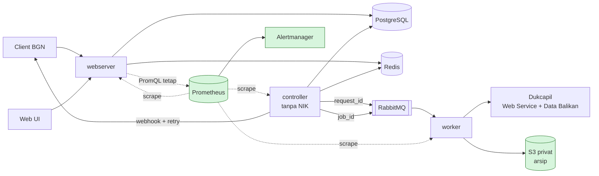

# ADR-0006: Delta arsitektur PoolRouter F1 — prioritas, alokasi, webhook retry, data balikan, dashboard, arsip, MFA

**Ringkasan:** F1 menambah tujuh kemampuan produksi (PRD v0.4.7 §11) di atas arsitektur F0 (ADR-0001 rev 15). Ketujuhnya ditambahkan **secara aditif**. Kontrak API downstream (`downstream-api.yaml`, SHAA-192) tidak berubah sama sekali. Modul kuota SHAA-195 tidak perlu dibongkar: alokasi reserved/shareable menjadi satu tahap tambahan **sesudah** cek global F0, di eksekusi Lua yang sama dengan pemberian token. Skrip F0 tidak diubah; upstream pool beralokasi memakai skrip baru yang menyusun blok F0 yang sama. Tahap itu hanya bisa menolak, tidak pernah memberi token di luar batas F0, sehingga bukti M-02 = 0 tetap berlaku. Satu-satunya perubahan yang tidak aditif ada di `admin-api.yaml`, yaitu respons login untuk peran yang wajib MFA. Konsumennya hanya Web UI di repo yang sama. Job F1 yang membaca NIK (data balikan, arsip, restore) dijalankan di worker, bukan di controller, sehingga invarian F0 "controller tidak membaca NIK" tetap terjaga. Langkah berikutnya: delta data contract (Klaus), lalu hand-off implementasi F1 oleh Fitcher setelah paket F1 lengkap.

- **Pemilik:** Shu
- **Tanggal:** 2026-11-04
- **Status:** final (rev 3), 2026-11-04. Difinalkan Shu sebagai leader Engineering sesuai arahan owner SHAA-180 dan `shaal-playbook` bagian 3; Luca menegaskan di SHAA-295 bahwa ADR project tidak diputuskan Luca. Jalur review: review keamanan D7 oleh Hauser (B1 dan B2 tertutup di rev 2, tanpa temuan blocking baru) dan quality gate Ridley (approve, tiga catatan non-blocking). Rev 3 memasukkan ketiga catatan Ridley (§3 butir 2 dan 6, uji wajib §3, §9 butir 6, §12). Nilai berlabel [asumsi] tetap berlaku sampai owner/BGN menjawab D-08, D-10, dan Q-02 (§14); perubahan nilai default tidak membuka ulang keputusan ini.
- **Issue:** SHAA-295 (induk SHAA-290)
- **Difinalkan oleh:** Shu
- **Lokasi akhir:** `docs/adr/0006-delta-arsitektur-f1.md` di repo `faisalcayunda/PoolRouter`, di-commit pelaksana saat hand-off F1. Sampai saat itu, lampiran di SHAA-295 adalah salinan resmi.
- **Hubungan dengan ADR lain:** melengkapi ADR-0001 rev 15, ADR-0002 rev 5, ADR-0003 rev 4, dan ADR-0004 rev 4. Satu butir ADR-0001 diganti, yaitu lokasi job F1: ADR-0001 §2 dan §7.2 menyebut "job F1 di controller"; ADR ini memindahkannya ke worker (D4, D6). Butir lain ADR-0001 tetap berlaku. ADR-0005 (ekstensi F2, SHAA-298) ditulis lebih dulu dan meminta ADR F1 menyebut penyesuaian di titik "filter alokasi"; penyesuaiannya ada di §4 butir 13. Nomor ADR-0005 sudah dipakai F2, jadi ADR F1 memakai ADR-0006.

## 1. Konteks

Sumber: PRD v0.4.7 §6, §7, §11, §12 (K-04, K-11, K-13, K-24, K-37, K-40, D-08, D-10); BRD/US F1 v0.1 (SHAA-294, approve): US-05A, US-05B, US-06B, US-13, US-11, US-14B, US-24, BR-F1-01…15; data contract v0.7.10 (§3.6, §3.7, §5, §8.3, §8.4, H-01…H-03, EN-04); ADR-0001 rev 15 (termasuk §3a K-20); ADR-0005 F2 (SHAA-298). Acuan ini sama dengan acuan hand-off F0 terbaru (SHAA-175, diperbarui Fitcher 2026-11-03).

Fakta F0 yang dipakai di bawah: downstream pool terhubung ke upstream pool lewat `downstream_pool_rute` (F0: satu rute aktif); `request.upstream_pool_id` baru terisi saat dispatch (EN-04); skrip Lua F0 tersusun dari blok bersama `bersama.lua` (ADR-0005 §8).

Batasan yang mengikat:

| Ref | Batasan | Dampak |
|---|---|---|
| SHAA-290, BR-F1-06 | Kontrak F0 (SHAA-192) dan modul kuota SHAA-195 tidak diubah tanpa catatan scope di SHAA-175 | Semua desain di bawah aditif; tidak ada catatan scope yang dibutuhkan (§10) |
| M-02, R-01 | 0 percobaan di atas `kuota_efektif` per 24 jam | Alokasi tidak boleh melonggarkan cek global F0 |
| K-17, ADR-0001 §2 | Broker hanya membawa id; controller tidak membaca NIK | Job F1 yang membaca NIK dijalankan di worker; pesan hanya membawa id |
| ADR-0002 D4 | Egress ke provider hanya dari webserver dan worker (IP tetap) | Pengiriman data balikan ke Dukcapil lewat worker |
| K-37 | MFA TOTP wajib untuk auditor dan platform admin sebelum produksi | D7 |
| D-08 (terbuka) | Format, transport, dan ack API Data Balikan Dukcapil belum diketahui | D4 membangun mesin dan port tanpa mengarang format kabel |
| D-10, Q-02 (terbuka) | Default aging; retensi online dan arsip | Nilai di ADR ini **default yang dapat dikonfigurasi** dan ditandai [asumsi] |
| K-22 | ±11,6 percobaan/s, 1 juta/hari | Semua mekanisme berskala kecil; tidak ada komponen baru demi performa |

Di luar lingkup ADR ini: R-21…R-33 dari roadmap pra-produksi, C-07, C-08, dan M-04 (OQ-F1-08 BRD, keputusan Fitcher); multi upstream dan N:M (F2); infrastruktur produksi (ADR infrastruktur terpisah setelah lokasi hosting diketahui).

## 2. Peta perubahan

| Butir | Story | Komponen yang berubah | Kontrak F0 yang disentuh |
|---|---|---|---|
| D1 Prioritas + aging | US-05A | controller (job aging, urutan dispatch tetap) | Tidak ada; kolom `prioritas_efektif` sudah ada di contract |
| D2 Alokasi reserved/shareable | US-05B | Skrip Lua kuota (tahap baru), intake, rebuild, quota tracker | Modul SHAA-195: tahap aditif sesudah cek global (§10) |
| D3 Webhook retry | US-06B | Job webhook controller | Tidak ada; header Standard Webhooks sama |
| D4 Data balikan | US-13 | Controller (penjadwal), worker (penyusun + pengirim) | Tidak ada |
| D5 Dashboard + alert | US-11 | Admin API (baca Prometheus), Prometheus, Alertmanager | Katalog metrik §5a.9 ditambah (aditif) |
| D6 Arsip + pencarian arsip | US-14B | Controller (penjadwal), worker (arsip, restore), S3 | Tidak ada |
| D7 MFA TOTP | US-24 | Sesi admin, CLI pengguna | `admin-api.yaml`: login dua langkah (§10) |

## 3. D1 — Prioritas ketat dan aging (K-11, US-05A)

**Fakta F0.** Dispatcher sudah memilih dengan urutan `(prioritas_efektif, dispatch_key)` (ADR-0001 §4), dan contract sudah punya kolom `prioritas` dan `prioritas_efektif` (F0: sama) serta nilai `alasan = aging` di `request_status_history`. F1 hanya mengisi mekanisme yang menaikkan `prioritas_efektif`.

| Opsi | Kelebihan | Kekurangan | Risiko |
|---|---|---|---|
| A. Prioritas efektif dihitung di `ORDER BY` dari umur request | Tanpa job | Indeks tidak bisa dipakai; kenaikan tidak tercatat (AC US-05A butir 2) | Sedang: kueri dispatch melambat seiring antrean |
| **B. Job aging di controller memperbarui `prioritas_efektif` dengan compare-and-set dan menulis riwayat** | Indeks parsial `(prioritas_efektif, dispatch_key) WHERE status = 'queued'` tetap dipakai, dengan filter downstream pool yang punya rute ke upstream pool itu (EN-04: `upstream_pool_id` belum terisi sebelum dispatch); setiap kenaikan tercatat | Satu job kecil lagi di controller | Rendah |
| C. Prioritas bawaan RabbitMQ | — | Prioritas tidak bisa diubah setelah pesan masuk (PRD risiko 5) | Ditolak |

**Keputusan: B.**
1. Konfigurasi per downstream pool: `prioritas` (1 = tertinggi, rentang 1…`prioritas_maks`) dan `aging_ambang_detik`. Default `prioritas_maks` = 5 dan `aging_ambang_detik` = 600 (10 menit) **[asumsi, D-10]**, rentang 60–86.400; `0` = aging mati untuk pool itu.
2. Saat intake, nilai ambang di-snapshot ke request (`aging_ambang_detik`), sama seperti TTL (AC US-05A butir 4). Intake juga mengisi `prioritas_diubah_at` = waktu intake; tanpa nilai awal itu, job aging (butir 3) tidak pernah memilih request tersebut. Perubahan ambang hanya berlaku untuk request baru.
3. Job aging berjalan di controller leader setiap 30 detik: `UPDATE request SET prioritas_efektif = prioritas_efektif − 1, prioritas_diubah_at = now() WHERE status = 'queued' AND prioritas_efektif > 1 AND aging_ambang_detik > 0 AND prioritas_diubah_at + aging_ambang_detik ≤ now()`, ditambah satu baris `request_status_history` (`alasan = aging`, tingkat asal dan tujuan) dalam transaksi yang sama. Satu putaran menaikkan paling banyak satu tingkat per request. Job ini hanya membaca kolom status dan prioritas, jadi tetap tanpa NIK.
4. Request yang menunggu retry (`queued`, `attempt_count > 0`) ikut menua; `not_before` tetap membatasi kapan ia boleh didispatch.
5. Anti-pola NIK (BR-F1-02) tidak berubah: request yang naik tingkat bercampur dengan request di tingkat tujuan dan diurutkan dengan `dispatch_key` acaknya sendiri. Sync tidak memakai antrean, jadi tidak terkena aging.
6. **Batas kelaparan.** Request dengan prioritas `p` mencapai tingkat 1 paling lambat `(p − 1) × (ambang + 30 detik)`, karena setiap kenaikan mereset `prioritas_diubah_at` dan job berjalan tiap 30 detik. Dengan default (p = 5, ambang 10 menit) batasnya 42 menit. Di tingkat 1, urutan acak tidak menjamin FIFO. Batas atasnya tetap TTL (K-18), seperti di F0. Ini diterima karena intake 429 menjaga panjang antrean ≤ kuota harian. Metrik `poolrouter_antrean_umur_tertua_seconds` (F0) dipakai untuk alert.

**Uji wajib:** property test urutan pilih (tingkat lebih tinggi selalu lebih dulu bila token ada); uji kelaparan dengan jam palsu (AC US-05A butir 7); uji statistik pengacakan dalam satu tingkat dengan N seed berbeda (catatan non-blocking Ridley di SHAA-294), bukan uji "tidak identik"; N dan ambang statistiknya dipilih pelaksana agar uji tidak flaky, dan nilainya dicatat di PR (catatan Ridley 3, SHAA-295).

## 4. D2 — Alokasi exact/persentase, reserved/shareable (K-13, US-05B)

**Model.** Satu upstream pool dilayani beberapa downstream pool lewat baris `downstream_pool_rute` (A-F1-04; strategi multi rute tetap F2). Kapasitas `kuota_efektif` (Q) satu upstream pool dibagi menjadi **anggaran**:
- setiap rute yang punya alokasi: anggaran `a_i` = angka tetap, atau `floor(persen_i × Q)` yang dihitung ulang saat Q berubah;
- **sisa tak teralokasi** `a_sisa = Q − Σ a_i`, yang selalu bersifat shareable.

Atribut alokasi disimpan **per baris `downstream_pool_rute`** (pasangan downstream pool dan upstream pool), bukan per downstream pool: `alokasi_jenis` (`exact` | `persen` | tanpa alokasi), `alokasi_nilai`, `sifat` (`reserved` | `shareable`), `boleh_pinjam` (bool). Alasannya: alokasi adalah pembagian kapasitas **satu upstream pool**, dan di F2 satu downstream pool bisa punya beberapa rute (ADR-0005 D1). Di F1 setiap downstream pool punya satu rute, jadi bagi pengguna hasilnya sama dengan "alokasi per downstream pool". Rute tanpa alokasi hanya memakai sisa tak teralokasi; secara konfigurasi ia sama dengan `a_i = 0, boleh_pinjam = true`.

| Opsi | Kelebihan | Kekurangan | Risiko M-02 |
|---|---|---|---|
| A. Ditegakkan di dispatcher dari hitungan PostgreSQL | Tanpa ubah Lua | Tidak atomik dengan jalur sync di webserver; dua sumber hitungan | Sedang |
| B. Alokasi sebagai upstream pool terpisah per client | Tanpa kode baru | Tidak ada peminjaman; kuota Dukcapil terpecah menjadi beberapa counter global | Tinggi: Σ counter terpisah tidak dijaga satu cek |
| **C. Tahap anggaran di eksekusi Lua yang sama dengan pemberian token, sesudah cek global F0; setiap percobaan dibebankan ke tepat satu anggaran** | Atomik untuk sync dan async; reserved terjamin secara konstruksi; cek global F0 tidak berubah | Skrip Lua lebih panjang (iterasi ≤ jumlah downstream pool per upstream pool); kolom sumber anggaran di log | Rendah |

**Keputusan: C.**

1. **Urutan cek dalam satu eksekusi Lua** (dispatch dan sync). Skrip F0 tidak diubah. Upstream pool yang punya minimal satu rute beralokasi memakai skrip baru `token_alokasi.lua` (nama final ditetapkan pelaksana), yang memanggil blok `bersama.lua` yang sama untuk tahap 1 lalu menambah tahap 2. Upstream pool tanpa alokasi tetap memakai skrip F0, sehingga konfigurasi F0 menjalankan kode yang sama persis.
   1. Cek F0 apa adanya: `pr:siap`, token rate, porsi sync (K-10), retry budget, dan `terpakai + slot_aktif < Q` (ADR-0001 §5a.1 butir 3). Bila gagal, jawaban sama dengan F0.
   2. **Tahap anggaran (baru).** Untuk downstream pool `d`, pilih anggaran pertama yang masih punya ruang (`u_x < a_x`, dengan `u_x` = terpakai anggaran `x` dalam jendela + slot aktifnya): (a) anggaran `d` sendiri; (b) bila `boleh_pinjam_d`: sisa tak teralokasi; (c) bila masih `boleh_pinjam_d`: anggaran downstream pool `shareable` lain, mulai dari ruang terbesar. Anggaran `reserved` milik pool lain tidak pernah dipilih. Bila tidak ada, skrip menjawab `anggaran_habis`: dispatcher melewati pool itu (butir 8), dan sync menjawab 429 `kuota_habis` (butir 9).
   3. Token diberikan, slot dicatat dengan sumber anggaran, dan percobaan dibebankan ke anggaran terpilih.
2. **Mengapa M-02 tetap aman.** Tahap 2 hanya bisa menolak, tidak pernah memberi token yang ditolak tahap 1. Bukti batas atas di ADR-0001 §5a.1 butir 4–7 tidak berubah.
3. **Mengapa reserved terjamin.** Setiap percobaan dibebankan ke satu anggaran yang masih punya ruang, dan admin API menjaga `Σ a_i ≤ Q`. Akibatnya `Σ u_x ≤ Σ a_x ≤ Q`, dan anggaran reserved hanya dipakai pemiliknya. Pool reserved selalu bisa memakai `a_r` dalam setiap jendela, kecuali kapasitas global terpotong oleh slot kedaluwarsa (sudah dicakup margin).
4. **Konsekuensi shareable yang disengaja.** Anggaran shareable yang sedang dipinjam bisa habis sebelum pemiliknya memakainya. Pemilik lalu mendapat 429, kecuali ia sendiri `boleh_pinjam` dan ada ruang di tempat lain. Pada mode `bergulir_24j`, kapasitas itu pulih bertahap dalam 24 jam. Admin yang butuh jaminan memilih `reserved`. Ini ditulis di layar konfigurasi (masukan untuk UX SHAA-303).
5. **Pencatatan pinjaman (AC US-05B butir 4).** Kolom baru `transaction_log.sumber_anggaran` berisi `downstream_pool_id` pemilik anggaran atau `sisa`. Pinjaman adalah baris dengan `sumber_anggaran` ≠ downstream pool request-nya. Pemberi dan peminjam terbaca langsung dari baris log, dan dari situ rebuild dan DQ dihitung.
6. **Jendela.** Anggaran memakai fungsi periode dan ember yang sama dengan counter F0 (`requested_at`, ember 10 menit, mode `bergulir_24j` atau `kalender`; ADR-0001 §5a.1 butir 1a–1d). Kunci Redis baru: `anggaran:{pool}:{sumber}` (ember) dan semaphore per sumber.
7. **Intake (K-12).** Cek F0 `terpakai + antre ≥ Q` (`kuota_intake.lua`) tetap. Tambahan untuk rute beralokasi, di skrip aditif `kuota_intake_alokasi.lua`: tolak 429 `kuota_habis` bila `antre_d ≥ ruang_d`. Hitungan `antre_d` memakai kunci `antre:dp:{downstream_pool_id}`, kunci yang sama dengan rencana ADR-0005 D1 butir 8; F1 yang pertama membuatnya, F2 memakainya ulang. Nilai `ruang_d` = ruang anggaran sendiri, ditambah ruang sisa dan shareable bila `boleh_pinjam_d`. Cek intake adalah estimasi penerimaan, sama seperti di F0; penegakan atomiknya di dispatch. Request async yang sudah diterima tetapi kehilangan ruang karena dipakai pool lain tetap `queued` sampai ruang pulih atau TTL habis (`expired`).
8. **Dispatcher.** Bila Lua menolak karena anggaran, dispatcher menandai downstream pool itu "anggaran habis" untuk siklus berjalan dan melanjutkan ke kandidat dari pool lain. Satu pool yang habis tidak menahan pool lain (tidak ada head-of-line blocking).
9. **Kode respons.** Tetap `kuota_habis` + `Retry-After`. Kontrak API downstream tidak berubah. `Retry-After` dihitung dari batasan yang mengikat: ember tertua anggaran yang paling cepat pulih, atau batas global. Untuk analitik, `request.reject_lingkup` (`upstream_pool` | `anggaran`) dicatat di baris `rejected` (usulan untuk Klaus).
10. **Validasi admin API (422).** `Σ a_i ≤ Q`. Perubahan `kuota_harian` atau `margin_kuota` yang membuat alokasi exact melampaui Q ditolak dengan jumlah kelebihannya; admin menurunkan alokasi dulu. Perubahan alokasi berlaku untuk pemberian token berikutnya dan dicatat di audit konfigurasi. Request yang sedang `in_flight` tidak terpengaruh.
11. **Rebuild Redis (§5a.2).** Ditambah: ember per anggaran dari `COUNT` log per (`sumber_anggaran`, ember); `antre` per downstream pool dari PostgreSQL; semaphore per sumber dari request `dispatched`/`in_flight`. Aturan konservatif F0 (nilai terbesar dari snapshot dan `COUNT`, TTL slot penuh) berlaku sama.
12. **Quota tracker (US-12).** Per downstream pool: anggaran, terpakai, sisa, pinjaman masuk, dan pinjaman keluar.
13. **Penyesuaian terhadap ADR-0005 D1 butir 11 dan §7.** ADR-0005 menggambar urutan "filter alokasi F1 → pemilih rute F2 → token F0". ADR ini menetapkan bahwa alokasi **bukan** filter terpisah di depan pemilih rute, melainkan tahap 2 di dalam skrip token per upstream pool, karena hanya di sana cek bisa atomik dengan pemberian token. Di F2, pemilih rute memperlakukan jawaban `anggaran_habis` dari satu kandidat sama seperti "tidak ada token", lalu mencoba kandidat berikutnya. Anggaran tetap per (downstream pool, upstream pool), sesuai butir Model. Invarian I-2 ADR-0005 tetap berlaku.

**Migrasi dari F0.** Satu rute tanpa alokasi berarti `a_sisa = Q` dan semua percobaan dibebankan ke `sisa`. Perilakunya identik dengan F0. Tidak ada data F0 yang ditulis ulang; baris log F0 dengan `sumber_anggaran` NULL dibaca sebagai `sisa`.

**Uji wajib (perluasan property test SHAA-195):** N pemanggil acak, beberapa downstream pool reserved, shareable, dan peminjam, kuota kecil, sync dan async bercampur. Invarian yang diuji: total ≤ Q per jendela (M-02); `u_r ≤ a_r` dan pool reserved selalu mendapat `a_r` bila ia meminta; tidak ada beban ke anggaran reserved pool lain; porsi sync tetap. Ditambah uji rebuild setelah failover dengan pinjaman berjalan, dan uji `Retry-After`.

## 5. D3 — Retry webhook (US-06B, OQ-F1-04)

**Fakta F0.** Pola outbox: `webhook_status = menunggu`, klaim compare-and-set `webhook_attempt_count` 0 → 1, satu kali kirim, `webhook_log` per percobaan dengan `attempt_no`. Contract §3.6 sudah menyebut bahwa retry F1 menambah baris tanpa mengubah definisi.

**Keputusan: perluas klaim F0 menjadi n → n+1 dengan jadwal; status request tidak pernah disentuh.**
1. Kolom baru `request.webhook_not_before`. Klaim: `UPDATE … SET webhook_attempt_count = n + 1 WHERE webhook_status = 'menunggu' AND webhook_attempt_count = n AND webhook_not_before ≤ now()`. `webhook_status` tetap `menunggu` di antara percobaan, lalu `terkirim` atau `gagal` di akhir. Tidak ada nilai status baru.
2. **Kebijakan default (konfigurasi platform, audit konfigurasi):** `webhook_batas_percobaan` 6 (rentang 1–10). Jeda sebelum percobaan ke-(n+1) = `min(cap, base × 4^(n−1))` dikali faktor acak 0,8–1,2, dengan `base` 30 s dan `cap` 2 jam. Jadwal nominalnya 30 s, 2 m, 8 m, 32 m, 2 j; total ±2 jam 43 menit. Sumber acak memakai trait `SumberAcakBackoff` yang sama (ADR-0001 §5a.3), sehingga uji bisa deterministik.
3. **Di-retry:** `gagal_jaringan` (timeout, koneksi, TLS), HTTP 5xx, 408, dan 429. Bila client mengirim `Retry-After`, nilai itu dipakai selama ≤ `cap`. **Tidak di-retry:** 4xx lain (termasuk 410), 3xx (`redirect_ditolak`, W-06), `ditolak_allowlist` (W-05, W-07), dan `gagal_internal`/`dekripsi_gagal`. Kelas tanpa retry adalah masalah konfigurasi yang butuh tindakan manusia; retry hanya mengulang kegagalan yang sama.
4. **Berhenti lebih awal.** Setiap klaim menjalankan urutan kirim F0 (contract §3.6) dari awal. Bila `client_webhook.aktif = false` saat retry tertunda, langkah (1) F0 berlaku: `webhook_status = tidak_dikirim`, tanpa koneksi keluar dan tanpa baris `webhook_log` baru; baris percobaan sebelumnya tetap sebagai riwayat. **Penonaktifan client tidak menghentikan retry**, sesuai ADR-0001 rev 15 §3a.5: selama client nonaktif, webhook adalah satu-satunya jalan client mengetahui status akhir. Untuk menghentikannya, platform admin menonaktifkan konfigurasi webhook client. Ini berbeda dari AC US-06B butir 6 BRD F1 v0.1 ("atau client dinonaktifkan"); ADR-0001 §3a.5 yang berlaku, dan BRD perlu diselaraskan. Bila `output_payload` sudah lewat `completed_at` + TTL (S-05), status menjadi `gagal` dengan `hasil_kedaluwarsa`. Dengan default di atas, kondisi ini hampir tidak pernah terjadi (±3 jam ≪ TTL 24 jam), tetapi dicek di kueri klaim.
5. **Controller mati di antara kirim dan commit.** F0 menutup klaim macet sebagai `gagal` tanpa kirim ulang. F1 menulis baris `webhook_log` untuk percobaan itu (`hasil = gagal_internal`, `error_class = klaim_kedaluwarsa`, nilai baru), lalu menjadwalkan percobaan berikutnya. Akibatnya pengiriman menjadi *at-least-once*. Ini sudah tercakup kontrak client F0: panduan Standard Webhooks mewajibkan dedupe per `webhook-id` (= `request_id`, ADR-0001 §5a.6). Tidak ada perubahan kontrak client.
6. **Isolasi.** Paling banyak 4 pengiriman bersamaan per client dan 32 total per controller. Client yang lambat tidak menahan client lain. Job webhook tidak memakai Redis kuota maupun token upstream (A-F1-05), dan tidak berbagi pool koneksi dengan dispatcher.
7. **Tanda tangan.** Setiap percobaan ditandatangani ulang dengan `webhook-timestamp` baru dan secret versi aktif saat kirim. Header `poolrouter-secret-versi` mengikuti versi itu.
8. Pengiriman ulang manual oleh client owner tidak ada di BRD F1, jadi tidak dibangun. Polling (US-17) tetap jalur cadangan.

**Uji wajib:** uji tabel klasifikasi retry; jadwal dengan stub acak; restart controller saat retry tertunda (NFR-03); klaim macet menghasilkan tepat satu baris `klaim_kedaluwarsa` dan satu kirim ulang; client lambat tidak mengubah latensi dispatch.

## 6. D4 — Data balikan otomatis (US-13, K-24)

**Fakta.** Contract §5 sudah menetapkan `data_balikan_batch`, `data_balikan_item`, eligibility (usulan), idempotensi, dan aturan tahan H-01/H-02. Format kabel, transport, autentikasi, dan ack Dukcapil masih terbuka (D-08).

| Opsi | Kelebihan | Kekurangan | Risiko |
|---|---|---|---|
| A. Tunggu D-08 sebelum membangun apa pun | Tanpa kerja ulang | Seluruh US-13 terblokir; rekaman H-01 makin lama tertahan online | Tinggi (jadwal, minimisasi data) |
| **B. Bangun mesin batch di balik port `PengirimDataBalikan`; adapter Dukcapil menyusul setelah D-08** | Penjadwalan, penyusunan, idempotensi, retry, pelepasan H-01, dan alert bisa selesai dan diuji dengan adapter mock | Adapter dan pemetaan format menjadi issue kecil terpisah yang terblokir D-08 | Rendah |
| C. Ekspor berkas untuk dikirim manual oleh BGN | Cepat | NIK keluar sistem tanpa kendali akses dan tanpa audit pengiriman | Ditolak |

**Keputusan: B.**
1. **Lokasi eksekusi.** Controller hanya menjadi penjadwal: saat pemicu `jumlah_n` atau `periode` terpenuhi (dihitung dari kolom tanpa NIK), ia menerbitkan pesan berisi `job_id` ke antrean job `pr.jobs` lewat port antrean F0. Penyusunan dan pengiriman dijalankan **worker** dengan role `pr_job_balikan` di pool koneksi tersendiri. Alasan: (a) invarian F0 "controller tidak membaca NIK" tetap berlaku; (b) egress ke Dukcapil tetap hanya dari worker dan webserver lewat IP tetap (ADR-0002 D4), sehingga tidak ada batas kepercayaan baru; (c) resolve secret provider sudah ada di worker. Pesan job hanya membawa id (K-17).
2. **Satu batch aktif per provider.** Penyusunan dijaga advisory lock PostgreSQL per provider. Invarian "satu `request_id` hanya di satu batch selain `gagal_permanen`" **ditegakkan constraint database, bukan kode** (bentuknya ditetapkan Klaus, misalnya unique partial index atau kolom `request.data_balikan_batch_id`).
3. **Mesin status batch:** `disusun` → `dikirim` → `diterima` | `gagal` → `gagal_permanen`. Transisi memakai compare-and-set, seperti request. Retry kirim memakai full jitter dengan base 5 menit, cap 1 jam, dan batas 5 percobaan (konfigurasi per provider). Setelah habis → `gagal_permanen` dan alert (D5). Admin bisa menyusun ulang item dari batch `gagal_permanen` menjadi batch baru (contract §5.2).
4. **Idempotensi ke provider.** `batch_id` dikirim sebagai kunci idempotensi bila API Dukcapil menyediakannya (D-08). Bila worker mati setelah kirim dan sebelum commit, batch yang sama dikirim ulang dengan `batch_id` yang sama. Tanpa dukungan dedupe di sisi Dukcapil, satu batch bisa terlapor dua kali. Ini **risiko terbuka** yang ditutup oleh jawaban D-08; dicatat di §12.
5. **Format kabel.** Adapter per provider memetakan struktur internal ke format kabel, dengan versi di `format_version`. Body dibentuk secara streaming, `payload_hash` (SHA-256) dihitung saat dikirim, dan body tidak disimpan. Ukuran batch maksimum dikonfigurasi (default 10.000 item **[asumsi, D-08]**) agar memori worker terbatas. **Default pemicu (OQ-F1-02c, dapat dikonfigurasi per provider, [asumsi] sampai D-08 dijawab):** mana yang lebih dulu dari `jumlah_n` = 10.000 transaksi eligible atau `periode` harian pukul 00.00 Asia/Jakarta, dengan toleransi `jadwal_kirim_at` 1 jam. Konfigurasi data balikan (pemicu, N, periode, toleransi, endpoint, rujukan secret, `format_version`) menjadi bagian konfigurasi provider dengan `config_schema_version` = 2. Dokumen versi 1 dari F0 tetap valid (ADR-0002 rev 5 D3).
6. **Pelepasan H-01.** Setelah batch `diterima`, rekaman H-01 dilepas dan dihapus oleh job purge F0 menurut predikat yang sudah ada. Job data balikan tidak menghapus apa pun.
7. **Jejak.** Pembuatan dan pengiriman batch dicatat di `data_balikan_batch` (pemicu, jumlah item, hasil, `payload_hash`) tanpa NIK. Pengiriman ke provider adalah akses layanan dan tidak ditulis ke `audit_akses`, sama seperti panggilan worker ke Web Service. Pengiriman ulang manual oleh admin dicatat di audit konfigurasi.

**Yang terblokir D-08 (tidak dikarang):** adapter Dukcapil, pemetaan format dan tanggal, autentikasi, ack, dan perilaku duplikat. Issue implementasinya dibuat `backlog` dan baru dipromosikan setelah D-08 dijawab.

**Uji wajib:** idempotensi susun ulang; crash di tiap transisi dengan adapter mock (tidak ada item hilang dan tidak ada item ganda di batch aktif); pelepasan H-01 hanya setelah `diterima`; 0 NIK di log aplikasi, trace, dan metrik.

## 7. D5 — Dashboard dan alert (US-11)

| Opsi | Kelebihan | Kekurangan | Risiko |
|---|---|---|---|
| A. Grafana untuk operator | Cepat; panel kaya | Permukaan login dan RBAC kedua di luar PoolRouter; operator harus punya dua akun | Sedang (akses) |
| **B. Dashboard di Web UI PoolRouter; admin API membaca Prometheus di sisi server dengan kueri tetap; alert lewat Alertmanager** | Satu RBAC dan audit; angka di dashboard dan di alert berasal dari metrik yang sama | Prometheus menjadi dependensi produksi (memang dibutuhkan untuk alert); Web UI butuh pustaka chart | Rendah |
| C. Dashboard dari agregat PostgreSQL | Tanpa Prometheus | Agregasi berat di DB utama dan jalur angka kedua yang bisa berbeda dari alert | Sedang |

**Keputusan: B.**
1. **Sumber angka.** Katalog metrik F0 (ADR-0001 §5a.9) ditambah metrik aditif di §11. Admin API punya endpoint dashboard yang menjalankan **kueri PromQL tetap dari kode** (tanpa PromQL dari pengguna, sehingga tidak ada injeksi atau SSRF) ke Prometheus internal, lalu menyaring hasil per peran. Operator melihat semua pool. Client owner hanya melihat client-nya, bila OQ-F1-09 disetujui Fitcher. Tidak ada NIK, `request_id`, atau IP (label sudah dilarang sejak F0).
2. **Degradasi.** Bila Prometheus tidak bisa dijangkau, endpoint menjawab `503`, dan UI menampilkan "data tidak tersedia", bukan nol (AC US-11). Jalur request inti tidak bergantung pada Prometheus.
3. **Ambang alert yang bisa diubah admin (AC US-11 butir 5).** Ambang disimpan di konfigurasi PoolRouter, dicatat di audit konfigurasi, dan diekspor sebagai gauge `poolrouter_ambang_alert{nama}`. Aturan Prometheus bersifat statis di repo (IaC, Platform & SRE) dan membandingkan metrik dengan gauge itu. Admin mengubah angka tanpa menyentuh aturan, dan perubahan berlaku pada evaluasi berikutnya.
4. **Alert awal** (ambang dan durasi default ditetapkan Platform & SRE, direview Huan): error rate upstream per `error_class` (US-11); `kuota_terpakai / kuota_efektif` ≥ 80% dan ≥ 95%, per upstream pool dan per anggaran; Redis fail-closed; umur antrean tertua; rasio webhook `gagal`; batch data balikan `gagal_permanen` dan item eligible yang menunggu terlalu lama (DQ-20); job arsip gagal atau tertunda; `poolrouter_dlq_pesan > 0`; kredensial kedaluwarsa ≤ 30 hari (F0); platform admin ber-MFA kurang dari 2 (D7). Pengelompokan, inhibisi, dan pesan pulih (resolved) memakai Alertmanager.
5. **Kanal dan penerima** (OQ-F1-05): ditetapkan Platform & SRE bersama BGN. Isi notifikasi hanya label yang diizinkan dan nilai metrik.
6. **Chart di Web UI.** ADR-0003 §3.5 menunda pustaka chart ke F1 lewat aturan §6. Pustaka dipilih pelaksana frontend dengan syarat ADR-0003 §6 butir 3: lisensi MIT/Apache, tanpa skrip atau aset eksternal, dan alternatif tabel yang aksesibel untuk setiap chart (WCAG 2.2 AA). Keputusan akhirnya diajukan ke Shu.

## 8. D6 — Arsip log dan pencarian arsip (K-04, US-14B, OQ-F1-06)

**Fakta.** Contract §8.3 sudah menetapkan urutan arsip (tulis berkas → manifest → verifikasi DQ-15 → `archived_at` → hapus online, kecuali H-02), restore ke skema terpisah yang hanya bisa dibaca auditor dengan masa berlaku, dan usulan format Parquet. Default retensi sementara dari Luca (OQ-F1-03, dapat dikonfigurasi): 3 bulan (90 hari) online, lalu arsip selama masa PKS. Nilai final menunggu Q-02.

**Keputusan teknis arsip:**
1. **Lokasi eksekusi.** Sama seperti D4: controller menjadwalkan job harian per (tabel, provider, tanggal `requested_at` WIB) yang sudah lewat retensi, lalu worker menjalankannya dengan role `pr_job_arsip` di pool koneksi tersendiri.
2. **Format: Parquet** (selaras usulan contract), dengan kompresi zstd. Baris di dalam setiap objek diurutkan menurut `nik`, dengan row group ±128.000 baris dan bloom filter pada kolom `nik`. Alasan: pencarian per NIK cukup membaca footer dan row group yang cocok lewat range GET, tanpa memulihkan satu hari penuh (±3 GB/hari full payload, ADR-0001 §1). Alternatif NDJSON+zstd lebih sederhana ditulis, tetapi setiap pencarian harus membaca seluruh objek.
3. **Crate** (lewat aturan ADR-0004 §3; versi dan pin ditetapkan pelaksana): `object_store` dengan fitur `aws` untuk S3-compatible (termasuk OBS Huawei lewat API S3), serta `parquet` dan `arrow`. Penulis dan pembaca ada di balik port `PenyimpanArsip`, agar uji memakai implementasi memori atau MinIO di container Podman. Versi `rustls` harus tetap satu di workspace (risiko ADR-0004 §4.2); bila `object_store` memaksa versi lain, pelaksana menghentikan pekerjaan dan mengajukannya ke Shu.
4. **Integritas.** Manifest per objek berisi jumlah baris, rentang `kode_transaksi`, SHA-256, `versi_contract`, dan versi kunci HMAC NIK. Verifikasi DQ-15 membaca ulang objek, membandingkan hash dan jumlah baris, dan baru setelah itu baris online dihapus. Jalan ulang untuk tanggal yang sama menimpa kunci objek yang sama (idempoten).
5. **Bucket** (disiapkan Platform & SRE): privat, enkripsi at rest dengan KMS lingkungan, versioning aktif, dan object lock mode compliance **bila layanan target mendukung** (belum terverifikasi, contract §8.3; Platform & SRE memverifikasi sebelum go-live). Kredensial job arsip hanya `PutObject` dan `GetObject` pada prefiks arsip, tanpa `DeleteObject`. Kredensial restore hanya `GetObject`. Penghapusan di akhir masa arsip dilakukan lewat lifecycle rule bucket, bukan oleh aplikasi.

**Pencarian arsip (OQ-F1-06):**

| Opsi | Kelebihan | Kekurangan | Risiko |
|---|---|---|---|
| **A. Restore terarah ke skema `arsip_pulih` di PostgreSQL, lalu cari dengan fungsi auditor F0** | Kontrol akses, audit, dan masking memakai jalur F0 yang sudah diuji | Latensi menit, bukan detik | Rendah |
| B. Kueri langsung ke S3 (DataFusion/DuckDB) | Tanpa restore | Mesin kueri baru; NIK dibaca di luar kendali role database; audit harus dibangun ulang | Tinggi |
| C. Indeks NIK online untuk semua arsip | Pencarian cepat | Menahan pseudonim NIK online selama masa arsip; menambah tabel besar | Sedang |

**Keputusan: A.**
1. Auditor mengajukan permintaan restore dengan `alasan` wajib, provider, rentang tanggal, dan **opsional** NIK. Admin API mencatat `audit_akses` (`aksi = minta_restore`, nilai baru). Permintaan hanya menyimpan HMAC NIK untuk setiap versi kunci yang tercatat di manifest objek dalam rentang itu, ditambah 4 digit terakhir. NIK plaintext tidak disimpan dan tidak lewat broker.
2. Worker (`pr_restore`) membaca objek dalam rentang. Dengan NIK: hanya row group yang lolos bloom filter dan baris yang HMAC-nya cocok yang dipulihkan, sehingga rentang boleh panjang (default maksimum 12 bulan). Tanpa NIK: seluruh baris dipulihkan, dengan rentang maksimum 7 hari **[asumsi]**, karena volumenya. Untuk itu objek arsip menyimpan kolom `nik_hmac` di samping `nik`.
3. Status permintaan (`antre`, `berjalan`, `siap`, `gagal`, `kedaluwarsa`) terlihat oleh auditor (AC US-14B). Hasil di `arsip_pulih` hanya bisa dibaca lewat fungsi `SECURITY DEFINER` auditor (ADR-0001 §7.2) yang menulis `audit_akses` dengan `sumber = arsip`. Hasil pencarian menggabungkan data online dan pulihan, dengan penanda sumber.
4. Data pulihan dihapus otomatis 14 hari setelah `siap` (contract §8.3), oleh job yang sama. Aturan B-03 (restore tidak menghidupkan data yang sudah dihapus) tidak berlaku untuk skema ini, karena `arsip_pulih` adalah salinan sementara yang sengaja dibuat untuk auditor, bukan pemulihan tabel online. Batasnya masa berlaku 14 hari tersebut.
5. **Operator tidak mendapat akses arsip di F1.** Contract §8.3 menyatakan restore hanya bisa dibaca auditor. AC US-14B butir 6 ("operator tidak bisa mencari arsip berdasarkan NIK, NIK 4 digit akhir") tetap terpenuhi karena operator tidak punya akses arsip sama sekali. Bila Fitcher menginginkan akses arsip tersamar untuk operator, itu perubahan contract yang diputuskan Klaus lebih dulu.

**Uji wajib:** crash di setiap langkah urutan arsip (tidak ada baris online yang terhapus tanpa objek terverifikasi); verifikasi checksum sampel; restore terarah menemukan NIK sintetis yang ada dan tidak menemukan yang tidak ada; skema pulihan tidak terbaca role selain fungsi auditor; penghapusan otomatis setelah 14 hari.

## 9. D7 — MFA TOTP wajib untuk auditor dan platform admin (K-37, US-24, OQ-F1-07)

Teknologi sudah diputuskan di K-37 dan ADR-0003 §3.6: TOTP RFC 6238, secret dienkripsi seperti secret provider, 10 kode pemulihan, dan reset disetujui platform admin lain. ADR ini menetapkan alur dan penegakannya.

1. **Parameter TOTP:** HMAC-SHA1, 6 digit, langkah 30 detik (kompatibel dengan aplikasi authenticator umum), toleransi ±1 langkah. Secret 160 bit dari CSPRNG, disimpan dengan envelope encryption AES-256-GCM dan AAD = `pengguna_id` (pola ADR-0001 §7). **Anti-replay (atomik):** langkah waktu terakhir yang diterima disimpan per pengguna. Kode diterima hanya bila `UPDATE pengguna_mfa SET langkah_terakhir = $n WHERE pengguna_id = $id AND langkah_terakhir < $n` mengubah tepat satu baris, sehingga dua permintaan paralel dengan kode yang sama tidak bisa lolos bersamaan. Implementasi memakai HMAC dari `aws-lc-rs` (sudah ada), divalidasi dengan vektor uji RFC 6238 Lampiran B, tanpa crate TOTP. Base32 untuk URI `otpauth://` boleh memakai crate kecil lewat aturan ADR-0004 §3.
2. **Kode pemulihan:** 10 kode, masing-masing 10 karakter base32 (50 bit), di-hash argon2id seperti password. Ditampilkan sekali dengan pola dialog satu-kali ADR-0003 §3.6a. Setiap kode sekali pakai; pemakaiannya juga atomik (`UPDATE … SET dipakai_at = now() WHERE dipakai_at IS NULL`). Setiap pemakaian ditulis ke `audit_akses` (`aksi = pakai_kode_pemulihan`, nilai baru) dan menaikkan `poolrouter_mfa_kode_pemulihan_total`, yang memicu notifikasi ke kanal keamanan (D5). Sisa kode ditampilkan ke pengguna.
3. **Login dua langkah (`admin-api.yaml`).**
   - `POST /admin/v1/auth/login`: untuk pengguna tanpa peran wajib-MFA, perilakunya tetap seperti F0 (204 + cookie sesi). Untuk pengguna dengan peran auditor atau platform admin: 200 `{ "langkah": "mfa" }` atau `{ "langkah": "daftar_mfa" }`, ditambah cookie `__Host-pr_mfa` (token pra-sesi 256 bit, `HttpOnly`, `Secure`, `SameSite=Strict`, umur 5 menit, sekali pakai, terikat ke pengguna). Belum ada sesi.
   - `POST /admin/v1/auth/mfa`: menerima kode TOTP atau kode pemulihan; berhasil → 204 + cookie sesi F0 dengan `mfa_terverifikasi_at`. Token pra-sesi hangus setelah 5 kegagalan.
   - `POST /admin/v1/auth/mfa/daftar` dan `…/daftar/konfirmasi`: hanya dengan token pra-sesi berstatus `daftar_mfa` **dan** kode pendaftaran yang sah (butir 3a). Langkah pertama memeriksa kode pendaftaran, lalu mengembalikan URI `otpauth://` sekali (QR dirender di frontend tanpa layanan eksternal). Langkah kedua mengonfirmasi dengan satu kode TOTP, lalu menampilkan kode pemulihan sekali. Kode pendaftaran baru dinyatakan terpakai saat konfirmasi berhasil.
   - Pembatas login F0 (5 kegagalan per username per 15 menit) mencakup kegagalan password dan kegagalan kode. Pesan kegagalan kode bersifat generik dan tidak menyebut apakah kode TOTP atau kode pemulihan yang salah. **Catatan untuk Fitcher:** dengan alur dua langkah, mencapai langkah kode berarti password benar. Ini praktik umum, dan dengan pembatas login serta password 15 karakter risikonya diterima. AC US-24 butir 3 dibaca untuk langkah kode.
3a. **Kode pendaftaran di luar kanal login (rev 2, temuan B1 Hauser).** Password saja tidak cukup untuk mendaftarkan authenticator. Kalau cukup, penyerang yang memegang password auditor atau platform admin bisa mendaftarkan authenticator miliknya dan mengunci pemilik sah. Celah itu terbuka di tiga titik: aktivasi F1, sesudah reset MFA, dan saat peran wajib-MFA diberikan.
   - **Penerbit:** platform admin lain (≠ target) yang identitasnya terverifikasi menurut butir 6a, lewat CLI `terbit-kode-daftar --untuk <username>`. Penerbitan wajib di ketiga titik di atas: perintah beri peran auditor atau platform admin dan perintah reset MFA langsung menerbitkan kode untuk target.
   - **Bentuk:** 128 bit acak (CSPRNG), ditampilkan sekali di TTY penerbit, dan diserahkan ke target lewat kanal di luar sistem (tatap muka atau kanal yang ditetapkan SPTJM). Server hanya menyimpan SHA-256-nya, karena entropinya tinggi seperti API key (ADR-0001 §7). Kode terikat ke `pengguna_id` target, berumur 24 jam, sekali pakai, dan gugur setelah 5 percobaan salah. Hanya satu kode aktif per pengguna; penerbitan baru menggugurkan yang lama.
   - **Jejak:** `audit_akses` mencatat `terbit_kode_daftar` (penerbit, target, alasan) dan `daftar_mfa` (target, berhasil atau gagal). Nilai kode tidak pernah dicatat.
   - **Akibat untuk penyerang:** password yang bocor tidak cukup. Penyerang juga butuh kode yang hanya dipegang target, dan kodenya berumur pendek.
3b. **Bootstrap (rev 2, B1).** Ada dua keadaan ketika belum ada platform admin ber-MFA yang bisa menerbitkan kode:
   - **Lingkungan baru:** perintah bootstrap F0 (tabel pengguna kosong, ADR-0003 §3.6c) membuat platform admin pertama **dan** mendaftarkan TOTP-nya langsung di TTY CLI, tanpa lewat admin API. Secret ditampilkan di TTY, lalu dikonfirmasi dengan satu kode.
   - **Aktivasi F1 di lingkungan yang sudah berjalan:** perintah `bootstrap-mfa --oleh <username>` hanya bisa dijalankan bila jumlah platform admin ber-MFA = 0. Perintah ini memverifikasi password pelaku (TTY, tanpa echo), lalu mendaftarkan TOTP pelaku di TTY.
   - **Batas kepercayaan:** pada keduanya, kepercayaan bertumpu pada akses `exec` ke container ditambah password, dua hal yang di luar kanal login web. Setiap pemakaian ditulis ke `audit_akses` (`aksi = bootstrap_mfa`, nilai baru) dan memicu alert ke kanal keamanan. Begitu ada satu platform admin ber-MFA, perintah bootstrap menolak berjalan. Admin pertama itu lalu menerbitkan kode pendaftaran untuk pengguna lain (butir 3a).
   - Selama jumlah platform admin ber-MFA masih kurang dari 2 setelah bootstrap, alert §9 butir 6 tetap menyala sampai admin kedua terdaftar.
4. **Penegakan.** Middleware RBAC admin API menganggap peran auditor dan platform admin **tidak aktif** pada sesi tanpa `mfa_terverifikasi_at`. Akibatnya semua rute peran itu, termasuk ekspor, pembukaan payload, dan restore, ditolak 403 dan dicatat `akses_ditolak`. Fungsi `SECURITY DEFINER` auditor menerima flag MFA dari sesi sebagai lapis kedua. Konfigurasi `POOLROUTER_MFA_WAJIB=false` hanya diterima pada `POOLROUTER_ENV` `dev` dan `ci`; di lingkungan lain proses menolak start.
5. **Aktivasi.** Migrasi rilis F1 mencabut semua sesi pemegang peran auditor dan platform admin (AC US-24 butir 8). Kontrol kompensasi K-40 tetap aktif sampai MFA berjalan di produksi, kecuali Luca memutuskan lain (BRD US-24). Panjang password minimum tetap 15 sampai Fitcher memutuskan perubahan konfigurasi (ADR-0003 §3.6).
6. **Reset MFA (OQ-F1-07).**
   - **Jalur normal:** platform admin lain yang aktif dan ber-MFA mereset lewat CLI (atau lewat UI pengguna bila BRD F1 kelak memasukkannya). Syaratnya: identitas pelaku terverifikasi (butir 6a), pelaku ≠ target, dan `--alasan` wajib. Dalam satu transaksi: satu baris `audit_akses` (`aksi = reset_mfa`, nilai baru), pencabutan sesi target, dan penerbitan kode pendaftaran baru untuk target (butir 3a). Target mendaftar ulang dengan kode itu.
   - **Pencegahan kasus satu admin:** di `POOLROUTER_ENV` `poc` dan `prod`, penonaktifan atau pencabutan peran yang membuat platform admin aktif ber-MFA kurang dari 2 ditolak. Kondisi kurang dari 2 juga memicu alert (D5).
   - **Break-glass** (misalnya semua platform admin kehilangan perangkat TOTP dan kode pemulihan): perintah `reset-mfa-darurat`. Perintah ini mensyaratkan password **dua** platform admin aktif yang berbeda, keduanya diverifikasi di TTY dengan pembatas login. Selain itu wajib ada `--alasan` dengan rujukan insiden atau SPTJM. Hasilnya: `audit_akses` (`aksi = reset_mfa_darurat`, kedua pelaku tercatat), alert ke kanal keamanan, pencabutan sesi target, dan kode pendaftaran baru untuk target. TOTP tidak disyaratkan di jalur ini, karena justru TOTP yang hilang. Risiko sisanya (akses `exec` ditambah dua password yang bocor) dicatat di §12.
   - **Jendela satu admin.** Sesudah bootstrap (butir 3b) dan sebelum platform admin kedua selesai mendaftar, hanya ada satu platform admin ber-MFA. Selama jendela ini break-glass tidak bisa dijalankan (butuh dua admin berbeda) dan bootstrap juga menolak (sudah ada satu admin ber-MFA), sehingga kode pemulihan admin itu adalah satu-satunya jalan pemulihan. Karena itu prosedur bootstrap baru dinyatakan selesai setelah admin pertama menerbitkan kode pendaftaran untuk admin kedua dan admin kedua selesai mendaftar; lingkungan `poc`/`prod` tidak menerima auditor atau traffic sebelum syarat admin ≥ 2 terpenuhi (cek kesiapan). Bila admin pertama kehilangan TOTP dan kode pemulihan di jendela ini, pemulihan di luar aplikasi dan diperlakukan sebagai insiden. Risiko sisa dicatat di §12.
6a. **Verifikasi identitas pelaku CLI (rev 2, temuan B2 Hauser).** ADR-0003 §3.6c (F0) menerima `--oleh` sebagai pernyataan, tidak dibuktikan, dan menyebut risiko itu ditutup di F1. ADR ini menutupnya. Di `POOLROUTER_ENV` `poc` dan `prod`, **setiap** perintah CLI yang mengubah pengguna, peran, atau MFA memverifikasi `--oleh` sebelum menulis apa pun:
   - Verifikasi memakai password pelaku dan kode TOTP pelaku, dibaca dari TTY tanpa echo dan tidak pernah dari argumen.
   - Pelaku wajib platform admin aktif yang ber-MFA.
   - Pembatas login (5 kegagalan per username per 15 menit, Redis) dan anti-replay atomik butir 1 sama dengan jalur web, sehingga satu kode TOTP tidak bisa dipakai dua kali lintas web dan CLI.
   - Kegagalan verifikasi dicatat di audit seperti login gagal, dan perintah berhenti tanpa perubahan.
   - Pengecualiannya hanya perintah bootstrap (butir 3b) dan `reset-mfa-darurat` (butir 6), masing-masing dengan syaratnya sendiri.
   - Di `dev` dan `ci`, perilaku F0 tetap berlaku untuk seed dan uji.
   - Akibatnya, akses `exec` saja tidak cukup untuk mengaku sebagai admin lain. Risiko sisa ADR-0003 §3.6c tertutup untuk `poc` dan `prod`.
7. **Di luar keputusan ini:** MFA untuk operator dan client owner (A-F1-03), serta WebAuthn atau passkey (ditunda, K-37).

**Uji wajib:** vektor RFC 6238; replay kode yang sama ditolak, termasuk dua permintaan paralel dengan kode yang sama (tepat satu yang lolos), lintas web dan CLI; toleransi ±1 langkah; kode pemulihan sekali pakai di bawah permintaan paralel, dan setiap pemakaian menghasilkan satu baris `pakai_kode_pemulihan` dan satu kenaikan metrik; pendaftaran tanpa kode pendaftaran, dengan kode milik pengguna lain, dengan kode kedaluwarsa, atau sesudah 5 percobaan salah → ditolak; penerbitan kode baru menggugurkan kode lama; bootstrap ditolak bila sudah ada platform admin ber-MFA; perintah CLI ubah pengguna/peran/MFA di `poc`/`prod` tanpa password dan TOTP pelaku yang valid → ditolak tanpa perubahan; `reset-mfa-darurat` dengan satu password atau dua password dari orang yang sama → ditolak; sesi tanpa MFA ditolak di setiap rute auditor dan admin (uji tabel dari OpenAPI); pembatas login mencakup langkah kode; penolakan kondisi admin < 2; `MFA_WAJIB=false` ditolak di `poc`/`prod`.

## 10. Dampak ke F0: SHAA-195, SHAA-192, dan data contract

**Modul kuota SHAA-195 tidak perlu dibongkar dan tidak perlu diubah sekarang.**

| Bagian SHAA-195 | Dampak F1 | Sifat |
|---|---|---|
| Cek global `terpakai + slot_aktif < kuota_efektif`, `pr:siap`, token rate, porsi sync, retry budget | Tidak berubah; tetap tahap pertama | — |
| Fungsi periode dan ember dari `requested_at` di `core` | Dipakai ulang untuk anggaran | Tanpa perubahan |
| Skrip Lua F0 (`kuota_intake.lua`, `rate_limit_ambil.lua`, `attempts_tambah.lua`, `kuota_retry_after.lua`, `siap.lua`, `bersama.lua`) | Tidak berubah. Upstream pool beralokasi memakai skrip baru `token_alokasi.lua` dan `kuota_intake_alokasi.lua` yang menyusun blok `bersama.lua` yang sama, lalu menambah tahap anggaran **sesudah** cek global | Aditif; hanya bisa menolak |
| Kunci Redis | `anggaran:{pool}:{sumber}`, semaphore per sumber, dan `antre:dp:{downstream_pool_id}` (dipakai ulang F2) | Kunci baru; kunci F0 tidak berubah |
| Rebuild §5a.2 | Langkah tambahan untuk anggaran dan `antre` per downstream pool | Aditif |
| Quota tracker US-12 | Rincian per downstream pool | Aditif |
| Property test M-02 | Diperluas (§4, uji wajib) | Aditif |

Rekomendasi tidak mengikat untuk Flik: pertahankan struktur skrip "cek global → beri token" sebagai fungsi yang bisa disusun, dan jangan menyatukan kunci counter dengan asumsi satu downstream pool. Ini bukan perubahan scope, dan tidak ada yang saya minta diubah di SHAA-195.

**Kontrak API (SHAA-192):**
- `downstream-api.yaml`: **tidak berubah**. Tidak ada kode, field, header, atau status baru. Retry webhook memakai header dan `webhook-id` yang sama, dan pengiriman *at-least-once* sudah tercakup panduan dedupe F0.
- `admin-api.yaml`: endpoint baru (alokasi dan aging, ambang alert, dashboard, konfigurasi data balikan, status batch, permintaan restore, MFA). Satu perubahan perilaku: respons `POST /auth/login` untuk peran wajib-MFA (D7). Konsumennya hanya Web UI di repo yang sama, dan client-nya dibangkitkan ulang dari OpenAPI (ADR-0003 §4). Ini bukan kontrak eksternal, sehingga tidak butuh versi API baru.

**Catatan scope di SHAA-175:** tidak diperlukan, karena tidak ada perubahan pada F0 yang sedang diimplementasikan. Semua delta masuk hand-off F1.

**Delta data contract (aditif, untuk Klaus; bentuk final ditetapkan di contract):**

| Butir | Usulan |
|---|---|
| D1 | `request.aging_ambang_detik`, `request.prioritas_diubah_at`; konfigurasi downstream pool `prioritas`, `aging_ambang_detik`; riwayat `alasan = aging` dengan tingkat asal dan tujuan |
| D2 | Konfigurasi alokasi per baris `downstream_pool_rute` (`alokasi_jenis`, `alokasi_nilai`, `sifat`, `boleh_pinjam`); `transaction_log.sumber_anggaran`; `request.reject_lingkup`; DQ baru: Σ beban per anggaran ≤ anggaran per jendela, dan tidak ada beban ke anggaran reserved pool lain |
| D3 | `request.webhook_not_before`; nilai `webhook_last_error` `hasil_kedaluwarsa`; `error_class` `klaim_kedaluwarsa`; konfigurasi kebijakan retry |
| D4 | Bentuk constraint invarian satu batch aktif; konfigurasi data balikan per provider (`config_schema_version` = 2); `pr_job_balikan` dijalankan di worker |
| D6 | Kolom `nik_hmac` dan versi kunci di objek arsip; tabel manifest arsip dan permintaan restore; nilai `aksi` `minta_restore`; `sumber = arsip` di audit; `pr_job_arsip`/`pr_restore` di worker |
| D7 | Tabel MFA pengguna (ciphertext, AAD, langkah terakhir, kode pemulihan ter-hash dengan `dipakai_at`); tabel kode pendaftaran (hash SHA-256, `pengguna_id`, penerbit, kedaluwarsa, jumlah gagal, `dipakai_at`); nilai `aksi` `terbit_kode_daftar`, `daftar_mfa`, `bootstrap_mfa`, `pakai_kode_pemulihan`, `reset_mfa`, `reset_mfa_darurat`; `sesi.mfa_terverifikasi_at` |
| §11 | Label metrik baru `downstream_pool_id` dan `sumber_anggaran` (bukan data pribadi) di daftar label yang diizinkan |

## 11. Metrik baru (aditif ke ADR-0001 §5a.9)

| Metrik | Jenis | Label | Untuk |
|---|---|---|---|
| `poolrouter_anggaran_terpakai`, `poolrouter_anggaran_efektif` | gauge | `upstream_pool_id`, `sumber_anggaran` | US-05B, quota tracker, alert |
| `poolrouter_pinjaman_total` | counter | `upstream_pool_id`, `downstream_pool_id`, `sumber_anggaran` | Pinjaman masuk/keluar |
| `poolrouter_aging_total` | counter | `upstream_pool_id` | US-05A |
| `poolrouter_webhook_menunggu` | gauge | — | Backlog retry |
| `poolrouter_webhook_total` | counter (F0) | `hasil` (nilai F1 masuk himpunan yang sama) | US-06B |
| `poolrouter_data_balikan_batch_total` | counter | `hasil` | US-13, M-05 |
| `poolrouter_data_balikan_tertunda` | gauge | — | DQ-20 |
| `poolrouter_arsip_job_total` | counter | `hasil` | US-14B |
| `poolrouter_arsip_tertunda_hari` | gauge | — | Arsip tertinggal |
| `poolrouter_restore_total` | counter | `hasil` | US-14B |
| `poolrouter_admin_mfa_aktif` | gauge | — | Alert < 2 (D7) |
| `poolrouter_mfa_kode_pemulihan_total` | counter | — | Notifikasi pemakaian kode pemulihan (D7) |
| `poolrouter_ambang_alert` | gauge | `nama` (himpunan tertutup) | D5 butir 3 |

## 12. Delta threat model (masukan untuk revisi TM-0001)

| Alur baru | Ancaman utama | Kontrol | Risiko sisa |
|---|---|---|---|
| Data balikan ke Dukcapil | Spoofing endpoint; NIK bocor di log | Egress dan `tls_trust` per provider yang sama (ADR-0002 D4–D5); body tidak disimpan; 0 NIK di log (uji) | Kirim ganda bila Dukcapil tanpa dedupe (D-08) |
| Arsip S3 | Pencurian kredensial; penghapusan atau perubahan objek | Kredensial tanpa Delete; versioning dan object lock bila didukung; SHA-256 di manifest | Object lock belum terverifikasi; NIK di objek dilindungi enkripsi bucket saja sampai R-24 |
| Restore | Elevasi: membaca data pulihan tanpa audit | Hanya lewat fungsi auditor; masa berlaku 14 hari; HMAC sebagai filter | Volume restore tanpa NIK dibatasi 7 hari |
| MFA | Brute force; replay; phishing; pendaftaran authenticator oleh penyerang yang memegang password; peniruan admin lewat CLI | Pembatas login; anti-replay atomik; kode pemulihan argon2id dengan audit dan notifikasi; kode pendaftaran di luar kanal login (§9 butir 3a); verifikasi password + TOTP pelaku CLI (butir 6a) | TOTP tidak tahan phishing (WebAuthn ditunda); bootstrap dan break-glass bertumpu pada akses `exec` ditambah password, dengan audit dan alert; selama jendela satu admin sesudah bootstrap, kehilangan TOTP dan kode pemulihan berarti terkunci dan pemulihan di luar aplikasi (§9 butir 6) |
| Webhook retry | Amplifikasi ke client | 6 percobaan, ≤ 4 bersamaan per client, tanpa retry pada 4xx | — |
| Dashboard (Prometheus) | Injeksi atau SSRF lewat kueri | Hanya PromQL tetap di kode; Prometheus internal | — |
| Alert | Data pribadi di notifikasi | Hanya label yang diizinkan | — |

TM-0001 direvisi Shu bersama hand-off F1, mengikuti aturan ADR-0001 §7.3: ditinjau ulang setiap ada alur atau batas kepercayaan baru.

## 13. Konsekuensi

- **Lebih mudah:** F0 berjalan ke PoC tanpa perubahan; kontrak client BGN stabil; reserved punya jaminan konstruksi; data balikan, arsip, dan alert bisa diuji ujung ke ujung sebelum D-08 dijawab; controller tetap tanpa akses NIK.
- **Lebih sulit atau perlu dikerjakan:** skrip Lua dan property test kuota menjadi lebih kompleks (D2 adalah butir berisiko tertinggi di F1); worker menjalankan dua jenis beban (request dan job) dengan pool koneksi dan role terpisah; Prometheus dan Alertmanager menjadi komponen produksi; dua crate besar baru (`parquet`/`arrow`, `object_store`) beserta risiko keselarasan versi `rustls`.
- **Biaya infrastruktur:** tambahan object storage arsip (perkiraan kasar ±90 GB/bulan mentah untuk full payload sebelum kompresi, ADR-0001 §1), serta Prometheus dan Alertmanager. Angkanya dihitung Platform & SRE di ADR infrastruktur produksi setelah lokasi hosting diketahui. ADR ini tidak membuat komitmen biaya.
- **Perkiraan kasar implementasi** (hari kerja, satu pelaksana, belum termasuk review): D2 4–6; D1 1–2; D3 2–3; D4 4–6 (tanpa adapter Dukcapil, yang menyusul 2–3 setelah D-08); D6 6–8; D7 4–5; D5 backend 2–3 dan aturan alert Platform & SRE 2–3; Web UI F1 8–12. Total backend ±23–33 hari. Kapasitas ini tidak boleh ditumpuk pada Flik selama F0 berjalan; pembagian Flik dan Camus diputuskan Shu saat hand-off. Tanggal tetap menunggu Q-01.
- **Rencana pemecahan saat hand-off F1** (dibuat setelah Fitcher mengirim hand-off; belum dibuat sekarang, sesuai aturan SHAA-290): backend D2+D1 (satu issue, review terketat), D3, D4 mesin, D4 adapter Dukcapil (`backlog`, terblokir D-08), D6, D7, dan D5 backend; Web UI F1; K2 Platform & SRE (bucket, object lock, Prometheus/Alertmanager, network policy); K2 Quality (perluasan property test, chaos, uji MFA).

## 14. Pertanyaan terbuka

| ID | Pertanyaan | Untuk | Dampak bila belum dijawab |
|---|---|---|---|
| F1-T1 | Format, transport, autentikasi, ack, dan dedupe API Data Balikan (D-08) | Owner/BGN lewat Luca | Adapter Dukcapil terblokir; risiko kirim ganda |
| F1-T2 | Default aging dan jumlah tingkat (D-10) | Owner lewat Luca | Dipakai default §3 [asumsi] |
| F1-T3 | Retensi online dan arsip (Q-02) | Owner lewat Luca | Jadwal arsip memakai usulan 90 hari |
| F1-T4 | Dukungan object lock dan versioning di layanan object storage target | Platform & SRE | Perlindungan penghapusan hanya lewat IAM |
| F1-T5 | Kanal dan penerima alert (OQ-F1-05) | Platform & SRE bersama BGN | Alert tidak terkirim ke siapa pun |
| F1-T6 | Urutan R-24 (enkripsi NIK tingkat aplikasi) terhadap go-live arsip | Fitcher bersama Klaus | Objek arsip awal berisi NIK yang hanya dilindungi enkripsi bucket; bila R-24 menyusul, perlu arsip ulang atau penerimaan risiko |

## Rujukan

- PRD v0.4.7 final (SHAA-162), §6, §7, §7a, §9, §11, §12, §13.
- BRD/US F1 v0.1 (SHAA-294, approve Ridley 2026-11-03): US-05A, US-05B, US-06B, US-13, US-11, US-14B, US-24; §7 D1–D7; §9 OQ-F1-01…10.
- ADR-0001 rev 15 (SHAA-218): §2, §3a, §3, §4, §4.1, §5, §5a.1–§5a.3, §5a.6, §5a.9, §7, §7.2, §7.3.
- ADR-0005 ekstensi F2 (SHAA-298): §2 invarian I-1…I-5, D1 butir 8 dan 11, §7, §8.
- ADR-0002 rev 5 (SHAA-165): D3 `config_schema_version`, D4 egress, D5 `tls_trust`.
- ADR-0003 rev 4 (SHAA-189): §3.5, §3.6, §3.6a, §3.6c, §4, §6. ADR-0004 rev 4: §3, §4.2, §4.4.
- Data contract v0.7.10 (SHAA-218): §3.1, §3.5, §3.6, §3.7, §5, §8.1, §8.3, §8.4, H-01…H-03, DQ-15, DQ-20, DQ-22.
- RFC 6238 (TOTP) dan RFC 4226 (HOTP); Standard Webhooks specification (pengiriman *at-least-once*, dedupe per `webhook-id`); Apache Parquet format (bloom filter dan statistik row group).
- Commit: belum ada (dokumen dimasukkan ke repo saat hand-off F1).

## Riwayat revisi

| Rev | Tanggal | Perubahan |
|---|---|---|
| 3 | 2026-11-04 | **Final.** Difinalkan Shu sebagai leader Engineering (SHAA-180, `shaal-playbook` bagian 3) setelah konfirmasi Hauser (B1 dan B2 tertutup) dan quality gate Ridley. Catatan non-blocking Ridley dimasukkan: batas kelaparan §3 butir 6 dikoreksi menjadi `(p − 1) × (ambang + 30 detik)` dan intake mengisi `prioritas_diubah_at` awal (§3 butir 2); jendela satu admin sesudah bootstrap dinyatakan eksplisit (§9 butir 6) dan dicatat sebagai risiko sisa (§12); syarat uji statistik tidak flaky ditambahkan ke uji wajib §3. Keputusan D1–D7 tidak berubah |
| 2 | 2026-11-04 | Status review, menunggu approve Luca. Review keamanan Hauser: B1, kode pendaftaran di luar kanal login (§9 butir 3a) dan jalur bootstrap eksplisit (butir 3b); B2, verifikasi password + TOTP pelaku untuk semua perintah CLI pengguna/peran/MFA di `poc`/`prod` (butir 6a), dan break-glass dengan dua password admin. Syarat non-blocking dimasukkan: anti-replay atomik, audit dan notifikasi kode pemulihan. Default pemicu data balikan OQ-F1-02c (§6) dan default retensi sementara Luca (§8). Bagian lain tidak berubah |
| 1 | 2026-11-04 | Versi pertama. D1–D7, dampak ke F0, delta data contract, metrik, delta threat model. Acuan: ADR-0001 rev 15, contract v0.7.10, ADR-0005 F2 (alokasi per rute, skrip F0 tidak diubah, `antre:dp:*` bersama, webhook tetap dikirim saat client nonaktif §3a.5). Final oleh Shu sebagai lead Engineering |
