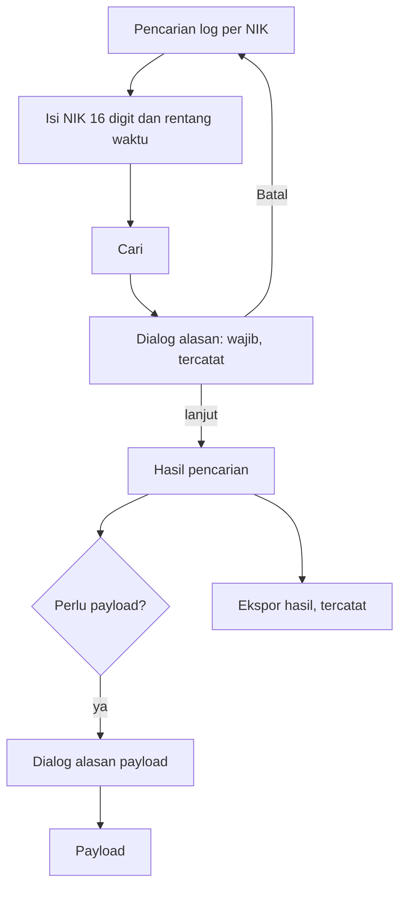

# Panduan Web UI PoolRouter F0: auditor

Panduan ini untuk auditor yang mencari log berdasarkan NIK, membuka payload transaksi, mengekspor hasil, dan membaca **Audit akses**. Setiap pencarian, pembukaan payload, dan ekspor dicatat dan tidak bisa diubah atau dihapus. Hal umum (masuk, sesi, bahasa) ada di `web-ui-f0-dasar.md`. Contoh memakai data sintetis; NIK contoh hanya `0000000000000000`.

- **Pembaca:** auditor PoolRouter
- **Pemilik teknis:** Viktor (perilaku UI), Nanami (alur); kesesuaian produk: Fitcher
- **Tanggal:** 2026-11-04
- **Versi:** draf 0.1, dicocokkan dengan `main` hash `c6829a25`
- **Status:** draft (menunggu verifikasi Viktor dan Nanami)

Penanda **Cocok dengan kode**, **Belum diuji**, dan **Selisih label** dijelaskan di `web-ui-f0-dasar.md`.

## Menu yang tersedia

**Kepatuhan › Pencarian log per NIK**, **Kepatuhan › Audit akses**, **Pemantauan › Log transaksi**, dan **Akun › Pengaturan**.

## Mencari log per NIK

1. Pilih **Pencarian log per NIK**. Halaman berisi catatan: "Setiap pencarian, pembukaan payload, dan ekspor dicatat di audit akses."
2. Isi **NIK (16 digit)**. Hanya angka. Contoh sintetis: `0000000000000000`. Spasi atau tanda baca yang ikut tertempel dibersihkan; yang dihitung adalah 16 digit angka.
3. Pilih rentang waktu: tanggal dan jam mulai serta akhir. Pencarian hanya berdasar rentang waktu tidak tersedia; NIK wajib.
4. Pilih **Cari**. Bila NIK kosong, bukan angka, kurang atau lebih dari 16 digit, tampil "Masukkan NIK 16 digit." dan fokus pindah ke kolom NIK. Tombol Cari tetap aktif supaya pesan terbaca.
5. Dialog **Alasan mencari log NIK** tampil: "Akses ini dicatat: nama Anda, waktu, dan alasan di bawah tersimpan di audit akses dan tidak bisa diubah atau dihapus."
6. Isi **Alasan** sepanjang 10 sampai 500 karakter, misalnya nomor tiket atau tujuan pemeriksaan (contoh sintetis: "Pemeriksaan tiket TKT-0001"). Enter di kolom ini membuat baris baru; **Ctrl+Enter** mengirim. Pilih **Cari** di dialog, atau **Batal** untuk kembali tanpa mencari.
7. Hasil tampil di tabel: **Waktu**, **Kode transaksi**, **Client**, **NIK**, dan **Status akses**. Notifikasi "Pencarian dicatat" muncul tanpa NIK.
8. Alasan tersimpan hanya selama halaman terbuka dan dipakai ulang bila Anda berpindah halaman hasil. Bila NIK atau rentang waktu diubah, dialog alasan muncul lagi.

Bila tidak ada hasil, tampil "Belum ada hasil untuk pencarian ini". Data di luar retensi online belum bisa dicari; pencarian arsip tersedia pada tahap berikutnya.

Teks galat untuk alasan terlalu pendek (di bawah 10 karakter) atau terlalu panjang (di atas 500 karakter) belum final di katalog; panduan ini tidak mengutipnya (lihat pertanyaan 4 pada komentar verifikasi). Perilakunya: alasan di luar rentang tidak dikirim, fokus kembali ke kolom alasan, dan isian tidak dipotong diam-diam.

Status: **cocok dengan kode** (validasi NIK 16 digit, dialog alasan, rentang 10–500 karakter, Ekspor). **Belum diuji** untuk hasil nyata.

## Membuka payload

Payload memuat data tambahan dari Dukcapil dan dicatat terpisah.

1. Pada baris hasil, pilih tombol payload. Dialog **Alasan membuka payload** tampil: "Payload memuat data tambahan dari Dukcapil. Akses ini dicatat terpisah dan tidak bisa diubah atau dihapus."
2. Kolom alasan sudah terisi dari alasan pencarian ("Terisi dari alasan pencarian. Boleh diubah."). Pastikan 10 sampai 500 karakter, lalu pilih **Buka payload**.
3. Payload tampil hanya-baca. Notifikasi "Payload dibuka. Akses ini tercatat di audit." muncul.
4. Bila payload sudah dihapus karena retensi, tampil "Payload sudah dihapus." Bila transaksi ditolak tanpa input, tampil "Ditolak tanpa input."

**Selisih label:** katalog v0.14 menamai tombol di dialog "Buka payload", sedangkan tombol pada baris tabel di `main` memakai teks lama "Lihat payload". Tombol baris diikuti dari katalog setelah SHAA-175 memuat v0.14.

Status: **cocok dengan kode** untuk alur; label seperti tercatat di atas.

## Mengekspor hasil

1. Setelah NIK 16 digit sah, tombol **Ekspor hasil** aktif. Bila belum aktif, teks bantu menyebut: "Masukkan NIK 16 digit yang sah untuk mengaktifkan ekspor."
2. Pilih **Ekspor hasil**, isi alasan di dialog (terisi dari alasan pencarian, boleh diubah), lalu konfirmasi. Browser mengunduh berkas CSV. Ekspor tercatat di audit akses.
3. Hasil terlalu besar menampilkan "Hasil terlalu besar. Persempit rentang waktu hingga paling banyak 10.000 record." Persempit rentang waktu, lalu ulangi.
4. Gagal membuat berkas: "Aksi belum berhasil. Coba lagi."

Berkas ekspor memuat NIK. Perlakukan sesuai ketentuan klasifikasi data BGN dan jangan membagikannya lewat kanal yang tidak diizinkan.

Status: **cocok dengan kode**; **belum diuji** untuk isi berkas CSV.

## Log transaksi untuk auditor

Layar sama dengan operator (lihat `web-ui-f0-operator.md`), dengan satu perbedaan: auditor mendapat kolom aksi untuk membuka payload (alurnya seperti bagian sebelumnya). NIK pada kolom mengikuti yang dikembalikan server. Status: **cocok dengan kode**.

## Membaca Audit akses

Halaman ini hanya bisa dibaca: "Catatan hanya bisa dibaca. Tidak ada aksi ubah atau hapus."

1. Pilih **Audit akses**.
2. Pilih rentang waktu ("Pilih rentang waktu untuk menampilkan catatan audit."). Rentang tidak valid menampilkan "Rentang waktu tidak valid."
3. Baca kolom: **Waktu**, **Pengguna**, **Aksi**, **Hasil**, dan **Alasan**. Aksi yang tercatat: **Cari**, **Ekspor**, **Lihat payload**, dan **Ditolak**. Hasil: **Diizinkan**, **Ditolak**, atau **Berhasil**.

Bila tidak ada catatan, tampil "Tidak ada catatan yang cocok" dengan petunjuk mengubah rentang atau menghapus filter. Bila gagal dimuat, tampil "Audit akses belum bisa dimuat" dengan **Coba lagi**.

Status: **cocok dengan kode**. **Selisih katalog:** katalog v0.14 memuat kolom **Peran**, **Filter atau kueri**, dan **Jumlah record**, tetapi layar di `main` sengaja tidak menampilkannya karena kontrak API F0 belum menyediakan datanya. Panduan mengikuti layar di `main`; perlu keputusan Viktor dan Nanami (pertanyaan 5 pada komentar verifikasi).

## Bila ada masalah

| Gejala | Kemungkinan penyebab | Yang dilakukan |
|---|---|---|
| "Masukkan NIK 16 digit." | NIK kosong, ada huruf, atau bukan 16 digit | Periksa NIK, isi 16 angka |
| Dialog alasan terus muncul | NIK atau rentang waktu diubah | Isi alasan lagi; ini perilaku normal |
| "Hasil terlalu besar" saat ekspor | Lebih dari 10.000 record | Persempit rentang waktu |
| Setelah masuk kembali, hasil pencarian kosong | Isi halaman bernilai NIK tidak dipulihkan | Ulangi pencarian |
| "Anda tidak punya akses ke halaman ini" | Peran tidak mencakup halaman | Hubungi platform admin |
