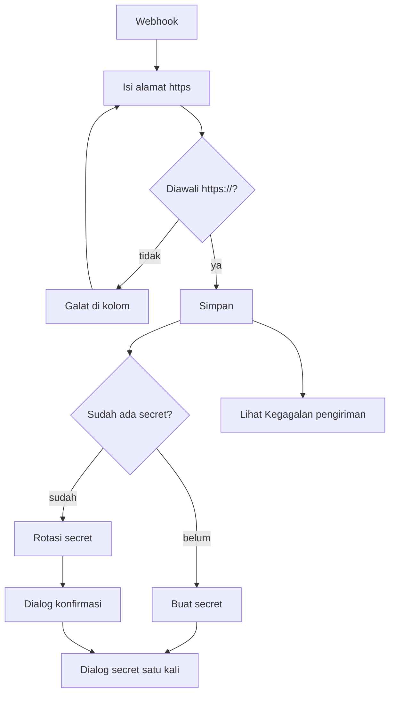

# Panduan Web UI PoolRouter F0: client owner

Panduan ini untuk client owner, yaitu pemilik aplikasi BGN yang memanggil PoolRouter. Anda mengelola kredensial dan webhook client milik Anda sendiri. Hal umum (masuk, sesi, bahasa) ada di `web-ui-f0-dasar.md`. Contoh memakai data sintetis; nilai secret tidak pernah ditulis di dokumen ini.

- **Pembaca:** client owner
- **Pemilik teknis:** Viktor (perilaku UI), Nanami (alur); kesesuaian produk: Fitcher
- **Tanggal:** 2026-11-04
- **Versi:** draf 0.1, dicocokkan dengan `main` hash `c6829a25`
- **Status:** draft (menunggu verifikasi Viktor dan Nanami)

**Status verifikasi seluruh panduan ini: belum diuji.** Layar Client dan kredensial serta Webhook belum ada di `main`, dan peran client owner belum tersedia di konteks peran kode UI (hanya platform admin, operator, dan auditor). Isi berdasar spec UI v0.3.2, UX F0 v0.3, dan katalog v0.14.

## Menu yang tersedia

**Client › Client dan kredensial**, Webhook (untuk client milik Anda), dan **Akun › Pengaturan**. Anda hanya melihat satu baris: client milik Anda.

## Membuat kredensial

1. Pilih **Client dan kredensial**.
2. Pada baris client Anda, pilih **Buat kredensial**.
3. Dialog "Kredensial baru untuk {nama_client}" tampil dengan **Client ID** dan **Client secret** ("ditampilkan sekali").
4. Pilih **Salin**. Notifikasi "Secret disalin" tampil tanpa menampilkan nilainya. Simpan secret di tempat aman milik aplikasi Anda.
5. Pilih **Sudah saya simpan** untuk menutup dialog. Esc dan klik di luar dialog tidak menutupnya. Setelah ditutup, secret tidak bisa dilihat lagi.
6. Satu client maksimal punya 2 kredensial aktif. Untuk mengganti kredensial, buat yang baru lalu **Cabut** yang lama.

Mencabut kredensial: pilih **Cabut**, baca dialog "Cabut kredensial?", lalu **Cabut kredensial**. Pencabutan tidak bisa dibatalkan dan request baru dengan kredensial itu ditolak dengan kode 401. Kredensial lain milik client yang sama tetap berjalan. Hasil request yang sedang diproses bisa diambil dengan kredensial lain milik client Anda.

Menonaktifkan client sendiri bukan tindakan client owner di F0; hubungi platform admin.

## Mengatur webhook

Webhook mengirim hasil request ke alamat aplikasi Anda. Webhook dikirim satu kali dan tidak dikirim ulang bila gagal; hasil tetap bisa diambil lewat polling dengan `queue_id`.

1. Buka **Webhook** untuk client Anda. Judul halaman: "Webhook · {nama_client}".
2. Isi **Alamat webhook**. Harus diawali `https://`; alamat tanpa https ditolak dengan pesan "Alamat webhook harus diawali https://." Simpan. Notifikasi: "Webhook tersimpan".
3. Di bagian **Secret tanda tangan** (dibuat oleh sistem, bukan diketik; tidak ada kolom isian secret):
   - Belum ada secret: pilih **Buat secret**. Dialog "Secret webhook baru untuk {nama_client}" tampil dengan **Salin** dan **Sudah saya simpan**. Salin sekarang; secret hanya tampil sekali. Pasang di aplikasi Anda untuk memverifikasi webhook.
   - Sudah ada secret: pilih **Rotasi secret**. Dialog "Rotasi secret webhook?" memperingatkan: "Secret lama langsung tidak berlaku. Aplikasi {nama_client} akan gagal memverifikasi webhook sampai secret baru dipasang di aplikasinya." Fokus awal di **Batal**. Konfirmasi dengan **Rotasi secret**, lalu simpan secret baru dari dialog satu kali.
   - Bila pembuatan atau rotasi gagal, secret lama tetap berlaku dan tampil pesan galat dengan **Coba lagi**.
4. **Kegagalan pengiriman**: tabel berisi **Waktu**, **Status request**, **Alasan gagal** ("Timeout {detik} detik" atau "HTTP {kode}"), dan **Catatan** ("Tidak dikirim ulang"). Bila tidak ada kegagalan dalam 24 jam terakhir, tampil "Tidak ada kegagalan dalam 24 jam terakhir."
5. Bila ada kegagalan, ambil hasil request lewat polling dengan `queue_id`.

## Bila ada masalah

| Gejala | Kemungkinan penyebab | Yang dilakukan |
|---|---|---|
| Aplikasi gagal memverifikasi webhook | Secret baru belum dipasang setelah rotasi | Pasang secret terbaru; bila hilang, rotasi lagi |
| Secret kredensial hilang | Secret hanya tampil sekali | Buat kredensial baru, cabut yang lama |
| "Alamat webhook harus diawali https://." | Alamat memakai http atau tanpa skema | Perbaiki alamat |
| Request ditolak dengan kode 401 | Kredensial dicabut atau client dinonaktifkan | Buat kredensial baru atau hubungi platform admin |
| Menu client tidak tampil | Akun bukan client owner | Hubungi platform admin |
