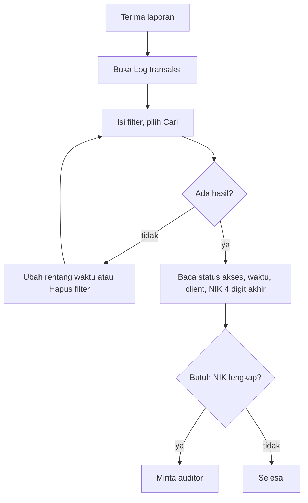

# Panduan Web UI PoolRouter F0: operator

Panduan ini untuk operator yang menelusuri transaksi lewat **Log transaksi** dan memantau **Kuota** (baca-saja). Operator melihat NIK hanya 4 digit akhir; NIK lengkap diminta lewat auditor. Hal umum (masuk, sesi, bahasa) ada di `web-ui-f0-dasar.md`. Contoh memakai data sintetis.

- **Pembaca:** operator PoolRouter
- **Tanggal:** 2026-11-04
- **Versi:** draf 0.1, dicocokkan dengan `main` hash `c6829a25`
- **Status:** draft, lulus bersyarat; layar yang belum ada ditandai belum diuji

Penanda **Cocok dengan kode**, **Belum diuji**, dan **Selisih label** dijelaskan di `web-ui-f0-dasar.md`.

## Menu yang tersedia

**Pemantauan › Log transaksi**, **Pemantauan › Kuota**, dan **Akun › Pengaturan**. Menu konfigurasi, client, dan kepatuhan tidak tampil.

## Menelusuri transaksi di Log transaksi

Dipakai saat Anda menerima laporan berisi kode transaksi, `queue_id`, atau nama client dan jam kejadian.

1. Pilih **Log transaksi** di menu navigasi. Tabel langsung memuat rentang waktu bawaan (24 jam terakhir).
2. Isi satu atau beberapa filter:
   - **Kode transaksi**: tanpa spasi. Bila ada spasi, tampil bantuan "Cari rekaman menggunakan kode transaksi."
   - **Queue ID**: isi `queue_id` yang dilaporkan.
   - **Client**: pilih dari client yang muncul pada hasil.
   - **Rentang waktu**: pilih tanggal dari kalender atau ketik langsung dengan format `03/11/2026`, lalu jam mulai dan jam akhir. Tanggal akhir harus sama dengan atau setelah tanggal awal; bila tidak, tampil pesan galat di bawah kolom.
3. Pilih **Cari**. Filter client yang aktif tampil sebagai chip "Client: {nama}".
4. Baca kolom hasil: **Waktu**, **Kode transaksi**, **Queue ID**, **Client**, **NIK** (4 digit akhir), **Status akses**, dan **Diminta pada**. Di layar sempit, kolom tertentu disembunyikan.
5. Gunakan **Baris per halaman** dan tombol **Halaman sebelumnya** atau **Halaman berikutnya** untuk berpindah halaman.
6. Pilih **Hapus filter** untuk mengosongkan kode, queue ID, dan client. Rentang waktu tetap.

Bila tidak ada hasil, tampil "Tidak ada log yang cocok" dengan petunjuk "Ubah rentang waktu atau hapus filter." Bila data gagal dimuat, tampil "Log belum bisa dimuat" dengan tombol **Coba lagi**.

Catatan penting untuk operator:

- Tidak ada pencarian per NIK untuk operator. Bila Anda butuh NIK lengkap, pesan di halaman berbunyi: "Pencarian per NIK hanya tersedia untuk auditor. Butuh NIK lengkap? Minta auditor." Akses auditor tercatat.
- Operator tidak melihat payload transaksi.
- Anda bisa membuka log langsung untuk satu transaksi lewat alamat `/log/{kode transaksi}`; kode transaksi bukan NIK dan aman disimpan di alamat.

Status: **cocok dengan kode** untuk filter, tabel, paginasi, dan catatan NIK/payload.

## Memantau Kuota (baca-saja)

Bagian ini **belum diuji** dengan data nyata.

Kuota membantu menjelaskan penyebab umum penolakan 429 ketika kuota harian atau porsi sync habis.

1. Pilih **Kuota** di menu navigasi.
2. Setiap kartu menampilkan satu upstream pool: nama pool, "Diperbarui {waktu}", dan tiga bagian:
   - **Hari ini**: "{terpakai} dari {total}", "Terpakai {persen}%, sisa {sisa}", dan "reset {waktu}".
   - **Jam berjalan ({rentang})**: pemakaian jam ini terhadap rate limit per jam.
   - **Porsi sync**: "Sync terpakai {terpakai} dari batas {persen}%".
3. Tingkat kuota ditandai dengan label **Aman**, **Hampir habis**, atau **Habis**.
4. Pilih pool tertentu di filter **Pool**, atau biarkan semua pool tampil.
5. Pilih **Muat ulang** untuk memuat angka terbaru. Halaman tidak memuat ulang sendiri.

Bila gagal dimuat, kartu terakhir yang berhasil tetap tampil dengan pesan "Data lama ditampilkan. Terakhir dimuat {waktu}." dan layar menawarkan **Coba lagi**. Bila belum ada upstream pool, tampil "Belum ada upstream pool"; mintalah platform admin menyiapkannya.

Pemahaman angka: catatan di halaman menyebut bahwa angka dihitung dari jumlah percobaan ke Dukcapil. Selisih angka dengan log transaksi belum ditetapkan; jangan menyimpulkan kehilangan data dari selisih kecil.

Operator tidak bisa mengubah kuota, rate limit, atau porsi sync. Perubahan dilakukan platform admin.

Status: **cocok dengan kode**. **Belum diuji** untuk tampilan data nyata (butuh backend dan data sintetis).

## Bila ada masalah

| Gejala | Kemungkinan penyebab | Yang dilakukan |
|---|---|---|
| "Anda tidak punya akses ke halaman ini" | Peran Anda tidak mencakup halaman itu | Hubungi platform admin |
| "Log belum bisa dimuat" | Jaringan atau galat server | Pilih **Coba lagi**; bila berulang, laporkan ke platform admin atau kanal dukungan Pusdatin |
| Tabel kosong padahal transaksi pasti ada | Rentang waktu terlalu sempit atau filter berlebih | Perlebar rentang, pilih **Hapus filter** |
| Perlu NIK lengkap | NIK operator dibatasi 4 digit akhir | Minta auditor |
