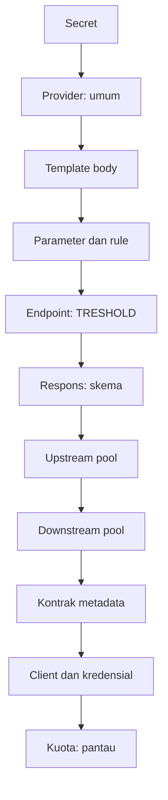

# Panduan Web UI PoolRouter F0: platform admin

Panduan ini untuk platform admin yang menyiapkan PoC: secret, provider, upstream pool, downstream pool, kontrak metadata, dan client; lalu memantau kuota. Hal umum (masuk, sesi, bahasa) ada di `web-ui-f0-dasar.md`. Contoh memakai data sintetis; nilai secret ditulis `${VAR}`.

- **Pembaca:** platform admin PoolRouter
- **Pemilik teknis:** Viktor (perilaku UI), Nanami (alur); kesesuaian produk: Fitcher
- **Tanggal:** 2026-11-04
- **Versi:** draf 0.1, dicocokkan dengan `main` hash `c6829a25`
- **Status:** draft (menunggu verifikasi Viktor dan Nanami)

**Status verifikasi seluruh panduan ini: belum diuji.** Layar Secret, Provider, Upstream pool, Downstream pool, Client, dan Webhook belum ada di `main` pada hash di atas (menu sudah terdaftar, halamannya belum). Isi berdasar spec UI v0.3.2, UX F0 v0.3, dan katalog UX copy v0.14. Satu-satunya layar yang sudah ada dan relevan, **Kuota**, dijelaskan di `web-ui-f0-operator.md` dengan status **cocok dengan kode**.

## Urutan penyiapan

Urutan ini penting: template provider yang merujuk secret yang belum dibuat ditolak.

## 1. Secret

1. Pilih **Secret**. Bila kosong: "Belum ada secret. Secret menyimpan kredensial provider, misalnya USER_ID dan PASSWORD."
2. Pilih **Tambah secret**, isi **Nama** (misalnya `USER_ID`, `PASSWORD`, `IP_USER`) dan **Nilai**, lalu **Simpan**. Notifikasi: "Secret tersimpan" (tanpa nilai).
3. Nilai tersamar. Setelah disimpan, nilainya tidak bisa dilihat atau disalin; hanya bisa diganti.
4. Untuk mengganti, pilih **Ganti** pada baris, isi **Nilai baru**, lalu simpan. "Nilai lama tidak bisa dilihat. Nilai baru langsung menggantikannya."
5. Kolom tabel: **Nama**, **Nilai**, **Dipakai oleh**, **Diubah**, **Aksi**.
6. Menghapus secret yang masih dipakai provider aktif ditolak: "Secret masih dipakai. {nama} masih dipakai oleh provider aktif: {daftar}. Nonaktifkan atau ubah provider itu dulu, lalu hapus secret ini."

## 2. Provider

Provider adalah API pihak ketiga yang dipanggil PoolRouter, misalnya API Dukcapil.

1. Pilih **Provider › Tambah provider**. Bila kosong, halaman menyarankan menyiapkan secret dulu dan menyediakan tombol **Buka menu Secret**.
2. Tab **Umum**: isi **Nama provider**, **Alamat endpoint (URL)**, **Metode**, dan **Autentikasi** (**Kredensial di body (variabel secret)**, **API key di header**, atau **Tanpa autentikasi**). JWT/OIDC belum tersedia.
3. Tab **Template**: tempel **Template body (JSON)**. Kunci ditulis persis seperti di dokumen Dukcapil, termasuk ejaan `TRESHOLD`. Pilih **Simpan template**. Bila ada galat, tampil "Template belum bisa disimpan. Baris {n}: {rincian}" dengan tombol **Ke baris {n}**. Bila secret yang dirujuk belum ada: "Secret {nama} belum dibuat. Buat di menu Secret, lalu simpan template lagi."
4. Tab **Parameter**: **Tambah parameter**, pilih jenis rule (**Regex**, **Enum**, **Panjang**, **Format tanggal**, atau **Panjang + regex**), lalu isi nilai. Nilai rule dikosongkan sampai ditetapkan BGN; sistem tidak mengisi nilai bawaan. Fungsi validasi kustom belum tersedia. "Rule baru hanya berlaku untuk request baru. Request yang sudah mengantre memakai rule saat masuk antrean."
5. Tab **Endpoint**: ubah nilai **TRESHOLD** di sini. Client tidak boleh mengirim `TRESHOLD` (ditolak dengan kode 422). Setiap perubahan tercatat di audit konfigurasi.
6. Tab **Respons**: isi **Skema respons (JSON)** dan **Kode respons** (kolom **Kode**, **Arti**, **Perlakuan**) lewat **Tambah kode respons**.
7. Notifikasi sukses: "Provider tersimpan".
8. **Nonaktifkan provider**: dialog konsekuensi (lihat bagian 6).

## 3. Upstream pool

1. Pilih **Upstream pool › Tambah upstream pool**.
2. Tab **Kuota dan rate limit**: pilih **Provider** (hanya provider yang sudah tersimpan), isi **Kuota harian (request)**, **Rate limit per jam (request)**, dan **Porsi maksimal sync (%)**. Bila lalu lintas sync sepi, async boleh memakai sisa porsi; sync di atas porsi ditolak dengan kode 429.
3. Tab **Anti-pola** (berlaku untuk request async; sync tidak diacak): **Jeda minimum (ms)**, **Jeda maksimum (ms)**, dan **Ambang NIK berdampingan (%)**. Jeda yang terlalu besar bisa membuat rate limit per jam tidak tercapai; cek hasil uji beban sebelum mengubah.
4. Jam reset kuota harian belum ditetapkan di spec (OQ-03).
5. **Nonaktifkan** pada baris membuka dialog konsekuensi (bagian 6).

## 4. Downstream pool dan kontrak metadata

1. **Downstream pool › Tambah downstream pool**: isi **Nama**, pilih **Mode** (**Async** atau **Sync**), pilih **Upstream pool** (satu downstream pool terkait satu upstream pool), dan **TTL antrean (jam)**. Bila kosong, TTL 24 jam; perubahan hanya berlaku untuk request baru.
2. **Kontrak metadata** (Downstream pool › {nama} › Endpoint): **Tambah field** dengan **Nama field**, **Tipe**, **Wajib?**, dan **Rule**. Metadata dicatat di log transaksi dan tidak dikirim ke Dukcapil. Request tanpa field wajib ditolak sebelum memakai kuota. Daftar field final menunggu data contract.

## 5. Client dan kredensial

1. **Client dan kredensial › Tambah client**: isi **Nama client** (unik), pilih **Jenis kredensial** (**OAuth2 client credentials** atau **API key**), pilih **Downstream pool** (client hanya bisa memakai pool yang ditautkan), dan **Alamat webhook (opsional)**. Pilih **Simpan client**. Notifikasi: "Client tersimpan".
2. **Buat kredensial** pada baris client membuka dialog "Kredensial baru untuk {nama_client}". Salin client secret dengan **Salin** sekarang; secret hanya tampil sekali. Dialog hanya bisa ditutup dengan **Sudah saya simpan** (Esc dan klik di luar tidak menutup). Satu client maksimal punya 2 kredensial aktif.
3. **Cabut** menghapus kredensial: dialog konsekuensi, tombol **Cabut kredensial**. Pencabutan tidak bisa dibatalkan; buat kredensial baru bila perlu.
4. Pengaturan webhook client ada di `web-ui-f0-client-owner.md`; platform admin dapat membukanya untuk semua client.

## 6. Aksi berisiko: dialog konsekuensi

Menonaktifkan provider, endpoint, upstream pool, downstream pool, atau client, dan mencabut kredensial, selalu lewat dialog. Fokus awal ada di **Batal**. Baca isi dialog sebelum konfirmasi.

| Dialog | Tombol konfirmasi | Akibat utama (ringkas) |
|---|---|---|
| Nonaktifkan provider? | Nonaktifkan provider | Request baru yang memakai provider ditolak dengan kode 503. Pulih begitu provider diaktifkan lagi. |
| Nonaktifkan endpoint? | Nonaktifkan endpoint | Request baru ke endpoint ditolak dengan kode 403. Client tidak boleh mengulang. |
| Nonaktifkan upstream pool? | Nonaktifkan pool | Hanya request yang sudah diteruskan ke pool yang dihentikan. Bila ini pool aktif terakhir untuk downstream pool tertentu, request baru ke downstream pool itu ditolak dengan kode 503. |
| Nonaktifkan client? | Nonaktifkan client | Request baru dari client ditolak dengan kode 401. Webhook tetap berjalan sampai dinonaktifkan terpisah. |
| Cabut kredensial? | Cabut kredensial | Request baru dengan kredensial itu ditolak dengan kode 401. Tidak bisa dibatalkan. |

Semua dialog menampilkan "Perkiraan dampak": jumlah request yang akan dibatalkan (`cancelled`) atau ditandai gagal (`failed`), dan jumlah yang "Sedang diproses" (hanya informasi). Angka itu perkiraan; angka final ada di hasil aksi dan di audit. Penolakan berlaku paling lambat 30 detik setelah Anda mengonfirmasi, dan aksi dicatat di audit konfigurasi. Bila aksi gagal: "Aksi belum berhasil. Coba lagi." dan dialog tetap terbuka. Teks lengkap setiap dialog mengikuti katalog v0.14 bagian `risk.*`.

## 7. Memantau Kuota

Lihat `web-ui-f0-operator.md`, bagian Memantau Kuota. Platform admin melihat layar yang sama dan dapat mengubah kuota di Upstream pool.

## Bila ada masalah

| Gejala | Kemungkinan penyebab | Yang dilakukan |
|---|---|---|
| Template tidak bisa disimpan | JSON salah atau secret belum dibuat | Ikuti nomor baris pada pesan; buat secret di menu Secret |
| Secret tidak bisa dihapus | Masih dipakai provider aktif | Nonaktifkan atau ubah provider yang tertera |
| Alamat webhook ditolak | Tidak diawali `https://` | Perbaiki alamat |
| Client menerima 503 | Provider atau pool aktif terakhir dinonaktifkan | Cek status provider dan upstream pool |
